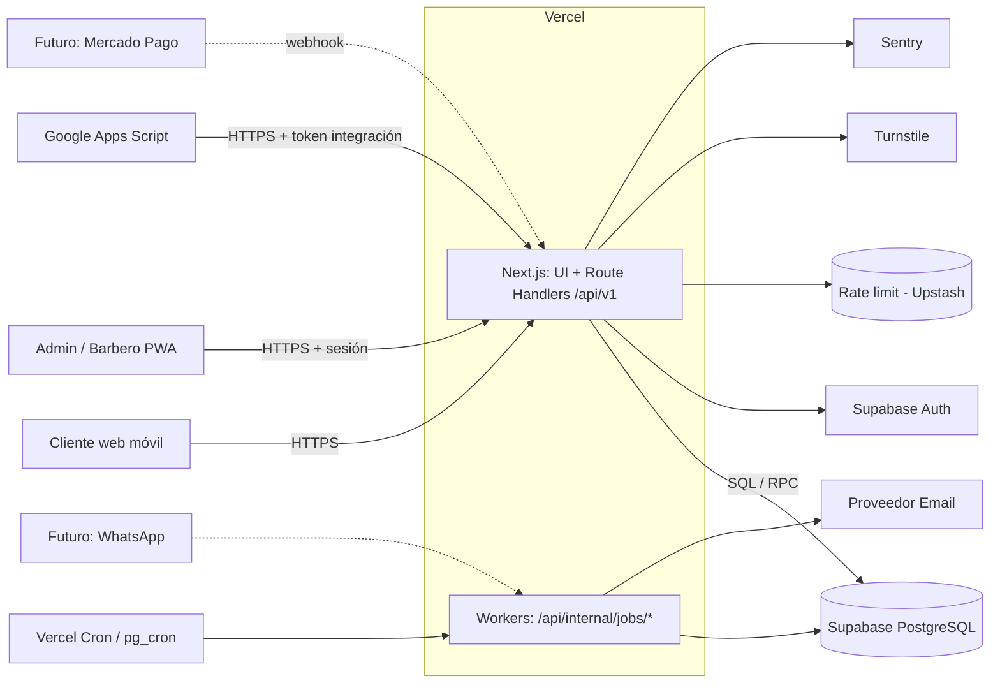
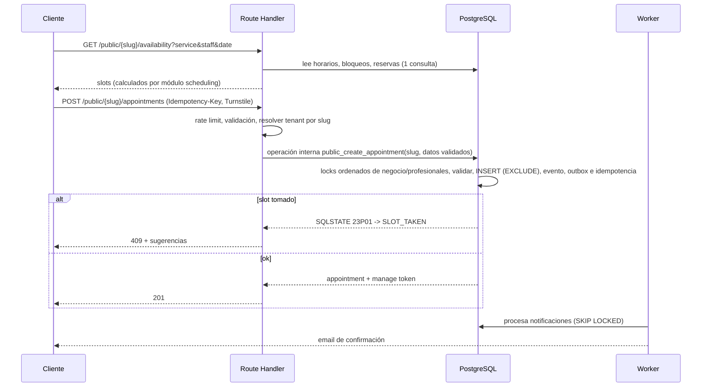

> Consolidación 2026-10-31: doc 14 incorporado. Propuestas P-xx y gates en
> [informe de consolidación](CONSOLIDATION_REPORT.md); esta edición no autoriza implementación.

> **Actualización de seguridad:** consultar `14_CORRECCIONES_CRITICAS.md` antes de implementar. Si existe contradicción, prevalecen esas correcciones.

# 03 — Arquitectura del sistema

## 1. Evaluación del stack propuesto

| Componente | Veredicto | Comentario / ajuste |
|---|---|---|
| Next.js (App Router) + React + TypeScript | ✔ Mantener | Un solo repo/lenguaje para UI y API. Route Handlers suficientes. |
| Tailwind + shadcn/ui | ✔ Mantener | Velocidad y consistencia; componentes propios (copiados) → sin lock‑in. |
| Node.js Route Handlers como backend | ✔ con disciplina | Lógica en `src/modules/*` (no en los handlers). Handlers = capa fina (auth, validación, llamada a servicio). |
| PostgreSQL en Supabase | ✔ Mantener | Necesitamos `btree_gist`, rangos, RLS, funciones, `pg_cron`: todo disponible. |
| Supabase Auth | ✔ con ajuste | Usar **sólo** para identidad (staff/admin). Roles por negocio **se leen de la BD**, no de claims del JWT (evitar claims obsoletos). |
| RLS | ✔ como defensa en profundidad | La autorización primaria está en la capa de servicio + funciones SQL; RLS impide fugas si hay un bug. |
| Vercel | ✔ con ajuste | Región de funciones `gru1` (São Paulo). Cron de 1 minuto requiere plan Pro (verificar límites vigentes) → alternativa `pg_cron` + `pg_net`. |
| Zod | ➕ Agregar | Validación de entrada y generación de OpenAPI. |
| Upstash Redis (rate limit) | ➕ Agregar | Rate limiting distribuido en serverless. Alternativa sin servicio nuevo: tabla en Postgres (más lenta). |
| Resend (u otro) | ➕ Agregar | Email transaccional. Interfaz `NotificationProvider` para cambiarlo. |
| Sentry | ➕ Agregar | Errores y trazas. |
| Cloudflare Turnstile | ➕ Agregar | Anti‑bot en reserva pública. |

**Costo/complejidad de los agregados**: bajos; todos tienen tier gratuito/económico (verificar precios vigentes). **No se agregan**: colas (SQS/Rabbit), Redis propio, microservicios, GraphQL, ORM pesado.

### Acceso a datos: decisión
- **Lecturas del panel** → cliente Supabase con JWT del usuario verificado (RLS aplica). El JWT no se transmite mediante una conexión arbitraria como `postgres`. Las escrituras pasan por operaciones autorizadas de BD; el mapa exacto de grants/DML de configuración se aprueba antes de la primera migración (P-01, doc 04 §4).
- **Operaciones críticas** (crear/reprogramar/cancelar reserva, fusionar clientes, gestionar miembros) → **funciones SQL** `SECURITY DEFINER` con `search_path=''` que reciben `business_id` como identificador de recurso, pero **nunca aceptan la identidad del actor como prueba de autorización**. La identidad se obtiene de `auth.uid()` en sesiones verificadas; para integraciones y workers, la API valida credenciales y emplea un rol técnico restringido y operaciones separadas que verifican dentro de BD la credencial/capacidad y el tenant, sin aceptar actor arbitrario del backend. Prohibido confiar en cabeceras `X-Actor-*` arbitrarias.
- **Servidor sin sesión**: rol técnico restringido (propuesta `app_server`, P-01), sin acceso directo a tablas de negocio, sólo operaciones internas que verifican credencial/capacidad y tenant en BD. `service_role` no se utiliza como credencial rutinaria de datos; queda separado para Auth Admin/Storage cuando corresponda. Nunca llega al navegador ni al HTML/GAS. No se crean roles o conexiones en esta consolidación.
- Query builder tipado (Kysely) o `supabase-js` con tipos generados; **sin ORM** que oculte SQL. El SQL de migraciones es la fuente del esquema.

## 2. Vista de contexto



## 3. Estructura del código (monolito modular)

```
/src
  /app                      # rutas Next.js (UI y route handlers)
    /(public)/b/[slug]/...  # portal cliente
    /(app)/...              # panel admin/barbero (autenticado)
    /api/v1/...             # route handlers (finos)
    /api/internal/jobs/...  # workers (protegidos por secreto/cron)
  /modules
    /tenancy      # negocios, miembros, resolución de contexto
    /auth         # sesión, permisos (can(actor, action, resource))
    /catalog      # servicios, profesionales
    /scheduling   # horarios, excepciones, bloqueos, disponibilidad (puro)
    /booking      # reservas, estados, políticas (llama funciones SQL)
    /customers    # clientes, normalización, fusión
    /notifications# outbox, providers, plantillas
    /integrations # tokens, changes feed, mapeos externos
    /audit        # registro de auditoría
    /analytics    # consultas de estadísticas
  /lib            # db client, http (errores, problem+json), zod, rate-limit, logger
  /ui             # componentes compartidos (shadcn)
/supabase
  /migrations     # SQL versionado
  /tests          # pgTAP
/docs             # estos documentos
```

La estructura anterior expresa dominios lógicos. El Sprint 0 existente usa `components/ui` y módulos `businesses/staff/services/availability/appointments`. No renombrarlos en esta tarea; el mapeo físico se aprueba en P-07 antes de añadir lógica.

Reglas: dependencias sólo "hacia abajo" (`app → modules → lib`); el cálculo de disponibilidad (`scheduling` lógico / `availability` físico actual) es **puro** (sin I/O) para poder testearlo exhaustivamente; un módulo no accede a tablas de otro: usa su API pública (`index.ts`).

## 4. Flujos clave

### 4.1 Reserva pública


### 4.2 Identificación del tenant

| Contexto | Cómo se determina `business_id` | Nunca se acepta de |
|---|---|---|
| Portal público | `slug` en la URL → lookup (cacheable) | body del cliente |
| Panel autenticado | `businessId` en la ruta **y** verificación de membresía activa | claim sin verificar |
| Integración | Fila de `integration_credentials` asociada al token | header/parámetro |
| Workers | Columna `business_id` de la fila procesada | — |
| Futuro | subdominio / dominio personalizado → tabla `business_domains` | — |

### 4.3 Jobs en segundo plano

| Job | Frecuencia | Función |
|---|---|---|
| `notifications.dispatch` | 1 min | Toma lotes `FOR UPDATE SKIP LOCKED`, envía, marca estado. |
| `appointments.expire_pending` | 1 min | `pending` vencidas → `expired`; cancela notificaciones asociadas. |
| `reminders.schedule` | al crear/reprogramar (no es job) | Inserta notificaciones con `scheduled_for`. |
| `idempotency.cleanup` | diario | Borra claves > 48 h. |
| `audit.retention` | mensual (D) | Particionado/archivo. |

Disparo: **opción recomendada** `pg_cron` + `pg_net` llamando a `/api/internal/jobs/*` con secreto (no depende del plan de Vercel). Alternativa: Vercel Cron (Pro). Los jobs son **idempotentes y reentrantes**; si se solapan, `SKIP LOCKED` evita doble procesamiento.

## 5. Observabilidad
- Logs JSON con `request_id`, `business_id`, `actor_type`, `route`, `latency_ms`, `status`.
- Sentry (errores + trazas de rutas críticas). Alertas: tasa de 5xx, `notifications` `dead` > 0, jobs sin ejecutar > 5 min, violaciones 23P01 anómalas.
- Métricas de negocio en tablas (no en herramienta aparte): reservas por estado, tiempo de confirmación.
- Health: `/api/health` (app) y `/api/health/db` (restringido).

## 6. Costos operativos estimados (orden de magnitud, verificar precios)
Vercel Pro (~US$20/mes por miembro), Supabase Pro (~US$25/mes + PITR opcional), Resend/Postmark (gratis a bajo costo), Upstash (gratis a bajo costo), Sentry (tier gratuito), dominio. **≈ US$50–90/mes** para una barbería. Primer cuello de botella previsible: conexiones a Postgres → usar el pooler de Supabase (modo transacción) desde funciones serverless.

## 7. Evolución a SaaS: qué decidir ahora vs. postergar

| Tema | Ahora (barato, evita reescribir) | Postergar |
|---|---|---|
| Multi‑tenancy | `business_id` en todo, RLS, FKs compuestas, slug | Particionado por tenant, BD dedicada para clientes grandes |
| Planes y límites | Columna `businesses.plan_id` nullable + función `app.check_limit(business, key)` stub | Catálogo de planes, enforcement real |
| Facturación recurrente | Tabla `businesses.billing_customer_ref` nullable; eventos de dominio auditables | Integración Mercado Pago Suscripciones/Stripe, webhooks, dunning |
| Onboarding | Seed idempotente `create_business(...)` reutilizable | Wizard self‑service, verificación de email/identidad |
| Sucursales | Dejar `location_id` **fuera**; documentar cómo añadir tabla `locations` y FK nullable en `staff_members`/`appointments` | Implementación |
| Dominios propios | Resolución de tenant centralizada en un único resolvedor | `business_domains`, certificados |
| Marca | `business_settings.branding jsonb` (colores, logo) | Temas avanzados |
| WhatsApp | `notifications.channel` + interfaz `NotificationProvider` | Proveedor, plantillas aprobadas, opt‑in |
| Mercado Pago | `appointments.status=pending` + `expires_at` + `payment_ref` nullable | Preferencias, webhooks, conciliación |
| Reportes | Vistas SQL simples | Réplica de lectura / warehouse |
| Admin global | Tabla `platform_admins`, audit con `actor_type` | Consola de plataforma |

## 8. Limitaciones conocidas y cuándo revisar la arquitectura

- Todas las mutaciones de agenda siguen el mismo protocolo de locks (doc 06 §4.0), incluso excepciones/bloqueos de negocio, expiraciones, imports y reversiones. No se autoriza una ruta de escritura que lo omita.
- GAS Modo B sólo lee. Reportes MVP: barridos completos y reconciliación; `/integrations/changes` queda reservado hasta diseño y pruebas (doc 05 §4). No confundir el outbox de notificaciones con un feed ordenado por commit.
- Serialización por profesional (lock de fila) es suficiente hasta miles de reservas/hora por tenant. Si aparece contención: reducir el alcance del lock o usar advisory locks por (profesional, día).
- Si el número de tenants supera ~cientos con cargas desparejas: evaluar particionado de `appointments` por `business_id` hash o por mes.
- Si Supabase deja de ser adecuado: el esquema es Postgres estándar; las únicas dependencias propietarias son Auth y `auth.uid()` (aisladas en `app.current_user_id()`).
