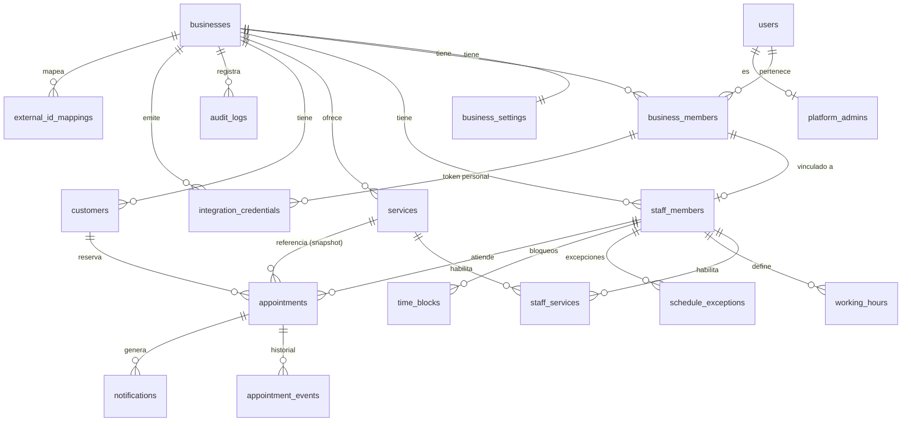

> Consolidación 2026-10-31: doc 14 incorporado. Propuestas P-xx y gates en
> [informe de consolidación](CONSOLIDATION_REPORT.md); esta edición no autoriza implementación.

> **Actualización de seguridad:** consultar `14_CORRECCIONES_CRITICAS.md` antes de implementar. Si existe contradicción, prevalecen esas correcciones.

# 04 — Diseño de base de datos (PostgreSQL / Supabase)

## 1. Principios

1. **UUID v4** (`gen_random_uuid()`) como PK. Excepción: tablas de eventos/log con `bigint generated always as identity` (orden y volumen).
2. **`business_id` obligatorio** en toda tabla de negocio. Cada tabla padre expone `UNIQUE (business_id, id)` para permitir **FKs compuestas** `(business_id, child_fk) → (business_id, id)`: la BD **impide** referenciar entidades de otro tenant aunque haya un bug.
3. Timestamps `timestamptz`: `created_at`, `updated_at` (trigger `app.touch_updated_at`), `deleted_at` (soft delete) donde aplique.
4. **Enums como `text` + `CHECK`** (más fácil de migrar que `CREATE TYPE`).
5. Dinero en **centavos** (`integer`) + `currency char(3)`.
6. Extensiones: `btree_gist`, `citext`, `pgcrypto`, `pg_cron`, `pg_net`.
7. Esquema `public` para datos; esquema `app` para funciones/ayudantes (no expuesto por PostgREST).
8. Tablas con RLS **habilitada y forzada**; `anon` sin acceso a ninguna tabla (el portal público pasa por el servidor).
9. Cambios sólo por migraciones nuevas generadas por CLI; no editar aplicadas. Estrategia expand/migrate/contract y recuperación en doc 12 §2.
10. Identidad, grants y excepciones de helpers: §4. No copiar SQL ilustrativo como migración aprobada.
11. Todo recurso mutable expone `version` (§3.20); las escrituras de agenda usan locks comunes (doc 06 §4.0).

## 2. Diagrama entidad‑relación



## 3. Tablas

Notación: **PK**, **FK**, `NN` = NOT NULL. Todas las FKs a tablas de negocio son compuestas `(business_id, x_id)` salvo indicación.

### 3.1 `businesses`
Objetivo: tenant.
| Columna | Tipo | Restricciones |
|---|---|---|
| id | uuid | **PK**, default gen_random_uuid() |
| slug | citext | NN, UNIQUE, CHECK `^[a-z0-9](?:[a-z0-9-]{1,38})[a-z0-9]$`, lista de reservados (`api`,`app`,`admin`,`b`...) |
| name | text | NN |
| legal_name, tax_id | text | null (futuro facturación) |
| phone | text | null (E.164) |
| address_line, city, region, country | text | country default 'AR' |
| timezone | text | NN default `America/Argentina/Buenos_Aires`; validación vía trigger contra `pg_timezone_names` |
| logo_path | text | null (Supabase Storage) |
| status | text | NN, CHECK in (`active`,`suspended`,`archived`) |
| plan_id | uuid | null (futuro) |
| billing_customer_ref | text | null (futuro) |
| created_at, updated_at, deleted_at | timestamptz | |
Índices: UNIQUE(slug). RLS: miembros activos leen su negocio; sólo `owner/admin` actualizan columnas permitidas (vía función); lectura pública sólo por servidor.

### 3.2 `business_settings`
Objetivo: políticas (ver doc 02 §2).
Columnas: `business_id` **PK/FK** (1:1), `slot_interval_minutes smallint NN default 15 CHECK in (5,10,15,20,30,60)`, `min_notice_minutes int NN default 60 CHECK >=0`, `max_advance_days int NN default 30 CHECK 1..365`, `cancellation_cutoff_hours int default 2`, `reschedule_cutoff_hours int default 2`, `max_client_reschedules smallint default 2`, `auto_confirm bool default true`, `pending_hold_minutes int default 10`, `allow_any_staff bool default true`, `require_email bool default false`, `public_booking_enabled bool default true`, `barber_can_edit_availability bool default false`, `max_active_bookings_per_customer smallint default 3`, `reminder_offsets_minutes int[] default '{1440,120}'`, `locale text default 'es-AR'`, `currency char(3) default 'ARS'`, `branding jsonb default '{}'`, `privacy_policy_version text`, timestamps.

### 3.3 `users`
Objetivo: perfil de usuarios de plataforma (espejo de `auth.users`).
`id uuid PK` **FK → auth.users(id) ON DELETE CASCADE**, `email citext NN UNIQUE`, `full_name text`, `phone text`, `avatar_path text`, `created_at`, `updated_at`, `deleted_at`.
**Los clientes que reservan NO están en esta tabla.** RLS: cada usuario lee/edita su fila; lectura de otros miembros sólo vía función/vista restringida al negocio compartido.

### 3.4 `platform_admins`
`user_id uuid PK FK→users`, `created_at`, `created_by`. Sin acceso por RLS a `authenticated` (se consulta desde función `app.is_platform_admin()` SECURITY DEFINER). El acceso de soporte a un negocio se otorga mediante `support_grants(id, business_id, platform_admin_id, reason NN, expires_at NN, created_at)` y queda en `audit_logs`.

### 3.5 `business_members`
Objetivo: pertenencia y rol por negocio (un usuario puede estar en N negocios).
| Columna | Tipo | Restricciones |
|---|---|---|
| id | uuid | **PK** |
| business_id | uuid | NN **FK→businesses** |
| user_id | uuid | **FK→users**, null mientras la invitación está pendiente |
| invited_email | citext | null |
| role | text | NN CHECK in (`owner`,`admin`,`barber`) |
| status | text | NN CHECK in (`invited`,`active`,`suspended`) |
| invited_by, accepted_at | | |
| created_at, updated_at | | |
Restricciones: `UNIQUE(business_id, id)`; `UNIQUE(business_id, user_id) WHERE user_id IS NOT NULL`; `CHECK (user_id IS NOT NULL OR invited_email IS NOT NULL)`. Trigger: impedir quitar/degradar al último `owner`. Escritura **sólo por función** `app.manage_member()` (previene escalamiento: no se puede otorgar un rol superior al propio ni modificarse a sí mismo el rol).

### 3.6 `staff_members`
Objetivo: profesional agendable.
`id uuid PK`, `business_id NN`, `member_id uuid null` (FK compuesta `(business_id, member_id) → business_members(business_id,id)`), `display_name text NN`, `bio text`, `photo_path text`, `color char(7)`, `is_active bool NN default true`, `accepts_online_bookings bool default true`, `sort_order int default 0`, timestamps, `deleted_at`.
Restricciones: `UNIQUE(business_id,id)`; `UNIQUE(business_id, member_id) WHERE member_id IS NOT NULL AND deleted_at IS NULL`. Índice: `(business_id, is_active, sort_order)`.

### 3.7 `services`
`id uuid PK`, `business_id NN`, `name text NN`, `description text`, `category text`, `price_cents int NN CHECK >=0`, `currency char(3) NN`, `duration_minutes int NN CHECK 5..480`, `buffer_after_minutes int NN default 0 CHECK 0..120`, `is_active bool default true`, `sort_order int`, timestamps, `deleted_at`.
Restricciones: `UNIQUE(business_id,id)`; `UNIQUE(business_id, lower(name)) WHERE deleted_at IS NULL`. Índice `(business_id, is_active, category, sort_order)`.

### 3.8 `staff_services`
`business_id NN`, `staff_member_id NN`, `service_id NN`, `price_override_cents int null`, `duration_override_minutes int null`, `created_at`.
**PK(staff_member_id, service_id)**; FKs compuestas a `staff_members` y `services` (garantiza mismo negocio). Índice `(business_id, service_id)`.

### 3.9 `working_hours`
Objetivo: intervalos laborales semanales (múltiples por día → descansos = huecos).
`id uuid PK`, `business_id`, `staff_member_id`, `weekday smallint NN CHECK 1..7` (ISO, 1=lunes), `start_time time NN`, `end_time time NN CHECK end_time > start_time`, `valid_from date NN default current_date`, `valid_until date null CHECK (valid_until IS NULL OR valid_until >= valid_from)`, timestamps.
Integridad de solapes (mismo profesional/día/vigencia): **trigger** `app.check_working_hours_overlap` (las exclusiones con `time` + `daterange` combinadas son posibles pero poco legibles; se documenta ambas opciones, recomendada: trigger + test). Índice `(staff_member_id, weekday, valid_from)`.
Cambio de jornada: se **cierra** la vigencia previa (`valid_until`) y se inserta la nueva; nunca se edita retroactivamente.

### 3.10 `schedule_exceptions`
Objetivo: excepciones por **fecha** (feriados, horario especial).
`id`, `business_id`, `staff_member_id null` (null = todo el negocio), `date date NN`, `kind text NN CHECK in ('closed','custom_hours')`, `start_time time null`, `end_time time null` (obligatorios si `custom_hours`; varios registros por fecha permitidos para turnos cortados), `reason text`, `created_by`, timestamps.
`CHECK ((kind='closed' AND start_time IS NULL AND end_time IS NULL) OR (kind='custom_hours' AND start_time IS NOT NULL AND end_time > start_time))`.
Semántica: si existe `custom_hours` para (profesional o negocio) en la fecha, **reemplaza** la jornada semanal; `closed` la anula. La excepción del profesional prevalece sobre la del negocio.

### 3.11 `time_blocks`
Objetivo: bloqueos por **rango absoluto** (vacaciones, trámites, bloqueo manual).
`id`, `business_id`, `staff_member_id null` (null = negocio), `during tstzrange NN CHECK (NOT isempty(during) AND NOT lower_inf(during) AND NOT upper_inf(during))`, `kind text CHECK in ('manual','vacation','other')`, `reason`, `created_by`, `created_at`, `deleted_at`.
Índice **GiST** `(business_id, staff_member_id, during)`. Crear un bloqueo toma el mismo lock de fila del profesional que `create_appointment` y devuelve (no borra) las reservas en conflicto para decisión humana.

### 3.12 `customers`
Objetivo: clientes que reservan (por negocio).
`id`, `business_id NN`, `full_name text NN`, `phone_e164 text null CHECK ~ '^\+[1-9][0-9]{7,14}$'`, `email citext null`, `instagram_handle citext null`, `notes text` (internas), `marketing_opt_in bool default false`, `consent_version text`, `consented_at timestamptz`, contadores: `completed_count int default 0`, `cancelled_count int default 0`, `no_show_count int default 0`, `first_visit_at`, `last_visit_at`, `merged_into_id uuid null` (FK compuesta a customers), `source text` (`public_web`,`admin`,`import_gas`), timestamps, `deleted_at`.
Restricciones: `UNIQUE(business_id,id)`; **`UNIQUE(business_id, phone_e164) WHERE phone_e164 IS NOT NULL AND deleted_at IS NULL AND merged_into_id IS NULL`**; índices `(business_id, lower(email))`, `(business_id, instagram_handle)`, trigram sobre `full_name` para búsqueda (`pg_trgm`). Contadores actualizados dentro de las funciones de cambio de estado (misma transacción).

### 3.13 `appointments`
Objetivo: reserva (entidad central).
| Columna | Tipo | Notas |
|---|---|---|
| id | uuid PK | |
| business_id | uuid NN | |
| customer_id | uuid NN | FK compuesta |
| staff_member_id | uuid NN | FK compuesta |
| service_id | uuid NN | FK compuesta (referencia; los datos viven en snapshot) |
| status | text NN | CHECK in (`pending`,`confirmed`,`cancelled`,`completed`,`no_show`,`expired`) |
| starts_at | timestamptz NN | UTC |
| ends_at | timestamptz NN | `starts_at + duration_snapshot` |
| blocked_until | timestamptz NN | `ends_at + buffer_snapshot` (lo calcula la función; CHECK de coherencia) |
| service_name_snapshot | text NN | |
| price_cents_snapshot | int NN | precio al reservar |
| currency | char(3) NN | |
| duration_minutes_snapshot | int NN | |
| buffer_minutes_snapshot | int NN | |
| source | text NN | CHECK in (`public_web`,`admin`,`staff`,`integration`,`import`) |
| created_by_member_id | uuid null | Derivado de identidad verificada; nunca autoridad del body |
| customer_notes, internal_notes | text | |
| expires_at | timestamptz null | sólo para `pending` |
| cancelled_at, cancelled_by (`customer`,`staff`,`system`), cancel_reason | | |
| completed_at, no_show_at | timestamptz null | |
| reschedule_count | smallint NN default 0 | |
| manage_token_hash | bytea null | SHA‑256 del token (alta entropía) |
| manage_token_expires_at | timestamptz null | Vence 24 h tras el turno; se recalcula al reprogramar, doc 08 §2 |
| payment_ref | text null | futuro |
| version | int NN default 1 | concurrencia optimista (`If-Match`) |
| created_at, updated_at | | |

Constraints:
```sql
CHECK (duration_minutes_snapshot > 0),
CHECK (buffer_minutes_snapshot >= 0),
CHECK (price_cents_snapshot >= 0),
CHECK (ends_at > starts_at),
CHECK (blocked_until >= ends_at),
CHECK (extract(epoch FROM (ends_at - starts_at)) = duration_minutes_snapshot * 60),
CHECK (extract(epoch FROM (blocked_until - ends_at)) = buffer_minutes_snapshot * 60),
CHECK ((status='pending') = (expires_at IS NOT NULL)),
CHECK (status <> 'cancelled' OR cancelled_at IS NOT NULL),
UNIQUE (business_id, id),
EXCLUDE USING gist (
  staff_member_id WITH =,
  tstzrange(starts_at, blocked_until, '[)') WITH &&
) WHERE (status IN ('pending','confirmed','completed','no_show'))
-- Predicado PROPUESTO P-02: requiere aprobar la ocupación histórica antes de migrar.
```
> Diseño propuesto: un trigger `BEFORE INSERT/UPDATE` deriva `ends_at` y `blocked_until` de `starts_at` y snapshots en minutos reales; ignora valores derivados del llamador. Los CHECK de diferencias verifican igualdad, no sólo orden. No usar columnas generadas basadas en `timestamptz + interval`, cuya volatilidad impide ese uso. El constructor `tstzrange` del EXCLUDE usa columnas ya persistidas. Catálogo nuevo no altera snapshots; ajuste histórico sólo por operación autorizada con motivo, locks, versión y auditoría. Debe probarse antes de S3/S6 (incluido DST).

Índices: `(business_id, staff_member_id, starts_at)`; `(business_id, starts_at)`; `(business_id, customer_id, starts_at DESC)`; `(business_id, status, starts_at)`; parcial `(expires_at) WHERE status='pending'`; `(business_id, updated_at, id)` solo para búsquedas/reconciliación; **no** es cursor de sincronización con garantía de completitud. Ver `14_CORRECCIONES_CRITICAS.md`.
Privilegios: `INSERT/UPDATE/DELETE` revocados a `anon` y `authenticated`; sólo `SELECT` (con RLS). Las escrituras ocurren únicamente en operaciones autorizadas de BD (ADR-004/019), con contexto verificado; el rol técnico tampoco tiene DML directo. `DELETE` prohibido a todos (trigger).

**Snapshot de precio y duración**: al crear, la función copia `services.name/price/duration/buffer` (o los `override` de `staff_services`) a las columnas `*_snapshot`. Cambios posteriores del catálogo no afectan reservas existentes. Si el admin desea cambiar precio/duración de una reserva existente, se hace por función explícita con evento `price_adjusted`/`duration_adjusted` (la duración requiere revalidar solapes).

### 3.14 `appointment_events`
Objetivo: historial append‑only.
`id bigint identity PK`, `business_id`, `appointment_id` (FK compuesta), `event_type text NN` (`created`,`confirmed`,`cancelled`,`rescheduled`,`completed`,`no_show`,`expired`,`reverted`,`reassigned`,`price_adjusted`,`service_record_linked`), `from_status`, `to_status`, `actor_type NN` (`customer`,`member`,`integration`,`system`), `actor_id uuid null` (usuario verificado para miembro; nunca actor asertado), `integration_credential_id uuid null` (credencial real para integración), `payload jsonb` (valores previos/nuevos), `request_id text`, `created_at`.
Índices `(appointment_id, id)`, `(business_id, created_at)`. `UPDATE/DELETE` revocados.

### 3.15 `notifications` (outbox)
`id uuid PK`, `business_id`, `appointment_id null` (FK compuesta), `customer_id null`, `channel text NN CHECK in ('email','whatsapp','sms','internal')`, `type text NN`, `recipient text NN` (snapshot de email/teléfono), `status text NN CHECK in ('pending','processing','sent','failed','dead','cancelled','skipped') default 'pending'`, `scheduled_for timestamptz NN`, `attempts smallint default 0`, `max_attempts smallint default 5`, `next_attempt_at timestamptz NN`, `locked_at`, `locked_by text`, `provider text`, `provider_message_id text`, `last_error text`, `payload jsonb NN`, `dedupe_key text NN`, `created_at`, `sent_at`.
`UNIQUE (business_id, dedupe_key)` — ej.: `appt:{id}:reminder:1440:v{reschedule_count}`. Índice parcial `(next_attempt_at) WHERE status IN ('pending','failed')`.

### 3.16 `audit_logs`
`id bigint identity PK`, `business_id uuid null`, `actor_type NN` (`user`,`integration`,`system`,`platform_admin`), `actor_user_id null`, `integration_credential_id null`, `asserted_actor text null` (metadato no confiable de acceso; nunca atribución humana de una escritura en Modo B), `action text NN` (`member.role_changed`, `integration.token_created`...), `entity_type`, `entity_id`, `before jsonb`, `after jsonb`, `ip inet`, `user_agent text`, `request_id text`, `created_at`.
Append‑only; sin `UPDATE/DELETE`; índices `(business_id, created_at DESC)`, `(entity_type, entity_id)`. Sin datos sensibles en `before/after` (se enmascaran tokens, secretos).

### 3.17 `integration_credentials`
`id uuid PK`, `business_id NN`, `name text NN`, `kind text NN CHECK in ('service_key','user_token')`, `member_id uuid null` (obligatorio si `user_token`), `token_prefix text NN UNIQUE` (8 caracteres visibles para identificación), `token_hash bytea NN` (SHA‑256 de un token aleatorio de 256 bits — adecuado porque no es una contraseña elegida por humanos), `scopes text[] NN`, `status text NN CHECK in ('active','revoked','expired')`, `expires_at timestamptz`, `last_used_at`, `last_used_ip inet`, `created_by`, `revoked_at`, `revoked_by`, `rotated_from_id uuid null`, `created_at`.
`CHECK ((kind='user_token') = (member_id IS NOT NULL))`. `service_key` admite exclusivamente scopes de lectura: validación al emitir y en cada operación en BD, aun si la API falla. `user_token` sólo escribe tras validar Modo A y membresía activa, con scopes ∩ permisos vigentes; revocación comprobada en cada solicitud, sin caché de autorización. Formato de token: `trn_<env>_<prefix>_<secret>`. El secreto se muestra **una sola vez**. Comparación en tiempo constante.

### 3.18 `external_id_mappings`
Objetivo: vincular entidades internas con IDs externos (Sheets, futuros).
`id uuid PK`, `business_id NN`, `external_system text NN` (`gas_sheets`, `google_calendar`, `mercadopago`), `entity_type text NN` (`customer`,`staff_member`,`service`,`appointment`,`service_record`), `internal_id uuid NN`, `external_id text NN`, `external_meta jsonb`, `status text default 'linked'` (`linked`,`needs_review`,`rejected`), `last_synced_at`, `sync_hash text`, `created_at`, `updated_at`.
**UNIQUE(business_id, external_system, entity_type, external_id)**. Unicidad inversa `(business_id,external_system,entity_type,internal_id)` donde la relación es 1:1, en particular `service_record` (una reserva ↔ un registro). Cliente fusionado puede conservar varios IDs externos; no imponer una unicidad inversa global que lo impida.

`internal_id` polimórfico **no tiene una FK nativa a múltiples tablas**. Cada operación autorizada valida existencia, tipo, tenant y estado del destino dentro de la transacción, con locks que coordinen baja/fusión y vinculación. `business_id` sí referencia a businesses. Confirmar en P-04 si se conserva este contrato con validación transaccional o se adoptan columnas/tablas tipadas con FKs compuestas; no presentar ambos como ya implementados. `needs_review` no se usa como vínculo confirmado. Un token de lectura no crea mapeos ni ejecuta imports. Sólo un admin autenticado o Modo A validado con permiso/scopes puede escribirlos.

### 3.19 Tablas auxiliares (justificadas)
- `idempotency_keys(business_id, key text, endpoint text, request_hash bytea, response_status int, response_body jsonb, created_at)` — clave lógica incluye tenant, autoridad/capacidad verificada, operación y key; no basta compartir key entre actores. Retención 48 h. Registro de respuesta y mutación se confirman en una transacción; hash y replay según doc 05 §1.6. Diseño de persistencia sensible pendiente P-06.
- `customer_match_candidates(id, business_id, customer_id, source_ref, reason, status)` — revisión de posibles duplicados (puede implementarse como `external_id_mappings.status='needs_review'` en el MVP).

### 3.20 Versionado y eventos de integración

`version int NOT NULL DEFAULT 1` en recursos mutables (negocios/settings, membresías,
profesionales, servicios, clientes, reservas y mapeos). Toda mutación incrementa la
versión de su recurso de control una sola vez, sin aceptar el nuevo valor del body.
Operaciones sobre horarios/excepciones/servicios habilitados de un profesional usan
versión del profesional padre; falta resolver el recurso de control de bloques y
excepciones globales en P-06 antes de S5. `If-Match`, update condicional, evento,
auditoría e idempotencia se coordinan en una transacción (doc 05 §1.6).

El outbox de integración será durable y escrito con la mutación. Su esquema y
publicación son diseño pendiente de S10 (P-05); un ID secuencial no implica orden de
commit. No se crea un `change_log` que prometa completitud por `updated_at`, secuencia
o ventana fija. El fallback MVP es barrido completo y reconciliación (doc 05 §4).

## 4. Aislamiento multi-tenant y contratos de privilegios

**P-01 aprobada para la base S1 en ADR-022 y SPRINT_1_DESIGN.md**. RLS ENABLE/FORCE en tablas de
negocio, FKs compuestas y tenant efectivo derivado de contexto. `businesses.id` es el
tenant raíz; `users/platform_admins` son identidad global y requieren políticas
específicas; no inventar un `business_id` para esas tablas. Nunca mover una fila a
otro negocio por PATCH, incluso si el actor pertenece a ambos.

| Superficie | Identidad y tenant | Acceso previsto |
| --- | --- | --- |
| Sesión | `auth.uid()` verificado, membresía activa y rol leídos dentro de BD; businessId sólo selector | SELECT con RLS. Escrituras sensibles sólo por RPC específicas; propuesta P-01: extender ese patrón a configuración para no omitir locks/versionado. |
| Público | Slug activo resuelto por operación interna; token de gestión válido en acciones sobre reserva | Operaciones internas limitadas; sin autoridad por actor/role/source/override del body. |
| Integración | Credencial vigente, tenant de la credencial, scopes; miembro activo para user_token | service_key sólo lectura; escritura Modo A validado y scopes ∩ rol. |
| Worker | Backend autentica job; operación reclama filas de cola y deriva tenant de ellas | Operaciones específicas; no acepta actor o tenant arbitrarios como autoridad. |
| Soporte | Usuario real, MFA y grant de soporte no vencido, motivo y alcance | Auditado, temporal, sin permiso implícito por ser superadmin. |

Separación propuesta P-01: `public` para tablas, `app` núcleo privado/helpers,
`api` RPC de sesión expuestas por PostgREST y `app_internal` operaciones del backend
no expuestas. Rol técnico propuesto `app_server`, sin privilegios de tablas, con
USAGE/EXECUTE sólo en sus operaciones. `service_role` separado para Auth Admin/Storage,
no para acceso rutinario de negocio. Aprobar propietario/roles/grants antes de migrar.

Checklist de cada función definer:

1. `search_path=''`, objetos calificados, sin SQL dinámico salvo necesidad revisada.
2. Revocar EXECUTE a PUBLIC en creación y default privileges; conceder por función a
   roles mínimos. USAGE de esquema no debe exponer el núcleo privado por accidente.
3. Derivar identidad, membresía activa y permiso dentro de la operación; ningún
   `p_actor_id`, `p_user_id`, `p_role` o header se toma como prueba de identidad.
   La API no puede pasar una identidad inventada que la BD acepte por confianza.
4. Tenant de todas las consultas y referencias = contexto verificado; para una
   sesión, el selector businessId requiere membresía. Identidad de auditoría real.
5. Tratar RLS como defensa adicional: propietario/superusuario/BYPASSRLS puede saltarla
   incluso con FORCE. La función debe validar y filtrar por tenant explícitamente.
6. Helpers RLS que consultan membresías deben evitar recursión. Permitir a
   authenticated sólo helpers booleanos mínimos documentados, sin exponer datos ni
   setters de contexto; `p_roles` como filtro no eleva roles. Registrar y probar esa
   excepción en catálogo de funciones, no usar una prohibición textual indiscriminada.
7. Aplicar locks/versionado e idempotencia cuando corresponda y probar invocación
   directa con roles reales de API, no sólo con postgres.

No se entrega SQL de grants/RLS ejecutable como plantilla aprobada. P-01 exige una
matriz por tabla/función y un catálogo antes de implementar, con pruebas cross-tenant.


La retención histórica de completed/no_show no se confunde con disponibilidad
futura: no se reserva retrospectivamente por omitir min_notice. La excepción de
políticas no permite saltar locks, integridad ni permisos. Cerrar P-02 antes de
habilitar ajustes de datos terminados.

## 5. Esquema de estados — resumen
`appointments.status`, `notifications.status`, `integration_credentials.status`, `business_members.status`, `businesses.status`. Todos `text + CHECK`, transiciones de appointments validadas por un núcleo privado que recibe sólo contexto construido por la operación verificada; ningún actor_role del llamador externo autoriza.

## 6. Retención y borrado
- Reservas y eventos: se conservan (obligación comercial/estadística) con anonimización del cliente a pedido (ver doc 08).
- audit_logs con business_id NULL sólo para eventos globales de plataforma; no implica acceso global para usuarios o integraciones.
- `audit_logs`: retención 24 meses online (ajustar tras validación legal); particionado mensual diferido.
- `idempotency_keys`: 48 h. `notifications` enviadas: 12 meses.

## 7. Implementación autorizada del corte S1

Ver SPRINT_1_REPORT.md y ../supabase/function-catalog.md. Se implementaron sólo
businesses/settings y users/business_members mínimos con lectura RLS, helper de
membresía, bootstrap de mantenimiento y proyección pública interna para app_server.
Las escrituras de usuario siguen denegadas; app.manage_member y flujos Auth son S2.
P-07 conserva módulos físicos. El resto de tablas/políticas de este diseño es futuro.
Defaults de EXECUTE: la tercera migración revoca el default global PUBLIC para
funciones futuras de postgres; el REVOKE por esquema por sí solo no lo elimina.
La prueba crea una función nueva dentro de rollback para comprobarlo realmente.

## 8. Implementación posterior S2

El usuario autorizó Auth, MFA y gestión de miembros. Ver SPRINT_2_DESIGN.md,
SPRINT_2_REPORT.md y catálogo actualizado. Perfil sincronizado desde auth.users;
operaciones sensibles por wrappers api y núcleo privado app.manage_member.
Invitaciones/replay viven en app con RLS y sin grants directos; api está expuesto
con EXECUTE individual. No se habilita escritura de configuración ni otras tablas.
La base física audit_logs de S2 usa id UUID, request_id UUID y before_data/after_data
para evitar nombres de campos ambiguos; son las mismas instantáneas lógicas de §3.16.
Se documenta esta elección de implementación expresamente; soporte y datos de
integración de la auditoría se completan en sus sprints, no se simulan actores.
