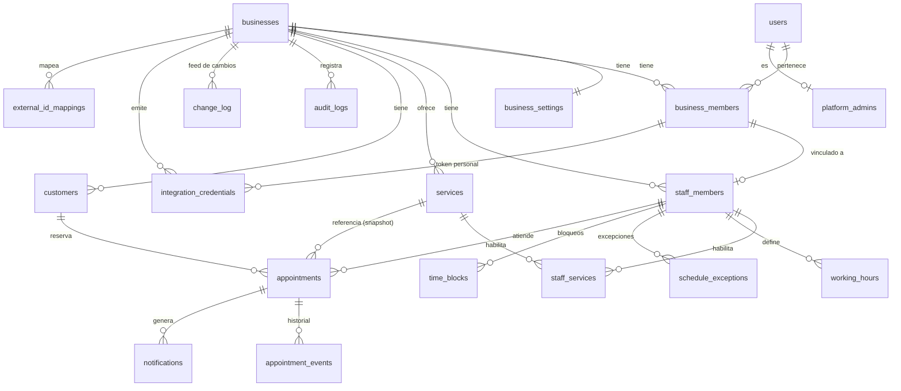

# 04 — Diseño de base de datos (PostgreSQL / Supabase)

## 1. Principios

1. **UUID v4** (`gen_random_uuid()`) como PK. Excepción: tablas de eventos/log con `bigint generated always as identity` (orden y volumen).
2. **`business_id` obligatorio** en toda tabla de negocio. Cada tabla padre expone `UNIQUE (business_id, id)` para permitir **FKs compuestas** `(business_id, child_fk) → (business_id, id)`: la BD **impide** referenciar entidades de otro tenant aunque haya un bug.
3. Timestamps `timestamptz`: `created_at`, `updated_at` (trigger `app.touch_updated_at`), `deleted_at` (soft delete) donde aplique.
4. **Enums como `text` + `CHECK`** (más fácil de migrar que `CREATE TYPE`).
5. Dinero en **centavos** (`integer`) + `currency char(3)`.
6. Extensiones: `btree_gist`, `citext`, `pgcrypto`, `pg_cron`, `pg_net`.
7. Esquema `public` para datos; esquema `app` para funciones/ayudantes (no expuesto por PostgREST).
8. Tablas con RLS **habilitada y forzada**; `anon` sin acceso a ninguna tabla (el portal público pasa por el servidor).
9. Cambios de esquema sólo por migración versionada (`supabase/migrations/YYYYMMDDHHMM_*.sql`), reversibles cuando sea posible.
10. **Esquemas y privilegios** (ver §4.1): `public` = tablas; `app` = núcleo privado; `api` = RPC para sesión de usuario; `app_internal` = funciones para el servidor (público, integración, workers). Ninguna función vive en `public`. Se revoca `EXECUTE` a `PUBLIC` y se concede función por función a **un único rol**.
11. **Concurrencia optimista**: los recursos mutables tienen `version` (§3.21) gestionada por trigger; el contrato HTTP está en doc 05 §1.8.
12. **Integridad temporal por construcción**: `ends_at` y `blocked_until` se **derivan** por trigger y se **verifican** por `CHECK` (§3.13).
13. **Feed de integración sin pérdidas**: tabla `change_log` con `tx_id xid8` y horizonte de visibilidad (§3.20), no `updated_at`.

## 2. Diagrama entidad‑relación



## 3. Tablas

Notación: **PK**, **FK**, `NN` = NOT NULL. Todas las FKs a tablas de negocio son compuestas `(business_id, x_id)` salvo indicación.

### 3.1 `businesses`
Objetivo: tenant. 
| Columna | Tipo | Restricciones |
|---|---|---|
| id | uuid | **PK**, default gen_random_uuid() |
| slug | citext | NN, UNIQUE, CHECK `^[a-z0-9](?:[a-z0-9-]{1,38})[a-z0-9]$`, lista de reservados (`api`,`app`,`admin`,`b`...) |
| name | text | NN |
| legal_name, tax_id | text | null (futuro facturación) |
| phone | text | null (E.164) |
| address_line, city, region, country | text | country default 'AR' |
| timezone | text | NN default `America/Argentina/Buenos_Aires`; validación vía trigger contra `pg_timezone_names` |
| logo_path | text | null (Supabase Storage) |
| status | text | NN, CHECK in (`active`,`suspended`,`archived`) |
| plan_id | uuid | null (futuro) |
| billing_customer_ref | text | null (futuro) |
| created_at, updated_at, deleted_at | timestamptz | |
Índices: UNIQUE(slug). RLS: miembros activos leen su negocio; sólo `owner/admin` actualizan columnas permitidas (vía función); lectura pública sólo por servidor.

### 3.2 `business_settings`
Objetivo: políticas (ver doc 02 §2). 
Columnas: `business_id` **PK/FK** (1:1), `slot_interval_minutes smallint NN default 15 CHECK in (5,10,15,20,30,60)`, `min_notice_minutes int NN default 60 CHECK >=0`, `max_advance_days int NN default 30 CHECK 1..365`, `cancellation_cutoff_hours int default 2`, `reschedule_cutoff_hours int default 2`, `max_client_reschedules smallint default 2`, `auto_confirm bool default true`, `pending_hold_minutes int default 10`, `allow_any_staff bool default true`, `require_email bool default false`, `public_booking_enabled bool default true`, `barber_can_edit_availability bool default false`, `max_active_bookings_per_customer smallint default 3`, `reminder_offsets_minutes int[] default '{1440,120}'`, `locale text default 'es-AR'`, `currency char(3) default 'ARS'`, `branding jsonb default '{}'`, `privacy_policy_version text`, timestamps.

**Columnas adicionales de `business_settings` (v1.1)**: `completion_early_minutes smallint NN default 30 CHECK 0..240` (cuánto antes del inicio puede marcarse *completado*), `no_show_grace_minutes smallint NN default 10 CHECK 0..120` (espera mínima tras el inicio para marcar *ausente*), `revert_window_days smallint NN default 30 CHECK 1..365` (ventana en que un `admin` puede revertir *completado/ausente*; fuera de ella sólo `owner`), `version int NN default 1` (§3.21).

### 3.3 `users`
Objetivo: perfil de usuarios de plataforma (espejo de `auth.users`). 
`id uuid PK` **FK → auth.users(id) ON DELETE CASCADE**, `email citext NN UNIQUE`, `full_name text`, `phone text`, `avatar_path text`, `created_at`, `updated_at`, `deleted_at`. 
**Los clientes que reservan NO están en esta tabla.** RLS: cada usuario lee/edita su fila; lectura de otros miembros sólo vía función/vista restringida al negocio compartido.

### 3.4 `platform_admins`
`user_id uuid PK FK→users`, `created_at`, `created_by`. Sin acceso por RLS a `authenticated` (se consulta desde función `app.is_platform_admin()` SECURITY DEFINER). El acceso de soporte a un negocio se otorga mediante `support_grants(id, business_id, platform_admin_id, reason NN, expires_at NN, created_at)` y queda en `audit_logs`.

### 3.5 `business_members`
Objetivo: pertenencia y rol por negocio (un usuario puede estar en N negocios).
| Columna | Tipo | Restricciones |
|---|---|---|
| id | uuid | **PK** |
| business_id | uuid | NN **FK→businesses** |
| user_id | uuid | **FK→users**, null mientras la invitación está pendiente |
| invited_email | citext | null |
| role | text | NN CHECK in (`owner`,`admin`,`barber`) |
| status | text | NN CHECK in (`invited`,`active`,`suspended`) |
| invited_by, accepted_at | | |
| created_at, updated_at | | |
Restricciones: `UNIQUE(business_id, id)`; `UNIQUE(business_id, user_id) WHERE user_id IS NOT NULL`; `CHECK (user_id IS NOT NULL OR invited_email IS NOT NULL)`. Trigger: impedir quitar/degradar al último `owner`. Escritura **sólo por función** `api.manage_member()` (identidad = `auth.uid()`; exige `aal2` para owner/admin) (previene escalamiento: no se puede otorgar un rol superior al propio ni modificarse a sí mismo el rol).

### 3.6 `staff_members`
Objetivo: profesional agendable.
`id uuid PK`, `business_id NN`, `member_id uuid null` (FK compuesta `(business_id, member_id) → business_members(business_id,id)`), `display_name text NN`, `bio text`, `photo_path text`, `color char(7)`, `is_active bool NN default true`, `accepts_online_bookings bool default true`, `sort_order int default 0`, timestamps, `deleted_at`. 
Restricciones: `UNIQUE(business_id,id)`; `UNIQUE(business_id, member_id) WHERE member_id IS NOT NULL AND deleted_at IS NULL`. Índice: `(business_id, is_active, sort_order)`.

### 3.7 `services`
`id uuid PK`, `business_id NN`, `name text NN`, `description text`, `category text`, `price_cents int NN CHECK >=0`, `currency char(3) NN`, `duration_minutes int NN CHECK 5..480`, `buffer_after_minutes int NN default 0 CHECK 0..120`, `is_active bool default true`, `sort_order int`, timestamps, `deleted_at`. 
Restricciones: `UNIQUE(business_id,id)`; `UNIQUE(business_id, lower(name)) WHERE deleted_at IS NULL`. Índice `(business_id, is_active, category, sort_order)`.

### 3.8 `staff_services`
`business_id NN`, `staff_member_id NN`, `service_id NN`, `price_override_cents int null`, `duration_override_minutes int null`, `created_at`. 
**PK(staff_member_id, service_id)**; FKs compuestas a `staff_members` y `services` (garantiza mismo negocio). Índice `(business_id, service_id)`.

### 3.9 `working_hours`
Objetivo: intervalos laborales semanales (múltiples por día → descansos = huecos).
`id uuid PK`, `business_id`, `staff_member_id`, `weekday smallint NN CHECK 1..7` (ISO, 1=lunes), `start_time time NN`, `end_time time NN CHECK end_time > start_time`, `valid_from date NN default current_date`, `valid_until date null CHECK (valid_until IS NULL OR valid_until >= valid_from)`, timestamps. 
Integridad de solapes (mismo profesional/día/vigencia): **trigger** `app.check_working_hours_overlap` (las exclusiones con `time` + `daterange` combinadas son posibles pero poco legibles; se documenta ambas opciones, recomendada: trigger + test). Índice `(staff_member_id, weekday, valid_from)`.
Cambio de jornada: se **cierra** la vigencia previa (`valid_until`) y se inserta la nueva; nunca se edita retroactivamente.

### 3.10 `schedule_exceptions`
Objetivo: excepciones por **fecha** (feriados, horario especial).
`id`, `business_id`, `staff_member_id null` (null = todo el negocio), `date date NN`, `kind text NN CHECK in ('closed','custom_hours')`, `start_time time null`, `end_time time null` (obligatorios si `custom_hours`; varios registros por fecha permitidos para turnos cortados), `reason text`, `created_by`, timestamps. 
`CHECK ((kind='closed' AND start_time IS NULL AND end_time IS NULL) OR (kind='custom_hours' AND start_time IS NOT NULL AND end_time > start_time))`. 
Semántica: si existe `custom_hours` para (profesional o negocio) en la fecha, **reemplaza** la jornada semanal; `closed` la anula. La excepción del profesional prevalece sobre la del negocio.

### 3.11 `time_blocks`
Objetivo: bloqueos por **rango absoluto** (vacaciones, trámites, bloqueo manual).
`id`, `business_id`, `staff_member_id null` (null = negocio), `during tstzrange NN CHECK (NOT isempty(during) AND NOT lower_inf(during) AND NOT upper_inf(during))`, `kind text CHECK in ('manual','vacation','other')`, `reason`, `created_by`, `created_at`, `deleted_at`. 
Índice **GiST** `(business_id, staff_member_id, during)`. Crear un bloqueo toma el mismo lock de fila del profesional que `create_appointment` y devuelve (no borra) las reservas en conflicto para decisión humana.

### 3.12 `customers`
Objetivo: clientes que reservan (por negocio).
`id`, `business_id NN`, `full_name text NN`, `phone_e164 text null CHECK ~ '^\+[1-9][0-9]{7,14}$'`, `email citext null`, `instagram_handle citext null`, `notes text` (internas), `marketing_opt_in bool default false`, `consent_version text`, `consented_at timestamptz`, contadores: `completed_count int default 0`, `cancelled_count int default 0`, `no_show_count int default 0`, `first_visit_at`, `last_visit_at`, `merged_into_id uuid null` (FK compuesta a customers), `source text` (`public_web`,`admin`,`import_gas`), timestamps, `deleted_at`. 
Restricciones: `UNIQUE(business_id,id)`; **`UNIQUE(business_id, phone_e164) WHERE phone_e164 IS NOT NULL AND deleted_at IS NULL AND merged_into_id IS NULL`**; índices `(business_id, lower(email))`, `(business_id, instagram_handle)`, trigram sobre `full_name` para búsqueda (`pg_trgm`). Contadores **recalculados** desde `appointments` por `app.recompute_customer_stats(customer_id)` dentro de la misma transacción de cada cambio de estado o fusión (no se incrementan/decrementan, para evitar derivas tras reversiones).

### 3.13 `appointments`
Objetivo: reserva (entidad central).

**Columnas** (las derivadas y los snapshots se explican en «Integridad temporal»)

| Columna | Tipo | Notas |
|---|---|---|
| id | uuid PK | |
| business_id | uuid NN | |
| customer_id, staff_member_id, service_id | uuid NN | FKs compuestas `(business_id, x)` |
| status | text NN | CHECK in (`pending`,`confirmed`,`cancelled`,`completed`,`no_show`,`expired`) |
| starts_at | timestamptz NN | UTC; **fuente única** |
| ends_at, blocked_until | timestamptz NN | **derivadas** por trigger; verificadas por CHECK |
| service_name_snapshot, price_cents_snapshot, currency, duration_minutes_snapshot, buffer_minutes_snapshot | NN | copiadas al crear; **inmutables** |
| source | text NN | CHECK in (`public_web`,`admin`,`staff`,`integration`,`import`) |
| created_by_member_id | uuid null | derivado del contexto verificado, nunca de un parámetro |
| customer_notes, internal_notes | text | |
| expires_at | timestamptz null | sólo `pending` |
| cancelled_at, cancelled_by (`customer`,`staff`,`system`), cancel_reason | | |
| completed_at, no_show_at | timestamptz null | exclusivos y ligados al estado |
| reschedule_count | smallint NN default 0 | |
| manage_token_hash | bytea null | SHA‑256 del token (256 bits) |
| manage_token_expires_at | timestamptz null | `starts_at + 24 h` (se recalcula al reprogramar); vencido ⇒ `410 MANAGE_LINK_EXPIRED` |
| payment_ref | text null | futuro |
| version | int NN default 1 | concurrencia optimista (§3.21) |
| created_at, updated_at | | |

#### Integridad temporal (fuente única + derivación + verificación)

**Fuente única**: `starts_at`, `duration_minutes_snapshot` y `buffer_minutes_snapshot`. Todo lo demás se deriva:

```
ends_at       = starts_at + duration_minutes_snapshot minutos
blocked_until = ends_at   + buffer_minutes_snapshot   minutos
```

Se garantiza en tres niveles (ninguno depende del cliente de la API):

1. **Derivación (trigger `BEFORE INSERT OR UPDATE`, `app.appointments_derive_times()`)**: recalcula `ends_at` y `blocked_until` a partir de la fuente única **e ignora** cualquier valor que envíe el llamador. Así `reschedule` sólo cambia `starts_at` y los derivados se actualizan solos.
2. **Verificación (`CHECK`)**: sólo con operadores *inmutables* (resta de `timestamptz` y `extract(epoch …)`), por lo que es válido en un `CHECK` y no depende de la zona horaria de sesión.
3. **Inmutabilidad de snapshots (trigger `BEFORE UPDATE`, `app.appointments_guard()`)**: rechaza cambios en `business_id`, `customer_id`*, `service_id`, `service_name_snapshot`, `price_cents_snapshot`, `currency`, `duration_minutes_snapshot`, `buffer_minutes_snapshot` y `created_at`, salvo que la función autorizada `app.adjust_appointment()` active `set_config('app.snapshot_edit','on', true)` (variable local a la transacción) y vuelva a validar solapes. (*`customer_id` sólo cambia por `merge_customers`, que usa el mismo mecanismo.) Ningún rol de API tiene `UPDATE`; este trigger es defensa ante bugs.

```sql
-- Tipos/valores
CONSTRAINT appt_duration_range   CHECK (duration_minutes_snapshot BETWEEN 5 AND 480),
CONSTRAINT appt_buffer_range     CHECK (buffer_minutes_snapshot BETWEEN 0 AND 120),
CONSTRAINT appt_price_nonneg     CHECK (price_cents_snapshot >= 0),
-- Coherencia temporal (inmutable: timestamptz - timestamptz, extract(epoch from interval))
CONSTRAINT appt_ends_coherent    CHECK (extract(epoch FROM (ends_at - starts_at))    = duration_minutes_snapshot * 60),
CONSTRAINT appt_blocked_coherent CHECK (extract(epoch FROM (blocked_until - ends_at)) = buffer_minutes_snapshot * 60),
-- Estado ↔ campos
CONSTRAINT appt_pending_expiry   CHECK ((status = 'pending') = (expires_at IS NOT NULL)),
CONSTRAINT appt_cancel_fields    CHECK ((status = 'cancelled') = (cancelled_at IS NOT NULL AND cancelled_by IS NOT NULL)),
CONSTRAINT appt_outcome_fields   CHECK (
     (status = 'completed' AND completed_at IS NOT NULL AND no_show_at IS NULL)
  OR (status = 'no_show'   AND no_show_at   IS NOT NULL AND completed_at IS NULL)
  OR (status NOT IN ('completed','no_show') AND completed_at IS NULL AND no_show_at IS NULL)),
UNIQUE (business_id, id),
-- No doble reserva (respaldo final; ver doc 06)
EXCLUDE USING gist (
  staff_member_id WITH =,
  tstzrange(starts_at, blocked_until, '[)') WITH &&
) WHERE (status IN ('pending','confirmed','completed'))
```

> **Por qué no columnas generadas**: `timestamptz + interval` es `STABLE` (depende de la zona), y una *generation expression* debe ser `IMMUTABLE`; por eso la derivación se hace por trigger y la verificación por `CHECK` con operadores inmutables. Por la misma razón el rango del `EXCLUDE` usa el constructor `tstzrange(...)` sobre columnas ya persistidas.
>
> `ends_at > starts_at` queda implícito (`duration ≥ 5`). `blocked_until ≥ ends_at` queda implícito (`buffer ≥ 0`).

**Resultado de la atención (`completed` / `no_show`) y reversión**
- `completed_at` y `no_show_at` son **mutuamente excluyentes** y sólo existen en su estado (CHECK `appt_outcome_fields`).
- Tiempos válidos: `completed_at ∈ [starts_at − completion_early_minutes, now()]` (nunca futuro); `no_show_at = now()` y sólo si `now() ≥ starts_at + no_show_grace_minutes`. Se valida en `app.transition_core` (doc 06 §4.5), no en el CHECK, porque dependen de `now()` y de `business_settings`.
- `revert` (admin/owner, motivo obligatorio) vuelve a `confirmed` y **pone ambos campos en NULL**; los valores previos quedan en `appointment_events.payload`. No existe transición directa `completed ↔ no_show` (se hace *revert* y luego la acción correcta; ambas auditadas).
- `no_show` **no ocupa** el slot (permite reutilizar el hueco tras la espera); por eso revertir un `no_show` vuelve a entrar al predicado del `EXCLUDE` y puede fallar con conflicto si el hueco fue reservado (doc 06 §4.5).
- Los contadores de `customers` **no se incrementan/decrementan**: se **recalculan** desde `appointments` (`app.recompute_customer_stats()`), evitando derivas tras reversiones.

Índices: `(business_id, staff_member_id, starts_at)`; `(business_id, starts_at)`; `(business_id, customer_id, starts_at DESC)`; `(business_id, status, starts_at)`; parcial `(expires_at) WHERE status='pending'`. (El feed de integración **no** usa `updated_at`: ver `change_log`, §3.20.)

Privilegios: `INSERT/UPDATE/DELETE` revocados a `anon`, `authenticated` y `app_server`; `SELECT` sólo a `authenticated` (con RLS). Las escrituras ocurren únicamente en funciones `SECURITY DEFINER` que verifican identidad y permisos (§4.1, ADR-004/019). `DELETE` prohibido a todos (trigger).

**Snapshot de precio y duración**: al crear, la función copia `services.name/price/duration/buffer` (o los `override` de `staff_services`) a las columnas `*_snapshot`. Cambios posteriores del catálogo no afectan reservas existentes. Si un admin necesita ajustar precio o duración de una reserva existente, usa `app.adjust_appointment()` (evento `price_adjusted`/`duration_adjusted`); un cambio de duración o buffer **revalida solapes** y rederiva `ends_at/blocked_until` en la misma transacción.

### 3.14 `appointment_events`
Objetivo: historial append‑only. 
`id bigint identity PK`, `business_id`, `appointment_id` (FK compuesta), `event_type text NN` (`created`,`confirmed`,`cancelled`,`rescheduled`,`completed`,`no_show`,`expired`,`reverted`,`reassigned`,`price_adjusted`,`service_record_linked`), `from_status`, `to_status`, `actor_type NN` (`customer`,`member`,`integration`,`system`), `actor_id uuid null`, `payload jsonb` (valores previos/nuevos), `request_id text`, `created_at`. 
Índices `(appointment_id, id)`, `(business_id, created_at)`. `UPDATE/DELETE` revocados.

### 3.15 `notifications` (outbox)
`id uuid PK`, `business_id`, `appointment_id null` (FK compuesta), `customer_id null`, `channel text NN CHECK in ('email','whatsapp','sms','internal')`, `type text NN`, `recipient text NN` (snapshot de email/teléfono), `status text NN CHECK in ('pending','processing','sent','failed','dead','cancelled','skipped') default 'pending'`, `scheduled_for timestamptz NN`, `attempts smallint default 0`, `max_attempts smallint default 5`, `next_attempt_at timestamptz NN`, `locked_at`, `locked_by text`, `provider text`, `provider_message_id text`, `last_error text`, `payload jsonb NN`, `dedupe_key text NN`, `created_at`, `sent_at`. 
`UNIQUE (business_id, dedupe_key)` — ej.: `appt:{id}:reminder:1440:v{reschedule_count}`. Índice parcial `(next_attempt_at) WHERE status IN ('pending','failed')`.

### 3.16 `audit_logs`
`id bigint identity PK`, `business_id uuid null`, `actor_type NN` (`user`,`integration`,`system`,`platform_admin`), `actor_user_id null`, `integration_credential_id null`, `action text NN` (`member.role_changed`, `integration.token_created`...), `entity_type`, `entity_id`, `before jsonb`, `after jsonb`, `ip inet`, `user_agent text`, `request_id text`, `created_at`. 
Append‑only; sin `UPDATE/DELETE`; índices `(business_id, created_at DESC)`, `(entity_type, entity_id)`. Sin datos sensibles en `before/after` (se enmascaran tokens, secretos).

### 3.17 `integration_credentials`
`id uuid PK`, `business_id NN`, `name text NN`, `kind text NN CHECK in ('service_key','user_token')`, `member_id uuid null` (obligatorio si `user_token`), `token_prefix text NN UNIQUE` (8 caracteres visibles para identificación), `token_hash bytea NN` (SHA‑256 de un token aleatorio de 256 bits — adecuado porque no es una contraseña elegida por humanos), `scopes text[] NN`, `status text NN CHECK in ('active','revoked','expired')`, `expires_at timestamptz`, `last_used_at`, `last_used_ip inet`, `created_by`, `revoked_at`, `revoked_by`, `rotated_from_id uuid null`, `created_at`. 
`CHECK ((kind='user_token') = (member_id IS NOT NULL))`. **`service_key` es de sólo lectura por construcción**: `CHECK (kind <> 'service_key' OR scopes <@ ARRAY['business:read','staff:read','services:read','availability:read','appointments:read','customers:read','changes:read','mappings:read'])`; un trigger valida que los scopes pertenezcan al catálogo y que, al crear un `user_token`, sean un subconjunto de lo que el rol del miembro permite (en cada uso se evalúa la **intersección** scopes ∩ permisos vigentes del miembro). La autenticación se hace **en la base de datos** (`app.ctx_integration(token_hash, scope)`: estado `active`, no vencido, negocio activo, miembro activo) en **cada** llamada; no hay caché, por lo que la revocación es inmediata. Formato de token: `trn_<env>_<prefix>_<secret>`. El secreto se muestra **una sola vez**. Comparación en tiempo constante.

### 3.18 `external_id_mappings`
Objetivo: vincular entidades internas con IDs externos (Sheets, futuros) **con integridad referencial real** (sin columna polimórfica sin FK) y sin asociaciones duplicadas.

| Columna | Tipo | Restricciones |
|---|---|---|
| id | uuid | PK |
| business_id | uuid | NN, FK→businesses |
| external_system | text | NN, CHECK in (`gas_sheets`,`google_calendar`,`mercadopago`) |
| entity_type | text | NN, CHECK in (`customer`,`staff_member`,`service`,`service_record`) |
| customer_id | uuid | null; FK compuesta `(business_id, customer_id) → customers(business_id, id)` |
| staff_member_id | uuid | null; FK compuesta → `staff_members` |
| service_id | uuid | null; FK compuesta → `services` |
| appointment_id | uuid | null; FK compuesta → `appointments`; **sólo para `service_record`** (la reserva con la que se vincula el registro de servicio de Sheets) |
| external_id | text | NN, CHECK `external_id = btrim(external_id) AND length(external_id) BETWEEN 1 AND 200` |
| external_meta | jsonb | null (≤ 4 KB, sin secretos) |
| status | text | NN default `linked`, CHECK in (`linked`,`needs_review`,`rejected`) |
| created_by_member_id / created_by_credential_id | uuid | null; derivados del contexto verificado |
| last_synced_at, sync_hash | | |
| version, created_at, updated_at | | `version` §3.21 |

```sql
-- Exactamente un destino interno y coherente con entity_type
CONSTRAINT map_one_target CHECK (
     (entity_type = 'customer'       AND customer_id       IS NOT NULL AND num_nonnulls(staff_member_id, service_id, appointment_id) = 0)
  OR (entity_type = 'staff_member'   AND staff_member_id   IS NOT NULL AND num_nonnulls(customer_id, service_id, appointment_id)     = 0)
  OR (entity_type = 'service'        AND service_id        IS NOT NULL AND num_nonnulls(customer_id, staff_member_id, appointment_id) = 0)
  OR (entity_type = 'service_record' AND appointment_id    IS NOT NULL AND num_nonnulls(customer_id, staff_member_id, service_id)     = 0)),

-- Aislamiento entre negocios: FKs compuestas (MATCH SIMPLE: se evalúan cuando la columna es no nula)
FOREIGN KEY (business_id, customer_id)     REFERENCES customers(business_id, id),
FOREIGN KEY (business_id, staff_member_id) REFERENCES staff_members(business_id, id),
FOREIGN KEY (business_id, service_id)      REFERENCES services(business_id, id),
FOREIGN KEY (business_id, appointment_id)  REFERENCES appointments(business_id, id)

-- U1: un ID externo identifica exactamente UNA entidad interna (todas las entidades)
CREATE UNIQUE INDEX map_u_external ON external_id_mappings
  (business_id, external_system, entity_type, external_id);

-- U2: relación inversa 1:1 para todo salvo customer
--     (un cliente fusionado puede conservar varios IDs externos; en el resto, una entidad interna ↔ un ID externo)
CREATE UNIQUE INDEX map_u_internal ON external_id_mappings
  (business_id, external_system, entity_type, coalesce(staff_member_id, service_id, appointment_id))
  WHERE entity_type <> 'customer';
```

**Reglas de integridad y controles**

| # | Regla | Mecanismo |
|---|---|---|
| M1 | Un mapeo no puede apuntar a una entidad de otro negocio | FKs compuestas con `business_id` (+ test de aislamiento) |
| M2 | Un `external_id` no puede asociarse a dos entidades internas | `map_u_external` |
| M3 | Una reserva no puede tener dos registros de servicio, ni un registro de servicio dos reservas | `map_u_external` + `map_u_internal` (`service_record`) |
| M4 | Un profesional/servicio no puede tener dos IDs externos del mismo sistema | `map_u_internal` |
| M5 | `entity_type`, `external_system`, `business_id` y el destino interno **no cambian** tras crearse | trigger `app.mapping_guard()` (sólo `external_id`, `status`, `external_meta`, `last_synced_at`, `sync_hash` son mutables) |
| M6 | El destino debe estar activo (`deleted_at IS NULL`) al crear el vínculo | validación en `app.upsert_mapping()` |
| M7 | Sólo identidades verificadas con permiso escriben mapeos (admin por sesión, o `user_token` de un admin con scope `mappings:write`) | `api.upsert_mapping` / `app_internal.integration_upsert_mapping` (§4.1); sin `INSERT/UPDATE/DELETE` directos |
| M8 | Reintentos seguros | `upsert` idempotente: misma `(entity, external_id)` → no-op `200`; mismo `external_id` hacia otra entidad → `TS008 DUPLICATE_RESOURCE`; misma entidad con otro `external_id` → `TS009 ALREADY_LINKED` (se debe **renombrar** con `PATCH` + `If-Match`, o desvincular) |
| M9 | Fusión de clientes | `merge_customers` reasigna `customer_id` de los mapeos del origen al destino; no hay colisión de U2 (excluye `customer`); si ambos tenían el mismo `external_id`, el duplicado se elimina |
| M10 | Desvincular | `DELETE` (admin, auditado, `If-Match`); desvincular un `service_record` registra evento en la reserva y emite `change_log` |
| M11 | Coincidencias dudosas (Instagram) | se crean con `status='needs_review'`; **no cuentan como vínculo efectivo** para el flujo de servicios hasta pasar a `linked` por un admin |

Alcance de `external_id`: es único por `(negocio, sistema, tipo)`. Si en el futuro hubiera dos planillas por negocio, se agrega `external_scope text` y se incluye en los índices (no se implementa en el MVP).

### 3.19 Tablas auxiliares (justificadas)
- `idempotency_keys(business_id, key text, endpoint text, request_hash bytea, response_status int, response_body jsonb, created_at)` — **PK (business_id, key, endpoint)**; TTL 48 h. Se escribe **en la misma transacción** que la operación (doc 06 §4.0): una segunda solicitud concurrente con la misma clave espera el `INSERT … ON CONFLICT` de la primera y recibe la respuesta almacenada.
- `customer_match_candidates(id, business_id, customer_id, source_ref, reason, status)` — revisión de posibles duplicados (puede implementarse como `external_id_mappings.status='needs_review'` en el MVP).
- `job_runs(job text, started_at, finished_at, processed int, error text)` — monitoreo de jobs (doc 12).
- `support_grants` — ver §3.4.

### 3.20 `change_log` (feed de integración sin pérdidas)

**Problema que resuelve**: con un cursor `(updated_at, id)`, una transacción A con `updated_at` anterior puede **confirmarse después** de que el consumidor ya avanzó su cursor más allá de esa marca. Esa fila no vuelve a aparecer. Un solapamiento fijo (p. ej. 5 min) sólo es una heurística: falla ante transacciones más largas que el solapamiento. Las secuencias (`bigserial`) tienen el mismo defecto: el valor se asigna al insertar, no al confirmar.

**Solución**: se ordena por el **identificador de transacción** y se entregan sólo filas por debajo del **horizonte de visibilidad** del snapshot actual (`pg_snapshot_xmin(pg_current_snapshot())` = la transacción más antigua aún en curso). Toda transacción con `xid` menor a ese horizonte ya terminó (confirmó o abortó), por lo que **no pueden aparecer filas nuevas por debajo de él**.

```sql
CREATE TABLE change_log (
  seq            bigint GENERATED ALWAYS AS IDENTITY PRIMARY KEY,
  tx_id          xid8        NOT NULL DEFAULT pg_current_xact_id(),
  business_id    uuid        NOT NULL REFERENCES businesses(id),
  entity_type    text        NOT NULL CHECK (entity_type IN ('appointment','customer','customer_merge','service_record_link')),
  entity_id      uuid        NOT NULL,
  entity_version int,
  op             text        NOT NULL CHECK (op IN ('upsert','delete')),
  created_at     timestamptz NOT NULL DEFAULT now()
);
CREATE INDEX change_log_feed ON change_log (business_id, tx_id, seq);

-- Consulta del feed (dentro de app_internal.integration_changes; business_id sale de la credencial verificada)
SELECT seq, tx_id::text, entity_type, entity_id, entity_version, op
FROM change_log
WHERE business_id = v_ctx.business_id
  AND (tx_id, seq) > (p_after_tx::xid8, p_after_seq)
  AND tx_id < pg_snapshot_xmin(pg_current_snapshot())      -- horizonte seguro
ORDER BY tx_id, seq
LIMIT p_limit;
```

- Se llena con triggers `AFTER INSERT/UPDATE` sobre `appointments`, `customers`, `external_id_mappings` (`service_record`) y `merge_customers`, **en la misma transacción** que el cambio (si la transacción aborta, desaparece el registro).
- `(tx_id, seq)` es un orden total estable; el cursor `(tx_id, seq)` sólo avanza. Las filas de una misma transacción se vuelven visibles juntas, por lo que un corte de página dentro de una transacción es seguro (el cursor incluye `seq`).
- Requiere PostgreSQL ≥ 13 (`xid8`, `pg_current_xact_id`); Supabase corre ≥ 15 (verificar versión del proyecto).
- **Costo**: el feed queda retrasado mientras exista una transacción larga abierta. Controles: `idle_in_transaction_session_timeout = 60s`, `statement_timeout` para el rol de API, alerta si el retraso del horizonte > 5 min (doc 12 §5). Los datos del *payload* se leen al momento de la consulta (estado actual); varias filas de log de la misma entidad en una página se **colapsan** en una.
- **Retención**: 90 días. El job de limpieza guarda `purged_through_tx` (tabla `app.feed_state`). Un cursor con `tx` ≤ ese valor devuelve `410 CURSOR_EXPIRED` y el consumidor reconstruye con la reconciliación (doc 05 §4.2).
- Privilegios: sin acceso directo para `anon`/`authenticated`/`app_server`; sólo lectura mediante `app_internal.integration_changes`.

### 3.21 Versionado optimista (`version`)

Tablas con `version int NOT NULL DEFAULT 1`: `businesses`, `business_settings`, `business_members`, `staff_members`, `services`, `customers`, `appointments`, `external_id_mappings`.

- Trigger `BEFORE UPDATE app.bump_version()`: `NEW.version := OLD.version + 1` **siempre** (ignora el valor enviado por el llamador). Los `UPDATE` sin cambios reales se evitan en la capa de servicio (un `PATCH` vacío responde `200` sin escribir).
- Colecciones hijas (`working_hours`, `schedule_exceptions`, `staff_services`) **no tienen** `version` propia: modificarlas exige `If-Match` con la `version` del `staff_members` padre y las funciones hacen `UPDATE staff_members SET updated_at = now()` para incrementarla.
- Las funciones que reciben `p_expected_version` toman el lock de fila (`FOR UPDATE`), **luego** comparan y recién después escriben (sin TOCTOU). Contrato HTTP: doc 05 §1.8.

### 3.22 `app.role_permissions` (fuente única de la matriz)

`role text, action text, scope text` (`any` | `own`), `PRIMARY KEY (role, action)`. Se siembra desde `supabase/permissions.json` (misma fuente que genera el módulo TS `can()` para la UI). `app.authorize(ctx, action, staff_member_id)` consulta esta tabla y aplica la condición de propiedad (`own` ⇒ el profesional del contexto debe ser el de la reserva). Un test de CI verifica que TS y SQL coinciden con la matriz del doc 02 §6. **La decisión autoritativa es la de la base de datos.**

## 4. Aislamiento multi‑tenant en SQL (ilustrativo)

```sql
-- Ayudantes (esquema app, no expuesto)
create function app.current_user_id() returns uuid
language sql stable as $$ select (select auth.uid()) $$;

create function app.is_member(p_business uuid, p_roles text[] default null)
returns boolean language sql stable security definer set search_path = '' as $$
  select exists (
    select 1 from public.business_members m
    where m.business_id = p_business
      and m.user_id = app.current_user_id()
      and m.status = 'active'
      and (p_roles is null or m.role = any(p_roles))
  );
$$;

-- RLS: miembros ven su negocio; barberos sólo sus reservas
alter table public.appointments enable row level security;
alter table public.appointments force row level security;

create policy appt_select_admin on public.appointments for select to authenticated
  using (app.is_member(business_id, array['owner','admin']));

create policy appt_select_barber on public.appointments for select to authenticated
  using (
    app.is_member(business_id, array['barber'])
    and staff_member_id in (
      select s.id from public.staff_members s
      join public.business_members m on m.id = s.member_id and m.business_id = s.business_id
      where s.business_id = appointments.business_id and m.user_id = app.current_user_id()
    )
  );
-- Sin políticas INSERT/UPDATE/DELETE: sólo funciones SECURITY DEFINER escriben.
```

Patrón repetido por tabla: `SELECT` para `owner/admin` del negocio; `SELECT` restringido para `barber`; escrituras sólo por funciones o políticas `WITH CHECK (app.is_member(business_id, array['owner','admin']))` en tablas de configuración simples (servicios, profesionales, horarios).

### 4.1 Esquemas, roles y privilegios (identidad en funciones `SECURITY DEFINER`)

**Regla central**: una función privilegiada **nunca** toma como autoridad un `actor_id`, `user_id`, `role` ni `created_by` recibido por parámetro. La identidad se **deriva dentro de la función** a partir de una fuente verificable según el contexto (doc 08 §3.1). El `business_id` recibido es un *selector* que se **valida** contra esa identidad; el tenant efectivo sale siempre del contexto verificado (`ctx.business_id`).

| Esquema | Contenido | Quién puede `USAGE`/`EXECUTE` | Expuesto por PostgREST |
|---|---|---|---|
| `public` | Tablas (RLS forzada). **Sin funciones.** | `authenticated`: sólo `SELECT` según RLS | Sí (sólo tablas) |
| `app` | Núcleo privado: `create_appointment_core`, `transition_core`, `authorize`, `ctx_*`, helpers de RLS | `postgres` (dueño). A `authenticated`, **sólo** `is_member()`/`current_user_id()` (las usan las políticas) | No |
| `api` | RPC para **sesión de usuario** (`api.create_appointment`, `api.transition_appointment`, `api.manage_member`, …). Identidad = `auth.uid()` | `EXECUTE` sólo a `authenticated` | Sí |
| `app_internal` | Funciones para el **servidor** en contextos sin sesión: `public_*`, `integration_*`, `worker_*` | `EXECUTE` sólo a `app_server` | **No** |

Roles:
- `app_server`: rol de login para el pool de conexiones del servidor (vía pooler). **Sin privilegios sobre tablas**; sólo `USAGE` en `app_internal` y `EXECUTE` en sus funciones. No usa `service_role` de Supabase para datos de negocio (la clave `service_role` queda reservada a Auth Admin API/Storage).
- Dueño de las funciones: `postgres` (tiene `BYPASSRLS`). **Por eso** cada función debe verificar explícitamente identidad y permisos: RLS no la protege.

```sql
-- Línea base (migración 0001)
REVOKE ALL ON SCHEMA app, api, app_internal FROM PUBLIC;
ALTER DEFAULT PRIVILEGES FOR ROLE postgres IN SCHEMA app, api, app_internal
  REVOKE EXECUTE ON FUNCTIONS FROM PUBLIC, anon, authenticated;   -- Postgres concede EXECUTE a PUBLIC por defecto
GRANT USAGE ON SCHEMA api TO authenticated;
GRANT USAGE ON SCHEMA app_internal TO app_server;

-- Por cada función:
CREATE FUNCTION api.transition_appointment(p_business_id uuid, p_appointment_id uuid, p_action text,
                                           p_expected_version int, p_reason text DEFAULT NULL)
RETURNS public.appointments
LANGUAGE plpgsql SECURITY DEFINER SET search_path = '' AS $$
DECLARE v_ctx app.ctx := app.ctx_session(p_business_id);   -- 1º statement: auth.uid() → miembro activo → rol (TS005 si no es miembro)
BEGIN
  RETURN app.transition_core(v_ctx, p_appointment_id, p_action, p_expected_version, p_reason);
END $$;
REVOKE ALL ON FUNCTION api.transition_appointment(uuid,uuid,text,int,text) FROM PUBLIC;
GRANT EXECUTE ON FUNCTION api.transition_appointment(uuid,uuid,text,int,text) TO authenticated;
```

**Checklist obligatorio para toda función `SECURITY DEFINER`** (verificado por tests de catálogo, doc 11 §12):
1. `SET search_path = ''` y todos los objetos calificados con esquema.
2. Primer statement: construir/validar el contexto (`app.ctx_session | ctx_public | ctx_integration | ctx_system`).
3. Sin parámetros que representen identidad o autoridad (`*actor*`, `*user_id*`, `*role*`, `*created_by*`, `*member_id*`); sin `business_id` fuera del rol de selector.
4. Todo acceso a datos filtra por `ctx.business_id` y usa FKs/consultas por `(business_id, id)`.
5. `REVOKE ALL … FROM PUBLIC` + `GRANT EXECUTE` a **un único** rol.
6. Autorización efectiva con `app.authorize(ctx, action, staff_member_id)`; propiedad `own` para barberos.
7. Sin SQL dinámico salvo con `format('%I'/'%L')`.
8. Errores con el catálogo SQLSTATE `TSxxx` (doc 06 §4.0); nunca mensajes que filtren existencia entre tenants.

`app.ctx` (tipo compuesto): `actor_type ('member'|'customer'|'integration'|'system')`, `user_id`, `member_id`, `member_role`, `staff_member_id` (si el miembro es barbero), `credential_id`, `credential_kind`, `scopes text[]`, `business_id`, `aal` (nivel de autenticación de la sesión).

## 5. Esquema de estados — resumen
`appointments.status`, `notifications.status`, `integration_credentials.status`, `business_members.status`, `businesses.status`. Todos `text + CHECK`, transiciones de `appointments` validadas por función `app.assert_transition(from,to,actor_role)`.

## 6. Retención y borrado
- Reservas y eventos: se conservan (obligación comercial/estadística) con anonimización del cliente a pedido (ver doc 08).
- `audit_logs`: retención 24 meses online (ajustar tras validación legal); particionado mensual diferido.
- `idempotency_keys`: 48 h. `notifications` enviadas: 12 meses.
