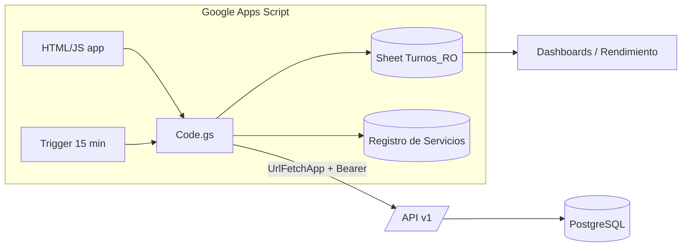
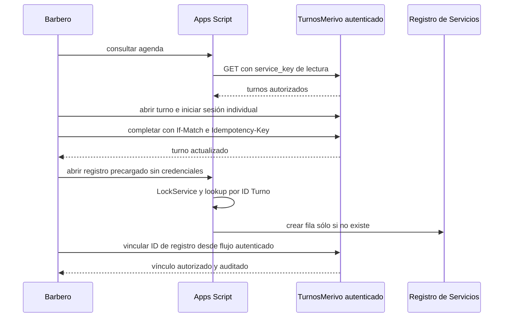

> Consolidación 2026-10-31: doc 14 incorporado. Propuestas P-xx y gates en
> [informe de consolidación](CONSOLIDATION_REPORT.md); esta edición no autoriza implementación.

> **Actualización de seguridad:** consultar `14_CORRECCIONES_CRITICAS.md` antes de implementar. Si existe contradicción, prevalecen esas correcciones.

# 07 — Integración con Google Apps Script (GAS)

Principio: el sistema de turnos **no depende** de GAS para nada (ni para confirmar reservas ni para notificar). GAS es un **cliente más** de la API v1.

## 1. Opciones de arquitectura

| Criterio | A — Bajo demanda | B — Sincronización periódica | C — Híbrido (**recomendada**) |
|---|---|---|---|
| Latencia de agenda | Real (≈300–900 ms por llamada desde `UrlFetchApp`) | Hasta el período del trigger (5–15 min) | Real para agenda |
| Datos para reportes en Sheets | Requiere llamadas pesadas por reporte | Local y rápido | Local y rápido |
| Cuotas de Apps Script | Consume `UrlFetch` por cada vista | Bajo y predecible (lotes) | Moderado |
| Riesgo si la API cae | La agenda falla | Reportes siguen con último dato | Agenda falla; reportes siguen |
| Riesgo de inconsistencia | Nulo (una sola fuente) | Medio (desfase, duplicados) | Bajo (agenda siempre viva) |
| Complejidad | Baja | Media (cursores, upserts) | Media |
| Mantenimiento | Bajo | Medio | Medio |

**Decisión**: **C**.
- **Agenda y próximos clientes**: bajo demanda; caché breve sólo para lecturas. Escrituras desde TurnosMerivo con identidad individual; Modo A sólo si se validó de extremo a extremo. Nunca cachear autorización/revocación.
- **Reportes/KPIs MVP**: trigger periódico orientativo cada 15 min y reconciliación nocturna, con barridos completos paginados del alcance acordado y upsert por negocio/id/version en Turnos_RO. Frecuencia no garantiza frescura si una corrida falla. `/integrations/changes` no se habilita hasta cerrar diseño y pruebas (doc 05 §4).
- **Regla**: GAS jamás escribe directamente en la base de turnos ni "empuja" campos de reserva sobreescribiéndolos; sólo invoca **comandos** de la API (el servidor valida y decide).



## 2. Autenticación e identidad

### 2.1 Problema
Una credencial compartida **no** identifica quién actúa. Hay que resolver (a) qué negocio, (b) qué permisos máximos y (c) qué persona.

### 2.2 Dos tipos de credencial (tabla `integration_credentials`)

| Tipo | Quién | Dónde se guarda en GAS | Scopes típicos | Identidad |
|---|---|---|---|---|
| `service_key` | Proceso de sincronización | `PropertiesService.getScriptProperties()` | `appointments:read`, `staff:read`, `services:read`, `customers:read`, `mappings:read`; changes:read sólo para feed futuro habilitado | El **negocio** (sin persona) |
| `user_token` | Un barbero/admin concreto | Almacenamiento personal sólo tras validar despliegue, aislamiento y operador real; UserProperties no basta por sí solo | Scopes ∩ rol vigente | Persona verificada únicamente bajo Modo A validado |

Los tokens nunca viajan al navegador: el HTML llama a `google.script.run` → `Code.gs` → `UrlFetchApp`. Nunca se imprimen en logs ni se guardan en hojas.

### 2.3 Dos modos según cómo esté desplegado GAS (**supuesto S4 a confirmar**)

**Modo A (preferido) — identidad individual verificable**
Requiere validar con cuentas distintas el modelo real de despliegue, quién ejecuta, quién puede leer tokens y cómo se prueba la identidad del operador. Desplegar "como el usuario que accede" y usar UserProperties son hipótesis a probar, no prueba suficiente por sí solos. Hasta aprobar P-08 no se habilita escritura desde GAS.
1. El barbero/admin entra al panel de turnos → *Conectar Apps Script* → se genera un `user_token` (se muestra una vez, vence a 90 días, rotable).
2. Lo pega una vez en la app GAS (guarda en `UserProperties`).
3. Cada llamada de escritura usa **ese** token: el servidor sabe quién es (miembro, rol, profesional) y aplica **sus** permisos reales. Prevención de suplantación: demostrar aislamiento de tokens entre cuentas y que el operador no puede seleccionar la credencial de otra persona; el backend valida miembro y scope en cada solicitud.

**Modo B (fallback) — script "ejecutar como yo" (propietario)**
Cuando el despliegue usa al propietario no se asume identidad individual verificable ni aislamiento por UserProperties. Sin prueba del operador real se aplica Modo B:
- Se usa **una** `service_key` con scopes mínimos.
- X-Actor-Asserted, si existe, sólo es metadato no confiable de acceso; no identifica una persona ni autoriza. Registrar credential_id y actor_type=integration, sin fabricar actor humano. Al ser sólo lectura, no genera eventos de escritura.
- **Modo B estrictamente de solo lectura en el MVP**: exclusivamente consultas necesarias para agenda y sincronización (appointments:read y datos mínimos de catálogo; changes:read sólo si se habilita el feed futuro). Se prohíben `confirm`, `complete`, `no-show`, `links:write`, `cancel`, `reschedule`, `create`, `revert` y cambios de catálogos. Esas operaciones se realizan desde el panel autenticado de TurnosMerivo o, posteriormente, mediante identidad individual verificable.
- No existen transiciones de escritura permitidas en Modo B; se mantiene rate limiting, scopes de lectura mínimos y auditoría de accesos.
- Controles compensatorios: alertas por volumen anómalo, revocación inmediata, rotación cada 90 días, auditoría semanal.

Recomendación: arrancar en Modo B **solo lectura** y migrar a Modo A únicamente luego de validar de extremo a extremo la identidad individual y la protección de los tokens.

### 2.4 Ciclo de vida y seguridad de credenciales
- Formato `trn_live_<prefix>_<secreto 256 bits>`; se guarda sólo el hash SHA‑256 + `token_prefix`.
- Expiración obligatoria; `rotate` crea el nuevo y mantiene el viejo 24 h (`rotated_from_id`); `revoke` impide nuevas solicitudes desde la siguiente verificación, sin caché de autorización; una operación ya iniciada tiene su punto de verificación transaccional. Rotación no revive una credencial revocada.
- Scopes mínimos; negocio derivado del token; `businessId` de la ruta debe coincidir.
- `last_used_at/ip` visibles en el panel; alertas por uso desde un patrón inusual.
- Sin allowlist de IP (las IP de Google son variables); compensado por scopes + rate limit + rotación.
- Toda llamada de integración genera `audit_logs` (escrituras) y logs estructurados (lecturas).

## 3. Fuente de verdad por entidad

| Entidad | Fuente de verdad | Réplica / vínculo | Reglas |
|---|---|---|---|
| Reservas (turnos) | **PostgreSQL** | `Turnos_RO` en Sheets (sólo lectura) | GAS no sobrescribe; usa comandos |
| Disponibilidad, horarios, bloqueos | PostgreSQL | — | |
| Cliente: datos de contacto y contadores de reserva | PostgreSQL | mapeo `customer` | Teléfono es clave; no sobrescribir con datos de Sheets más viejos |
| Cliente: información comercial (canal de adquisición, compras de productos, recompra 30 días, etc.) | **Google Sheets** | Opcionalmente `external_meta` | El sistema de turnos no la modifica |
| Profesional | PostgreSQL para agenda; **Sheets** para comisiones/cierres | mapeo `staff_member` | Vinculación manual 1:1 al inicio |
| Servicio (catálogo) | PostgreSQL para duración/habilitación/precio de reserva; **Sheets** para precio contable vigente al registrar | mapeo `service` | Ver §5 sobre cambios de precio |
| Registro de servicio efectivamente realizado (pago, propina, observaciones) | **Google Sheets** | mapeo `service_record` ↔ reserva | Sólo se guarda el **vínculo** en PostgreSQL |
| Cierre de caja | Google Sheets | `service_record` ya asociado | PostgreSQL no lo duplica |

## 4. Mapeo de identificadores (`external_id_mappings`)

Ejemplos de filas (`external_system='gas_sheets'`):

| entity_type | internal_id | external_id | Notas |
|---|---|---|---|
| `customer` | uuid cliente | `ig:juanp` o ID de fila estable | Si hoy la clave es Instagram, se guarda tal cual; puede cambiar después sin romper el vínculo |
| `staff_member` | uuid | nombre/ID del barbero en hoja *Barberos* | Carga manual asistida |
| `service` | uuid | ID/nombre en *Catálogo de Servicios* | Carga manual asistida |
| `appointment` | uuid reserva | ID de fila en `Turnos_RO` | Opcional |
| `service_record` | uuid reserva | **ID del registro** en *Registro de Servicios* | UNIQUE en ambas direcciones → evita duplicar |

**Prerrequisito (S3)**: agregar a *Registro de Servicios* una columna `ID` (UUID generado por GAS) y `ID Turno` (uuid de la reserva). Si las filas existentes carecen de ID, se rellenan una vez (migración controlada en la hoja).

### 4.1 Vinculación inicial de clientes (import desde Sheets)
1. Exportar BDD Clientes vía script → lotes de 200 a `PUT /mappings` / endpoint de import (modo `dry_run=true` primero).
2. Por cada fila: normalizar teléfono → si hay match → crear mapeo `linked`; si sólo hay Instagram y existe cliente con mismo handle → mapeo `needs_review`; sin match → crear cliente (`source='import_gas'`) y mapeo.
3. Informe del dry run (nuevos / vinculados / a revisar / inválidos) antes de confirmar. Aplicación sólo por admin autenticado o Modo A validado con permisos; nunca con la service_key de lectura. `source` permite trazabilidad, no rollback automático: revertir requiere plan auditado que no elimine clientes ya usados.

## 5. Flujo "turno → servicio realizado" (sección 12 del requerimiento)

Flujo MVP compatible con Modo B:



La escritura comercial en Sheets conserva su autenticación existente; no concede
permiso para escribir en PostgreSQL. El vínculo fallido se marca pendiente: un admin
lo concilia desde TurnosMerivo. El trigger con service_key sólo detecta discrepancias,
**no** completa enlaces. Modo A, tras validación P-08, puede invocar comandos con su
user_token, versión y key, aplicando exactamente los mismos permisos que el panel.

Antiduplicados: lookup por ID Turno bajo LockService, unicidad transaccional de mapeo
en ambos sentidos donde 1:1 y PUT de efecto idempotente con precondición vigente.
No hay transacción distribuida Sheets/PostgreSQL: mostrar estados pendientes y
recuperar por conciliación; nunca prometer atomicidad entre ambos sistemas.


| Situación | Comportamiento |
|---|---|
| Servicio distinto al reservado | El barbero elige el real; la fila de Registro guarda el servicio real y el vínculo conserva la reserva; la reserva **mantiene** su snapshot (no se reescribe) y se registra evento `service_record_linked` con `{booked_service, performed_service}` |
| Precio distinto al snapshot | Registro de Servicios guarda el **precio efectivo**; la reserva conserva el precio cotizado; el reporte muestra diferencia |
| Cliente no asiste | `no-show` en PostgreSQL; **no** se crea registro de servicio ni se suma a facturación; sí a métricas de ausencias |
| Cancelación | Sin registro de servicio. Si ya existía vínculo (error), se marca para revisión |
| Cliente espontáneo (sin reserva) | Se registra en Sheets como hoy; opcional: crear reserva `source='integration'` retroactiva `completed` (futuro) o dejar sin vínculo |
| Completar dos veces | `409 INVALID_STATE_TRANSITION`/respuesta idempotente; el segundo registro es bloqueado por lookup |
| Revertir `completed` | Sólo admin; si hay vínculo, se exige anular/ajustar la fila de Sheets antes (la API devuelve el vínculo existente) |

## 6. Reportes y reconciliación; incremental condicionado

- MVP: barrido completo paginado del alcance de reportes, repetido periódicamente.
  La ventana hoy-7d/hoy+30d puede ser una optimización de agenda, **no** reconciliación
  de todo el historial ni recuperación garantizada de bajas antiguas.
- Cerrar P-05 antes de S10: alcance histórico requerido por KPIs, API de paginación,
  cambios de fecha dentro/fuera de rangos y tratamiento de bajas/fusiones. Una corrida
  lee datos confirmados pero no se presenta como snapshot transaccional instantáneo.
- Upsert por `(business_id,entity_type,id)` y versión; no append ciego. Persistir el
  checkpoint sólo después de aplicar el lote; repetirlo tras fallo no duplica.
  No borrar ausencias de páginas o barridos incompletos. Publicar KPIs sólo al
  terminar la corrida; documentar último éxito y desfase. Tombstones versionados o
  snapshot autoritativo completo deben cubrir bajas (doc 05 §4).
- LockService excluye triggers superpuestos de este script; no bloquea a TurnosMerivo
  ni a operadores que editan hojas manualmente. Proteger IDs y registrar discrepancias.
- Fallos 429/5xx: backoff acotado por la cuota/tiempo de ejecución; checkpoint y
  continuación/reinicio sin perder pendientes. Sync_Errors no guarda tokens ni PII innecesaria.
- La réplica de reservas es unidireccional PostgreSQL → Sheets. Campos comerciales
  de Sheets conservan dueño; cualquier PATCH a TurnosMerivo necesita identidad
  individual validada, scope, rol y If-Match. Modo B no envía cambios ni mapeos.
- Feed futuro: outbox de integración durable en la transacción, publicador de eventos
  confirmados con orden/watermark seguros, tombstones y cursor tras persistir lote.
  Timestamp+id, secuencia de inserción o solapamiento fijo no garantizan completitud.
  No habilitar changes antes de las pruebas de commits fuera de orden (doc 11 §12).
- Verificar cuotas vigentes en el spike de S11; no prometer decenas de llamadas por
  día con un barrido histórico cuyo tamaño todavía no está medido.


## 7. Contrato mínimo de la librería GAS (Sprint 11; no implementar ahora)

```javascript
// Pseudocódigo — sin implementar aún
TurnosClient.request(method, path, body, {idempotencyKey, expectedVersion})
//  - lee token sólo de almacenamiento validado para el modo de despliegue
//  - añade Authorization, X-Request-Id; en escrituras autorizadas key e If-Match
//  - Modo B rechaza toda escritura; ningún header asserted autoriza
//  - reintenta 429/5xx con backoff exponencial (máx. 4)
//  - normaliza errores a {code, message, request_id}
TurnosClient.listAppointments({from, to, staffId, status})
TurnosClient.transition(id, 'complete'|'no-show'|'confirm', version) // sólo Modo A validado
TurnosClient.link(id, serviceRecordId, version) // sólo Modo A validado
TurnosSync.run()        // barrido completo paginado -> Turnos_RO
TurnosSync.reconcile()  // nocturno
```

## 8. Riesgos de esta integración
| Riesgo | Mitigación |
|---|---|
| Suplantación en Modo B | Sin escrituras; scopes de lectura mínimos, auditoría y migración futura a Modo A |
| Cuotas/tiempo de GAS | Caché, lotes, cursor |
| Fila de Registro editada a mano (borra `ID Turno`) | Reconciliación nocturna + protección de columna |
| Cambio de nombre de barbero/servicio en Sheets | Mapeo por ID estable, no por nombre |
| GAS caído | Turnos siguen operando; panel propio de turnos disponible |
