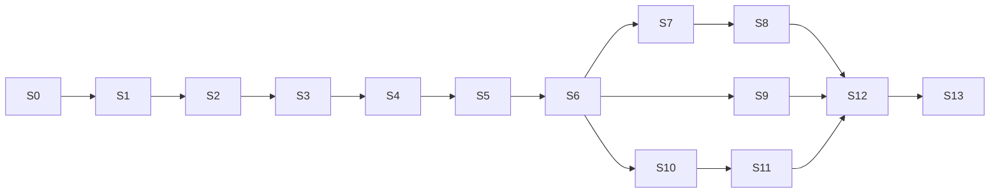

> Consolidación 2026-10-31: doc 14 incorporado. Propuestas P-xx y gates en
> [informe de consolidación](CONSOLIDATION_REPORT.md); esta edición no autoriza implementación.

> **Actualización de seguridad:** consultar `14_CORRECCIONES_CRITICAS.md` antes de implementar. Si existe contradicción, prevalecen esas correcciones.

# 10 — Roadmap de implementación

## 1. Supuestos de estimación
- 1 desarrollador full‑time (o equivalente) usando Codex para generar código; **el esfuerzo incluye revisar, testear e integrar** lo generado (aprox. 35–45 % del tiempo).
- Sprints de **1 semana** (S0–S1 y S13 pueden ser más cortos). Unidad de esfuerzo: días‑persona (dp).
- Complejidad: B (baja), M (media), A (alta). Riesgo: B/M/A.
- Total MVP estimado: **14–17 semanas calendario** (≈ 60–75 dp). Con dedicación parcial multiplicar proporcionalmente.
- Los sprints son **secuenciales salvo indicación**; cada uno termina con *demo verificable* y *PR mergeado con CI verde*.

## 1.1 Estado y puerta previa

S0 implementado; infraestructura local preparada. Este roadmap describe trabajo
futuro, no certifica CI remoto, despliegues o tablas existentes. La consolidación es
sólo Markdown. P-01/P-07 y la dependencia mínima de membresías fueron aprobadas explícitamente
en ADR-022; ver SPRINT_1_REPORT.md para la entrega local. Las pruebas de doc 14 son gates
para implementar, no se declaran ejecutadas por editar documentación.

## 2. Definición de terminado (global)
1. Código en `main` vía PR revisado; CI verde (lint, tipos, unit, integración, pgTAP).
2. Migraciones aplicadas en *staging* sin errores; reversibles o con plan de rollback.
3. Tests nuevos para reglas de negocio y autorización del sprint.
4. Sin secretos ni PII en logs; RLS probada para tablas nuevas.
5. Documentación afectada actualizada (`docs/`), ADR si hubo decisión nueva.
6. Criterios de aceptación del sprint demostrados.

## 3. Resumen

| Sprint | Tema | Esfuerzo | Complejidad | Riesgo |
|---|---|---|---|---|
| S0 | Configuración del proyecto | 3–4 dp | B | B |
| S1 | Multi‑tenancy base | 4–5 dp | M | M |
| S2 | Autenticación y roles | 5 dp | M | M |
| S3 | Modelo de datos completo + RLS | 5 dp | A | M |
| S4 | Profesionales y servicios | 5 dp | M | B |
| S5 | Horarios y disponibilidad (cálculo) | 6 dp | A | A |
| S6 | Motor de reservas (BD) | 7 dp | A | A |
| S7 | Portal público | 6 dp | M | M |
| S8 | Panel administrativo + barbero | 8–9 dp | A | M |
| S9 | Notificaciones | 5 dp | M | M |
| S10 | API de integración | 5 dp | M | M |
| S11 | Integración con Google Apps Script | 6–7 dp | A | A |
| S12 | Pruebas de seguridad y concurrencia | 4–5 dp | M | M |
| S13 | Despliegue productivo y piloto | 3–4 dp | M | M |

> Reordenamiento menor respecto del orden de prioridad solicitado: el **modelo de datos** (S3) se ejecuta antes de profesionales/servicios para fijar el esquema y las políticas RLS de una sola vez; el resto respeta el orden pedido.

## 4. Detalle por sprint

### S0 — Configuración del proyecto
- **Objetivo**: base reproducible y automatizada.
- **Alcance**: repo, Next.js + TS estricto + Tailwind + shadcn, ESLint/Prettier, Vitest, Playwright (smoke), Supabase CLI local (Docker), GitHub Actions, Vercel (preview), Sentry, variables de entorno tipadas (Zod), logger con `request_id`, convenciones (`AGENTS.md`).
- **Dependencias**: cuentas Vercel/Supabase/GitHub.
- **Tareas**: scaffolding; estructura `modules/`; regla ESLint de import restringido; pipeline CI; `GET /api/health`.
- **Tablas/Endpoints**: ninguna / `GET /api/health`.
- **Pruebas**: smoke e2e, unit de utilidades.
- **Aceptación local entregada**: comandos npm y landing sin Supabase. Infraestructura CLI preparada posteriormente. Preview, Sentry, logger y health del alcance original no se consideran entregados; quedan como tareas operativas autorizables antes de piloto, no se agregan retroactivamente a S0.

### S1 — Arquitectura multi‑tenant
- **Objetivo**: contexto de tenant y esquema base.
- **Alcance**: businesses/settings; contexto y resolución por slug y selector de ruta validado donde exista identidad. El punto de extensión por token queda documentado; la integración real espera S10. Helpers mínimos y grants aprobados P-01, FKs, RLS y fixtures de dos negocios; alta del negocio mediante operación de plataforma revisada, sin self-service.
- **Dependencias**: S0 e infraestructura local. **P-01 aprobada (ADR-022)**: adelantar sólo la base de identidad/membresía y fixtures SQL sintéticos necesarios; mantener invitaciones, MFA, UI y gestión de roles en S2. La alternativa de posponer membresías a S2 no fue elegida. La aprobación no incluye login, invitaciones, MFA, UI o gestión de roles.
- **Tareas**: migraciones, `TenantContext`, middleware de resolución, tests pgTAP de patrón RLS.
- **Endpoints**: `GET /public/{slug}`.
- **Pruebas**: aislamiento básico entre 2 negocios seed; slug inválido/reservado.
- **Aceptación**: conforme a alternativa P-01 aprobada, aislamiento comprobado con actores de prueba y roles sin bypass; acceso público devuelve sólo campos permitidos, sin SELECT anon. GET público limitado a datos base disponibles en S1, sin prometer catálogo/agenda de otros sprints. No cerrar S1 sin evidenciar la aceptación acordada.

### S2 — Autenticación y roles
- **Estado local**: autorizado posteriormente por el usuario; entrega, pruebas y límites en SPRINT_2_REPORT.md. No implica despliegue, PR ni comienzo de S3.
- **Objetivo**: login seguro y RBAC por negocio.
- **Alcance**: Supabase Auth (SSR), `users`, `business_members`, `platform_admins`, operación autorizada de membresía (doc 04 §4), invitaciones, MFA TOTP para owner/admin, `can()`, selector de negocio, layout autenticado.
- **Tablas**: users/business_members si no se adelantó su base en P-01, platform_admins y audit_logs base. Reutilizar lo aprobado/aplicado en S1; no recrear ni editar migraciones aplicadas.
- **Endpoints**: `GET/POST /members…`, `/me`.
- **Pruebas**: matriz de permisos (unit), escalamiento de privilegios (X‑05, X‑06), pgTAP de RLS de membresía.
- **Aceptación**: owner invita admin y barbero; barbero no puede cambiar roles; usuario en 2 negocios cambia de contexto; último owner no se puede quitar.

### S3 — Modelo de datos completo
- **Objetivo**: esquema final del MVP con integridad.
- **Alcance**: todas las tablas del doc 04 (`staff_members`, `services`, `staff_services`, `working_hours`, `schedule_exceptions`, `time_blocks`, `customers`, `appointments` con `EXCLUDE`, `appointment_events`, `notifications`, `integration_credentials`, `external_id_mappings`, `idempotency_keys`), triggers (`touch_updated_at`, append‑only, overlap de horarios), privilegios, RLS, tipos TS generados.
- **Pruebas**: pgTAP de constraints, igualdad temporal y snapshots, FKs, EXCLUDE y ocupación histórica P-02 aprobada, grants y catálogo de definer (X-01…X-19), append-only. No implementar el predicado histórico propuesto hasta aprobación de producto.
- **Aceptación**: suite pgTAP verde; `supabase db reset` reproduce el esquema; intento de cruzar tenants falla por FK.

### S4 — Profesionales y servicios
- **Objetivo**: catálogo operativo.
- **Alcance**: CRUD profesionales y servicios, `staff_services`, baja lógica, desactivación con reporte de reservas futuras, UI admin básica (listas y formularios), validación Zod.
- **Endpoints**: doc 05 §2.2 (sin horarios) y §2.3.
- **Pruebas**: unit + integración API; autorización por rol; unicidad de nombre por negocio.
- **Aceptación**: admin gestiona profesionales/servicios; barbero sólo lectura; servicio sin profesionales no aparece en público.

### S5 — Horarios y disponibilidad
- **Objetivo**: calcular slots correctamente (cálculo informativo).
- **Alcance**: `working_hours` (vigencias, múltiples intervalos), `schedule_exceptions`, `time_blocks`, UI del editor de horarios, módulo puro `scheduling` (`computeSlots`), `GET availability` (público y privado), caché corto.
- **Dependencias**: S3, S4 y aprobación P-03 del protocolo común de locks y P-06 de versiones de recursos globales, antes de escribir horarios/bloqueos.
- **Pruebas**: unit exhaustivos + property‑based (fast‑check) + casos DST con zona de prueba (p. ej. `America/New_York`), escenarios B‑02…B‑23 (parte de cálculo).
- **Aceptación**: slots correctos con descansos, feriados, vacaciones, vigencias y buffers; p95 < 600 ms con datos de 1 negocio (10 profesionales, 60 días).

### S6 — Motor de reservas
- **Objetivo**: garantía transaccional.
- **Alcance**: `app.create_appointment`, `reschedule`, `transition`, `cancel`; asignación "cualquier profesional"; snapshots; eventos; outbox (encolado); idempotencia; contadores de cliente; normalización de teléfono y match de clientes; endpoints de reservas y clientes.
- **Pruebas**: concurrencia real de reservas/reprogramación cruzada, horarios/excepciones/bloqueos globales, expiración/worker, todos los estados incluidos históricos, fallos de candidato, 428/412/409, idempotencia y rollback de outbox/auditoría. Cerrar P-02/P-03/P-06 antes de implementar.
- **Aceptación**: 0 dobles reservas en la prueba de estrés; reprogramación atómica; estados inválidos rechazados con `409`.

### S7 — Portal público
- **Objetivo**: reserva end‑to‑end sin cuenta.
- **Alcance**: flujo de 5 pasos, Turnstile, rate limits, página de gestión por token, `.ics`, SEO/OG, PWA manifest.
- **Pruebas**: e2e Playwright (móvil), abuso (rate limit), accesibilidad (axe), `SLOT_TAKEN` UX.
- **Aceptación**: reservar, cancelar y reprogramar desde el celular; Lighthouse móvil ≥ 90 (rendimiento/accesibilidad); sin fuga de datos del cliente existente.

### S8 — Panel administrativo y de barbero
- **Alcance**: dashboard, agenda día/semana, detalle, nueva reserva, bloqueos, clientes (búsqueda, ficha, fusión), estadísticas básicas, vista Barbero, PWA instalable.
- **Pruebas**: e2e por rol; permisos de UI y de API; fusión de clientes; rendimiento de agenda.
- **Aceptación**: admin opera un día completo sin tocar BD; barbero ve sólo lo propio; acciones auditadas.

### S9 — Notificaciones
- **Alcance**: worker (`dispatch`, `expire_pending`), provider de email, plantillas, recordatorios, reintentos/backoff, dedupe, panel de estado (cola/dead), `pg_cron`/`pg_net` o Vercel Cron.
- **Pruebas**: idempotencia (doble ejecución del worker), reintentos, cancelación de recordatorios al reprogramar, proveedor simulado con fallos.
- **Aceptación**: emails de confirmación/cancelación/reprogramación/recordatorio correctos; ningún duplicado con 2 workers concurrentes; `dead` genera alerta.

### S10 — API de integración
- **Alcance MVP**: credenciales, scopes de sólo lectura compartida, revocación sin caché, me, listados/barridos paginados y reconciliación; mapeos/vínculos con identidad real, auditoría, límites y OpenAPI. Cerrar P-04/P-05. changes queda reservado: sólo habilitable si existe diseño de publicador y pruebas de completitud; no es requisito para entregar el fallback MVP seguro.
- **Pruebas**: scopes/tenant, denegación de toda escritura Modo B, revocación, barridos interrumpidos, tombstones, cambios históricos y versiones. Si se propone feed, pruebas de doc 11 §12 antes de habilitarlo.
- **Aceptación**: token revocado falla en la siguiente solicitud; reconciliación converge tras barrido completo/reintentos sin duplicados ni borrados por lotes incompletos. No afirmar garantía incremental con un filtro updated_since o secuencia.

### S11 — Integración con Google Apps Script
- **Alcance**: librería `TurnosClient` y `TurnosSync` (GAS), vistas de agenda en la app actual (sólo en este sprint), acciones desde TurnosMerivo autenticado en Modo B o Modo A validado P-08, flujo precargado de Registro de Servicios, columnas `ID`/`ID Turno`, `Turnos_RO`, reconciliación nocturna, import inicial de clientes con *dry run*, vinculación manual de barberos/servicios.
- **Dependencias**: S10; resolver preguntas S3/S4 del doc 01.
- **Pruebas**: contra *staging* con hoja de pruebas; doble clic/duplicados; fallo parcial; cursor perdido; caída de API.
- **Aceptación**: flujo reserva → completar autenticado → registro → vínculo autenticado/conciliado, sin duplicados; Modo B no escribe en TurnosMerivo; dashboards usan Turnos_RO y muestran último éxito. GAS conserva sus módulos con API caída. No prometer transacción distribuida ni habilitar Modo A sólo por UserProperties.

### S12 — Seguridad y concurrencia
- **Alcance**: suite de aislamiento (X-01…X-19), carga (k6) de reservas simultáneas y disponibilidad, revisión OWASP ASVS (checklist), escaneo de dependencias/secretos, prueba de restauración de backup, ajuste de límites.
- **Aceptación**: checklist de doc 08 §10 completo salvo revisión legal; 0 hallazgos críticos/altos abiertos.

### S13 — Despliegue productivo y piloto
- **Alcance**: entornos prod/staging, dominios, DNS de email (SPF/DKIM/DMARC), monitoreo y alertas, runbooks, datos reales de la barbería (staff, servicios, horarios), capacitación, piloto controlado (2 semanas), plan de rollback.
- **Aceptación**: reservas reales durante el piloto sin incidentes severos; métricas del doc 01 §8 medidas.

## 5. Dependencias entre sprints

S7, S9 y S10 pueden solaparse parcialmente tras S6 si hay más de una persona.

## 6. Riesgos y mitigaciones del plan
| Riesgo | Mitigación |
|---|---|
| Subestimar el motor (S5/S6) | Presupuesto con holgura; tests de propiedades desde el inicio; no empezar UI de reservas antes de S6 estable |
| Codex genera lógica de negocio incorrecta | Funciones SQL y `scheduling` revisadas línea a línea; tests escritos **antes** de la implementación (TDD) en estas áreas |
| Incertidumbre de integración GAS (S4 del doc 01) | Spike de 1 día en S2 para confirmar modo de despliegue y cuotas |
| Alcance creciente | `CODEX_IMPLEMENTATION_GUIDE.md`: lista explícita de "fuera de alcance" |
| Dependencia de planes pagos (Cron, PITR) | Decidir plan antes de S9/S13 |
| Cumplimiento legal tardío | Iniciar revisión legal en S7 (en paralelo) |

## 7. Qué NO entra en el MVP (control de alcance)
Pagos, WhatsApp, Google Calendar, multi‑sucursal, multi‑servicio por turno, onboarding self‑service, planes/suscripciones, dominios propios, lista de espera, reportes avanzados, notificaciones push, modo offline.
