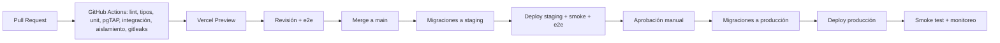

> Consolidación 2026-10-31: doc 14 incorporado. Propuestas P-xx y gates en
> [informe de consolidación](CONSOLIDATION_REPORT.md); esta edición no autoriza implementación.

# 12 — Despliegue y operaciones

## 1. Entornos

| Entorno | Propósito | App | Base de datos | Datos |
|---|---|---|---|---|
| **local** | Desarrollo | `next dev` | Supabase CLI (Docker) | Seeds sintéticos |
| **preview** | Una URL por PR | Vercel Preview | Proyecto Supabase *staging* (esquema por migraciones) o rama de BD | Sintéticos |
| **staging** | Validación previa a release, pruebas GAS | Vercel (rama `staging`) | Proyecto Supabase *staging* | Sintéticos/anonimizados |
| **production** | Operación real | Vercel (rama `main`) | Proyecto Supabase *production* | Reales |

Reglas: proyectos de Supabase **separados** por entorno (staging/prod); claves y secretos distintos; ningún entorno no‑productivo accede a datos reales.
Regiones: Supabase **São Paulo (sa‑east‑1)** y funciones de Vercel en `gru1` para minimizar latencia desde Buenos Aires (verificar disponibilidad vigente; ver observaciones legales sobre transferencia internacional en doc 08 §9).

## 2. Flujo de CI/CD



**Orden crítico**: aplicar migraciones **antes** del deploy de código; las migraciones deben ser **compatibles hacia atrás** (patrón *expand → migrate → contract*): el código anterior debe seguir funcionando con el esquema nuevo. Nunca eliminar columnas en el mismo release que deja de usarlas.
- Migraciones: `supabase/migrations/*.sql`, aplicadas con `supabase db push` desde CI con credenciales de CI (no personales). Prohibido editar migraciones ya aplicadas; se crea una nueva.
- Recuperación: preferir roll-forward con migración correctiva; no ejecutar down destructivo automáticamente. Antes de cambios riesgosos tomar backup/marker PITR y verificar restauración. Rollback de código sólo si el esquema sigue compatible; fallos de datos requieren restauración probada o corrección auditada, nunca borrar tenants/membresías para deshacer una entrega.
- Primero aplicar/reconstruir en Supabase local con fixtures sintéticos y pruebas de privilegios/RLS; luego staging. Documentar destino, precondiciones, impacto y plan de recuperación de cada migración. Nada de este flujo se ejecuta durante la consolidación documental.
- Feature flags simples (`business_settings` o variables de entorno) para activar funcionalidades gradualmente.

## 3. Variables de entorno

| Variable | Alcance | Descripción |
|---|---|---|
| `NEXT_PUBLIC_SUPABASE_URL` | cliente+servidor | URL del proyecto |
| `NEXT_PUBLIC_SUPABASE_PUBLISHABLE_KEY` | cliente+servidor | Clave pública actual del contrato S0; no concede permisos de negocio por sí sola |
| `SUPABASE_SERVICE_ROLE_KEY` | **sólo backend privilegiado** | Auth Admin/Storage cuando corresponda, nunca cliente/GAS/HTML ni credencial rutinaria de datos |
| `DATABASE_URL_APP_SERVER` (propuesta P-01) | servidor | Rol técnico restringido para operaciones internas, sin acceso directo a tablas; aprobar grants/propietario antes de configurar |
| `APP_BASE_URL` | ambos | URL pública (enlaces en emails) |
| `INTERNAL_JOBS_SECRET` | servidor | Autentica llamadas del cron a `/api/internal/jobs/*` |
| `TURNSTILE_SITE_KEY` / `TURNSTILE_SECRET_KEY` | cliente / servidor | Anti‑bot |
| `UPSTASH_REDIS_REST_URL` / `_TOKEN` | servidor | Rate limiting |
| `EMAIL_PROVIDER_API_KEY`, `EMAIL_FROM` | servidor | Email transaccional |
| `SENTRY_DSN`, `SENTRY_AUTH_TOKEN` | servidor / CI | Errores y source maps |
| `INTEGRATION_TOKEN_PEPPER` (opcional) | servidor | Pepper adicional para hash de tokens |
| `FEATURE_*` | servidor | Flags |

Validación con Zod por capacidad habilitada. S0 y preparación actual arrancan sin Supabase: las dos variables públicas pueden estar vacías; una configuración parcial/inválida falla. No hacer obligatorios secretos de sprints futuros. `.env.example` sin valores reales. Cookie/sesión sólo al implementar S2; no activar Auth en esta tarea.

## 4. Jobs y programación
- `pg_cron` + `pg_net` → `POST /api/internal/jobs/notifications-dispatch` (1 min), `…/expire-pending` (1 min), `…/cleanup` (diario) con `Authorization: Bearer $INTERNAL_JOBS_SECRET`.
- Alternativa: Vercel Cron (verificar frecuencia mínima y límites por plan).
- Cada job registra inicio/fin/cantidad en `job_runs` (tabla simple) y emite alerta si pasan > 5 min sin ejecución.
- Timeouts: handlers de job procesan lotes pequeños (≤ 50) para respetar el límite de duración de funciones serverless.

## 5. Monitoreo y alertas

| Señal | Herramienta | Umbral / alerta |
|---|---|---|
| Errores 5xx / excepciones | Sentry | > 1 % de requests en 5 min |
| Latencia API | Vercel Analytics / logs | p95 > 1 s sostenido |
| Disponibilidad | Monitor externo (UptimeRobot/BetterStack) sobre `/api/health` y portal público | Caída > 2 min |
| Notificaciones `dead` / cola atrasada | Consulta SQL + job de alerta | `dead > 0` o pendientes con `next_attempt_at` < now()‑10 min |
| Jobs detenidos | `job_runs` | Sin ejecución > 5 min |
| BD: conexiones, CPU, disco, consultas lentas | Panel Supabase + `pg_stat_statements` | CPU > 80 %, disco > 80 %, query > 500 ms recurrente |
| Violaciones `23P01` anómalas / 429 masivos | Logs | Picos 5× sobre línea base (posible abuso) |
| Seguridad | Alertas de uso inusual de tokens de integración, logins fallidos | Notificación al owner |

Dashboards mínimos: salud de API, reservas/hora por estado, cola de notificaciones, errores por ruta.

## 6. Backups y recuperación
- **Backups**: diarios automáticos (Supabase) + PITR (verificar plan). Export lógico semanal cifrado fuera del proveedor.
- **Objetivos**: RPO ≤ 15 min (con PITR), RTO ≤ 4 h.
- **Runbook de restauración**: (1) declarar incidente; (2) congelar escrituras (modo mantenimiento: `public_booking_enabled=false` global); (3) restaurar a un proyecto nuevo al instante elegido; (4) validar conteos, constraints, RLS; (5) apuntar la app (variables) o volcar datos; (6) reconciliar notificaciones enviadas vs. pendientes para evitar duplicados; (7) informar a GAS (cursor puede quedar "adelantado": forzar resync); (8) postmortem.
- **Simulacro trimestral** con registro de tiempos.

## 7. Runbooks operativos (a redactar en Sprint 13)
1. *Doble reserva detectada* (no debería ocurrir): consultar `appointment_events`, revisar constraint y último deploy.
2. *Cola de notificaciones atascada*: ver `job_runs`, reiniciar job, reprocesar `failed`.
3. *Token de integración comprometido*: revocar → rotar → revisar `audit_logs` desde `last_used_at` previo.
4. *Fuga entre tenants sospechada*: congelar acceso, revisar logs, ejecutar suite de aislamiento, notificación legal.
5. *Caída de Supabase/Vercel*: página de estado, comunicación al cliente, plan manual (agenda en papel/exportación diaria).
6. *Rotación de secretos de plataforma*.
7. *Alta de nuevo negocio (hasta tener onboarding)*: script `create_business()` + checklist.

## 8. Seguridad operativa
Acceso a producción por SSO/MFA; mínimo privilegio en Vercel/Supabase/GitHub; protección de rama `main` (PR + CI + 1 revisión); secretos sólo en gestores de variables; logs con retención 30–90 días y sin PII; DNS del email (SPF, DKIM, DMARC) validado; dominio con renovación automática.

## 9. Costos mensuales de referencia (verificar precios vigentes)
Vercel Pro ≈ US$20 por asiento; Supabase Pro ≈ US$25 + PITR (complemento variable); email transaccional (gratis–US$20); Upstash (gratis–US$10); Sentry (gratis–US$26); monitor externo (gratis); dominio (~US$15/año). **Total ≈ US$60–110/mes** para una barbería; el costo marginal por tenant adicional es bajo hasta que la BD requiera escalar.

## 10. Escalado progresivo
1. Ajustar plan/tamaño de Supabase y pooler. 2. Índices/consultas según `pg_stat_statements`. 3. Caché de disponibilidad (15 s → Redis si hace falta). 4. Réplica de lectura para reportes. 5. Particionado de `appointments`/`audit_logs`. 6. Extraer *workers* a un servicio aparte sólo si el volumen lo justifica.

## 11. Checklist de salida a producción
- [ ] Migraciones y seeds aplicados; `create_business()` ejecutado para la barbería.
- [ ] Variables completas y verificadas; claves de staging **no** presentes.
- [ ] Dominio, HTTPS, DNS de email validados; remitente probado en Gmail/Outlook.
- [ ] Monitores y alertas activos con destinatarios reales.
- [ ] Backups/PITR habilitados y simulacro realizado.
- [ ] Suite de seguridad/concurrencia verde en staging con la misma versión.
- [ ] Textos legales publicados (privacidad, términos).
- [ ] Plan de rollback y contacto de guardia definidos.

## 12. Desarrollo local existente y migraciones futuras

Node 24, npm y Docker con motor Linux. CLI fijada en package-lock, sin login/link
remoto necesario. No repetir init --force sobre config existente.

```sh
npm ci
npm run db:start
npm run db:status
npm run dev
# Parada normal conserva datos locales:
npm run db:stop
```

Config actual: PostgreSQL major 17 (se comprobó 17.11 en la sesión anterior),
API 54321, PostgreSQL 54322, shadow 54320 y Studio 54323. Auth/registro, seeds,
Storage, Realtime y demás servicios no usados están deshabilitados. Public es el
único esquema expuesto y auto_expose_new_tables=false; no sustituye RLS ni grants.
Estos hechos describen la preparación previa, no una nueva ejecución en esta tarea.

La landing no necesita .env.local ni conexión. Para futuras conexiones copiar
.env.example sólo si no existe .env.local, y completar ambas variables públicas
con valores de desarrollo. No volcar status -o env a Git: contiene credenciales.
No configurar app_server/service_role antes del sprint y revisión correspondientes.

Después de aprobar el modelo (estos comandos **no se ejecutan ahora**):

```sh
npm run supabase -- migration new init_tenancy
# Escribir SQL y tests revisados; luego aplicar sólo local:
npm run db:migrate
npm run supabase -- migration list --local
npm run supabase -- test db
# Sólo en base local descartable; elimina datos:
npm run db:reset
```

Los scripts migrate/reset usan --local. Nunca cambiar a --linked/--db-url ni hacer
push remoto implícitamente. db:reset --no-seed no es rollback de producción. Crear
fixtures/seed revisados sólo con autorización del esquema; no editar migraciones
aplicadas. La carpeta migrations actual se conserva vacía durante esta consolidación.

## Acceso local del Sprint 2

Auth y Mailpit local están habilitados. Seguir SPRINT_2_REPORT.md para configuración,
bootstrap inicial, activación por código, MFA y pruebas. SUPABASE_AUTH_ADMIN_KEY es
privada, sólo para Auth Admin; auth:configure-local la obtiene sin imprimir claves y
escribe exclusivamente .env.local ignorado. Mantener DATABASE_URL_APP_SERVER
restringida; no reemplazarla por una conexión privilegiada. Una modificación de
config.toml exige stop/start conservando volúmenes; no implica db:reset. CLI start/status
pueden imprimir credenciales: no guardar su salida completa en logs ni Git.
Mailpit http://127.0.0.1:54324 captura los mensajes sin enviarlos a Internet. Antes de
producción configurar SMTP, site_url, HTTPS, controles operativos y recuperación MFA.
