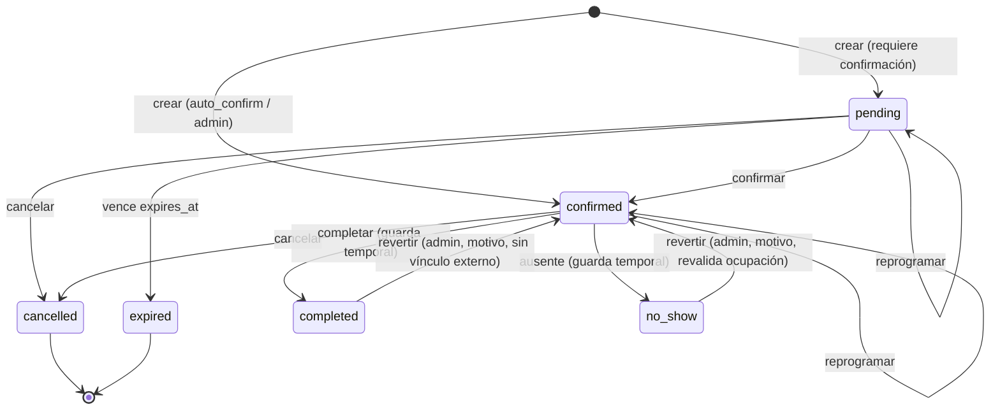

# 02 — Requisitos funcionales y reglas de negocio

Convención: `RF-xx` requisito funcional, `RN-xx` regla de negocio. Prioridad: **M** = MVP, **D** = diferido.

## 1. Reglas de negocio transversales

| ID    | Regla                                                                                                                                                                                                                                                                                                           |
| ----- | --------------------------------------------------------------------------------------------------------------------------------------------------------------------------------------------------------------------------------------------------------------------------------------------------------------- |
| RN-01 | Todo dato de negocio pertenece a exactamente un `business_id`. Ninguna operación cruza tenants.                                                                                                                                                                                                                 |
| RN-02 | Todos los instantes se guardan en UTC (`timestamptz`). Los horarios laborales se guardan como hora local + zona del negocio y se resuelven a UTC al generar disponibilidad.                                                                                                                                     |
| RN-03 | Un profesional no puede tener dos reservas activas (`pending`, `confirmed`, `completed`) cuyos rangos ocupados se superpongan. Rango ocupado = `[starts_at, starts_at + duración + buffer)`.                                                                                                                    |
| RN-04 | El final del **servicio** debe caer dentro de un intervalo laboral; el **buffer** posterior puede exceder el cierre pero no puede chocar con otra reserva o bloqueo.                                                                                                                                            |
| RN-05 | Un servicio no puede cruzar un descanso (los descansos son huecos entre intervalos laborales).                                                                                                                                                                                                                  |
| RN-06 | Precio, duración, buffer y nombre del servicio se **copian** a la reserva al crearla (snapshot) y no cambian si el catálogo cambia.                                                                                                                                                                             |
| RN-07 | Baja lógica (`deleted_at`) para profesionales, servicios y clientes. Nunca se borran filas referenciadas por reservas.                                                                                                                                                                                          |
| RN-08 | Los cambios de estado se registran en `appointment_events` (append‑only) y las acciones sensibles en `audit_logs`.                                                                                                                                                                                              |
| RN-09 | Cambiar horarios laborales **no cancela** reservas existentes; el sistema informa conflictos y el admin decide.                                                                                                                                                                                                 |
| RN-10 | Anticipación mínima y ventana máxima aplican a clientes públicos; admin/barbero pueden saltearlas explícitamente (`override_policies=true`), quedando auditado.                                                                                                                                                 |
| RN-11 | Reservar es posible sin cuenta. El cliente gestiona su reserva mediante un **token de gestión** de un solo uso por reserva (alta entropía, guardado hasheado).                                                                                                                                                  |
| RN-12 | Las operaciones de creación y cambio de estado son **idempotentes** mediante `Idempotency-Key`.                                                                                                                                                                                                                 |
| RN-13 | **Concurrencia optimista**: todo recurso mutable tiene `version`; las modificaciones de staff/integración exigen `If-Match` y ante desajuste responden `412 VERSION_CONFLICT` sin efectos (doc 05 §1.8). Las acciones del cliente por token no exigen `If-Match`; la máquina de estados impide el doble efecto. |
| RN-14 | **Integridad temporal**: `ends_at = starts_at + duración` y `blocked_until = ends_at + buffer`, derivados por la base de datos a partir de `starts_at` y de los snapshots de duración/buffer, y verificados por `CHECK`. Los snapshots son inmutables salvo ajuste explícito y auditado (doc 04 §3.13).         |
| RN-15 | **Identidad en escrituras**: toda escritura se atribuye a una identidad **verificada** (sesión, `user_token`, token de gestión del cliente o sistema). Una credencial de negocio (`service_key`) es de **sólo lectura**. Ninguna identidad declarada por el cliente tiene valor de autorización (doc 08 §3.1).  |
| RN-16 | **Resultado de la atención**: `completed` y `no_show` son excluyentes; sólo `admin/owner` los revierte, con motivo; un `completed` con registro de servicio vinculado no se revierte hasta desvincular.                                                                                                         |
| RN-17 | **Vínculos externos**: un ID externo identifica una sola entidad interna del mismo negocio; reserva ↔ registro de servicio es 1:1 (doc 04 §3.18).                                                                                                                                                               |

## 2. Políticas configurables por negocio (`business_settings`)

| Parámetro                          | Default    | Descripción                                                      |
| ---------------------------------- | ---------- | ---------------------------------------------------------------- |
| `slot_interval_minutes`            | 15         | Grilla de inicio de turnos (5, 10, 15, 20, 30, 60).              |
| `min_notice_minutes`               | 60         | Anticipación mínima para reservar online.                        |
| `max_advance_days`                 | 30         | Ventana máxima de reserva.                                       |
| `cancellation_cutoff_hours`        | 2          | Límite para que el cliente cancele sin intervención.             |
| `reschedule_cutoff_hours`          | 2          | Límite para reprogramar.                                         |
| `max_client_reschedules`           | 2          | Reprogramaciones permitidas al cliente.                          |
| `auto_confirm`                     | true       | Si false, reservas públicas entran `pending` hasta confirmación. |
| `pending_hold_minutes`             | 10         | TTL de `pending` cuando exige confirmación/pago (D).             |
| `allow_any_staff`                  | true       | Permite "cualquier profesional".                                 |
| `require_email`                    | false      | Email obligatorio. Teléfono siempre obligatorio.                 |
| `reminder_offsets_minutes`         | {1440,120} | Recordatorios previos.                                           |
| `max_active_bookings_per_customer` | 3          | Anti‑abuso.                                                      |
| `completion_early_minutes`         | 30         | Cuánto antes del inicio puede marcarse _completado_.             |
| `no_show_grace_minutes`            | 10         | Espera mínima tras el inicio para marcar _ausente_.              |
| `revert_window_days`               | 30         | Ventana en que un admin puede revertir; luego sólo `owner`.      |

## 3. Máquina de estados de reservas

Estados: `pending`, `confirmed`, `cancelled`, `completed`, `no_show`, `expired`.
"Reprogramado" **no es un estado**: es un evento (`rescheduled`) sobre la misma reserva (ADR-006).

| Desde               | Hacia                  | Actor permitido                                                               | Condiciones                                                                                                                                                                 |
| ------------------- | ---------------------- | ----------------------------------------------------------------------------- | --------------------------------------------------------------------------------------------------------------------------------------------------------------------------- |
| (nuevo)             | pending                | público, admin                                                                | `auto_confirm=false` o reserva con pago pendiente                                                                                                                           |
| (nuevo)             | confirmed              | público (auto), admin, barbero, integración `user_token`                      | slot válido                                                                                                                                                                 |
| pending             | confirmed              | admin, barbero propio, integración `user_token`, sistema (pago)               | no expirada                                                                                                                                                                 |
| pending/confirmed   | cancelled              | cliente (dentro de política), admin, barbero propio, integración `user_token` | `starts_at > now()` salvo admin                                                                                                                                             |
| pending             | expired                | sistema                                                                       | `expires_at <= now()`                                                                                                                                                       |
| confirmed           | completed              | admin, barbero propio, integración `user_token`                               | `now() ≥ starts_at − completion_early_minutes` (30 por defecto); `completed_at` ≤ `now()`; **nunca futuro, sin excepción**                                                  |
| confirmed           | no_show                | admin, barbero propio, integración `user_token`                               | `now() ≥ starts_at + no_show_grace_minutes` (10 por defecto)                                                                                                                |
| completed           | confirmed (**revert**) | **admin/owner**                                                               | motivo obligatorio; dentro de `revert_window_days` (después, sólo `owner`); **bloqueado** si hay registro de servicio vinculado (`LINKED_SERVICE_RECORD`) hasta desvincular |
| no_show             | confirmed (**revert**) | **admin/owner**                                                               | motivo obligatorio; misma ventana; revalida ocupación del hueco (puede fallar con `SLOT_TAKEN`/`REVERT_CONFLICT`)                                                           |
| completed ↔ no_show | —                      | —                                                                             | **No hay salto directo**: `revert` y luego la acción correcta (dos eventos auditados)                                                                                       |
| cancelled/expired   | cualquiera             | —                                                                             | **terminales**                                                                                                                                                              |

Invariantes de resultado (los garantiza la base de datos, doc 04 §3.13):

- `completed_at` y `no_show_at` son **mutuamente excluyentes** y sólo existen en su estado; `revert` los deja en `NULL` y conserva los valores previos en `appointment_events`.
- `no_show` **libera** el slot; `completed` lo mantiene ocupado.
- Los contadores del cliente (visitas, ausencias, cancelaciones) se **recalculan** desde las reservas tras cada transición; no se incrementan a mano.
- Ni el barbero ni ninguna credencial de integración pueden ejecutar `revert`.

Al violar una transición: `409 INVALID_STATE_TRANSITION`; al violar una guarda temporal: `422 POLICY_VIOLATION` (`COMPLETION_TOO_EARLY`, `NO_SHOW_TOO_EARLY`, `REVERT_WINDOW`).

## 4. Requisitos funcionales por módulo

### A. Negocios (M)

- RF-A1: Crear/editar negocio: nombre, `slug` único e inmutable salvo cambio explícito (redirecciones D), logo, dirección, teléfono, zona horaria (validada contra IANA), configuración.
- RF-A2: Página pública sólo si `public_booking_enabled` y `status='active'`.
- RF-A3: En el MVP el negocio se crea por seed/script de plataforma, no por self‑service (D).

### B. Profesionales (M)

- RF-B1: Alta, edición, baja lógica, activo/inactivo, color de agenda, orden.
- RF-B2: Un profesional puede vincularse a un `business_member` (para login) o existir sin usuario (sólo agendable).
- RF-B3: Servicios habilitados (`staff_services`) con override opcional de precio y duración.
- RF-B4: Desactivar un profesional **no cancela** reservas futuras: el sistema las lista y exige decisión del admin (reasignar/cancelar).
- RN-B1: Al reasignar una reserva a otro profesional se revalida disponibilidad completa (misma función transaccional).

### C. Servicios (M)

- RF-C1: Nombre, descripción, precio (entero en centavos), duración (5–480 min, múltiplo del paso de grilla recomendado), buffer posterior, categoría (texto en MVP), activo.
- RF-C2: Un servicio sin profesionales habilitados no se muestra públicamente.

### D. Disponibilidad (M)

- RF-D1: Jornada semanal por profesional con **múltiples intervalos por día** (turno cortado/descanso).
- RF-D2: Vigencia (`valid_from`, `valid_until`) para cambios de jornada sin perder historial.
- RF-D3: Excepciones por fecha (cierre total, horario especial, feriado de negocio o individual).
- RF-D4: Bloqueos por rango absoluto (vacaciones, trámite, manual) por profesional o para todo el negocio.
- RF-D5: Consulta de slots por fecha(s), servicio y profesional o "cualquiera".
- Detalle algorítmico en `06`.

### E. Reservas públicas (M)

Flujo: negocio → servicio → profesional/cualquiera → fecha → horario → datos → confirmar → pantalla + email con enlace de gestión.

- RF-E1: Datos obligatorios: nombre, teléfono (validado y normalizado). Email opcional salvo política.
- RF-E2: Aceptación de política de privacidad/consentimiento (checkbox con versión registrada).
- RF-E3: Si el horario fue tomado entre selección y confirmación: error `SLOT_TAKEN` + sugerencia de 3 horarios cercanos.
- RF-E4: **Reserva sin autenticación obligatoria**: decisión recomendada (ADR‑012). Mitigaciones: rate limit, Turnstile, límite de reservas activas por teléfono, token de gestión, confirmación por email.
- RF-E5: Cancelar/reprogramar desde el enlace de gestión según políticas (cutoffs, máximo de reprogramaciones).

### F. Gestión de reservas (M)

- RF-F1: Estados y transiciones de la sección 3.
- RF-F2: Creación manual (admin/barbero) con cliente existente o nuevo, saltando políticas con `override_policies`.
- RF-F3: Cancelación con motivo; quién canceló (`customer|staff|system`).
- RF-F4: Reprogramación mantiene el ID, incrementa `reschedule_count`, registra evento con valores previos.
- RF-F5: **Completar/ausente** sujetos a las guardas temporales del §3; `completed_at` nunca futuro.
- RF-F6: **Revertir** (admin/owner): motivo obligatorio, ventana `revert_window_days`; bloqueado si hay registro de servicio vinculado; revalidación de ocupación al revertir un ausente.
- RF-F7: **Concurrencia**: toda acción de staff envía `If-Match`; ante `412` la UI recarga el turno y muestra el estado vigente antes de permitir reintentar.
- RF-F8: **Panel de vinculaciones** (admin): importar clientes de Sheets (dry run + confirmación), vincular barberos y servicios 1:1, revisar candidatos `needs_review`, desvincular registros de servicio.

### G. Clientes (M)

- RF-G1: Alta automática al reservar (búsqueda por teléfono normalizado dentro del negocio).
- RF-G2: Campos: nombre, teléfono, email, Instagram (opcional), notas internas, opt‑in de marketing (separado del consentimiento transaccional).
- RF-G3: Contadores: visitas completadas, cancelaciones, ausencias, primera y última visita.
- RF-G4: **Identificación y vínculo** (ver sección 5).
- RF-G5: Fusión manual de duplicados (admin), con auditoría y redirección (`merged_into_id`).

### H. Notificaciones (M email / D otros)

- Tipos: `booking_confirmed`, `booking_cancelled`, `booking_rescheduled`, `reminder`, `admin_new_booking`, `admin_cancellation`.
- RF-H1: Se encolan dentro de la misma transacción que el cambio de estado (outbox).
- RF-H2: Reintentos con backoff exponencial (máx. 5), luego `dead` con alerta.
- RF-H3: Idempotencia por `dedupe_key`: el mismo evento no genera dos envíos.
- RF-H4: Recordatorios se cancelan si la reserva se cancela o reprograma (y se re‑encolan).

### I. Panel administrativo (M)

Agenda diaria/semanal con filtro por profesional, alta manual, cancelar/reprogramar (drag & drop D), bloqueos, clientes, estadísticas básicas (reservas por estado, ocupación, ausencias, por profesional, por canal).

### J. Panel del profesional (M)

Agenda del día, próximos turnos, ficha del cliente (nombre, teléfono, historial resumido, notas), marcar asistencia/completar.

## 5. Identificación y vinculación de clientes

1. **Clave natural dentro del negocio**: `phone_e164` normalizado. Unicidad parcial: `UNIQUE (business_id, phone_e164) WHERE phone_e164 IS NOT NULL AND deleted_at IS NULL AND merged_into_id IS NULL`.
2. **Normalización** (Argentina): quitar espacios/guiones; `0` inicial y `15` de celular → formato `+54 9 <área><número>`. Usar `libphonenumber-js` con país por defecto `AR`. Si no parsea → error de validación.
3. **Instagram**: se normaliza (minúsculas, sin `@`, sin URL) y se guarda en `instagram_handle`. **No es único**: un handle puede cambiar o ser compartido; se usa como _pista_ de coincidencia.
4. **Match en reserva pública**: por teléfono. Si coincide, se reutiliza el cliente y se **actualiza el nombre sólo si estaba vacío** (no se sobrescribe; la respuesta pública **no revela** datos del cliente existente).
5. **Import desde Sheets** (una vez, luego incremental): para cada fila: (a) match por teléfono → vincular; (b) si no hay teléfono y hay Instagram → _candidato_ a revisión manual (cola `customer_match_candidates` o estado en mapeo `needs_review`); (c) caso contrario → crear. **Nunca fusionar por nombre.**
6. **Vínculo externo**: `external_id_mappings(entity_type='customer', external_system='gas_sheets', external_id=<clave estable en Sheets>)`. Si la hoja usa Instagram como clave, la clave externa es el Instagram **tal como está hoy** y el mapeo permite que luego cambie.
7. **Fusión**: función `merge_customers(source, target)` mueve reservas y mapeos y deja `merged_into_id`.

## 6. Matriz de permisos (entidad × acción)

**Fuente canónica**: `supabase/permissions.json` → siembra `app.role_permissions` (autoridad, evaluada en la base de datos) y genera el módulo TS `can()` (UI y _fail‑fast_). Un test de CI verifica que esta tabla, el JSON, la BD y el TS coinciden (doc 11 §5).

Leyenda: ✔ permitido · ◐ condicionado · ✖ denegado. "Propio" = reservas/agenda del profesional vinculado al usuario. **Integración**: `service_key` = **sólo lectura** (sin persona); `user_token` = identidad verificada de un miembro, efectivo = `scopes ∩ permisos del rol`.

| Entidad / acción                                 | Superadmin*  | Owner/Admin                  | Barbero                                         | Cliente (token)   | Integración `service_key` (sólo lectura)     | Integración `user_token`                   |
| ------------------------------------------------ | ------------ | ---------------------------- | ----------------------------------------------- | ----------------- | -------------------------------------------- | ------------------------------------------ |
| Negocio: ver público                             | ✔            | ✔                            | ✔                                               | ✔                 | ✔                                            | ✔                                          |
| Negocio: ver privado                             | ✔ (auditado) | ✔                            | ✖                                               | ✖                 | ◐ (sólo `business:read`: datos no sensibles) | ◐ por rol                                  |
| Negocio: editar                                  | ✔ (auditado) | ✔                            | ✖                                               | ✖                 | ✖                                            | ◐ (admin, sin escritura de config. en MVP) |
| Miembros: gestionar                              | ✔            | ✔ (sin asignar rol > propio) | ✖                                               | ✖                 | ✖                                            | ✖                                          |
| Profesionales/servicios: listar                  | ✔            | ✔                            | ✔                                               | ✔ (público)       | ✔                                            | ✔                                          |
| Profesionales/servicios: crear/editar/desactivar | ✔            | ✔                            | ✖                                               | ✖                 | ✖                                            | ✖ (MVP: sólo desde el panel)               |
| Horarios/bloqueos propios                        | ✔            | ✔                            | ◐ (`barber_can_edit_availability`)              | ✖                 | ✖                                            | ✖ (MVP)                                    |
| Horarios/bloqueos de otros                       | ✔            | ✔                            | ✖                                               | ✖                 | ✖                                            | ✖                                          |
| Disponibilidad: consultar                        | ✔            | ✔                            | ✔                                               | ✔                 | ✔                                            | ✔                                          |
| Reserva: crear                                   | ✔            | ✔                            | ◐ (propias o delegadas)                         | ✔ (con políticas) | ✖                                            | ◐ por rol (`appointments:write`)           |
| Reserva: ver                                     | ✔            | ✔ todas                      | ✔ propias                                       | ✔ la suya         | ✔ (lectura, sin notas internas)              | ◐ por rol                                  |
| Reserva: cancelar                                | ✔            | ✔                            | ◐ propias                                       | ◐ (política)      | ✖                                            | ◐ por rol                                  |
| Reserva: reprogramar                             | ✔            | ✔                            | ◐ propias                                       | ◐ (política)      | ✖                                            | ◐ por rol                                  |
| Reserva: confirmar                               | ✔            | ✔                            | ✔ propias                                       | ✖                 | ✖                                            | ◐ por rol (`appointments:status`)          |
| Reserva: completar / ausente                     | ✔            | ✔                            | ✔ propias                                       | ✖                 | ✖                                            | ◐ por rol (`appointments:status`)          |
| Reserva: **revertir** completado/ausente         | ✔            | ✔ (owner fuera de ventana)   | **✖**                                           | ✖                 | **✖**                                        | **✖**                                      |
| Vincular reserva ↔ registro externo              | ✔            | ✔                            | ◐ propias                                       | ✖                 | **✖**                                        | ◐ por rol (`links:write`)                  |
| Desvincular                                      | ✔            | ✔                            | ✖                                               | ✖                 | ✖                                            | ✖                                          |
| Mapeos externos: ver                             | ✔            | ✔                            | ✖                                               | ✖                 | ✔ (`mappings:read`)                          | ◐                                          |
| Mapeos externos: crear/editar                    | ✔            | ✔                            | ✖                                               | ✖                 | **✖**                                        | ◐ (admin, `mappings:write`)                |
| Clientes: ver                                    | ✔            | ✔                            | ◐ (sólo con reservas propias; sin notas ajenas) | ✖ (sus datos)     | ◐ (campos limitados)                         | ◐                                          |
| Clientes: crear/editar                           | ✔            | ✔                            | ◐ (crear al agendar)                            | ✖                 | ✖                                            | ◐ por rol (`customers:write`)              |
| Clientes: fusionar/exportar                      | ✔            | ✔                            | ✖                                               | ✖                 | ✖                                            | ✖                                          |
| Estadísticas                                     | ✔            | ✔                            | ◐ propias                                       | ✖                 | ✔ (agregadas)                                | ◐                                          |
| Feed de cambios / reconciliación                 | ✔            | ✔                            | ✖                                               | ✖                 | ✔ (`changes:read`)                           | ✔                                          |
| Auditoría                                        | ✔            | ✔ (su negocio)               | ✖                                               | ✖                 | ✖                                            | ✖                                          |
| Credenciales de integración                      | ✔            | ✔ (crear/revocar)            | ◐ (su `user_token`)                             | ✖                 | ✖                                            | ✖                                          |

\* El superadmin **no** hereda acceso silencioso: usa «acceso de soporte» explícito, con motivo, límite de tiempo y registro en `audit_logs` (doc 08).

## 7. Requisitos no funcionales

Disponibilidad objetivo 99.5 %; p95 API < 500 ms (excepto disponibilidad < 600 ms); mobile‑first (320 px mínimo); accesibilidad WCAG 2.1 AA en flujo público; i18n preparada (es‑AR por defecto); observabilidad (logs estructurados con `request_id`, `business_id`).
