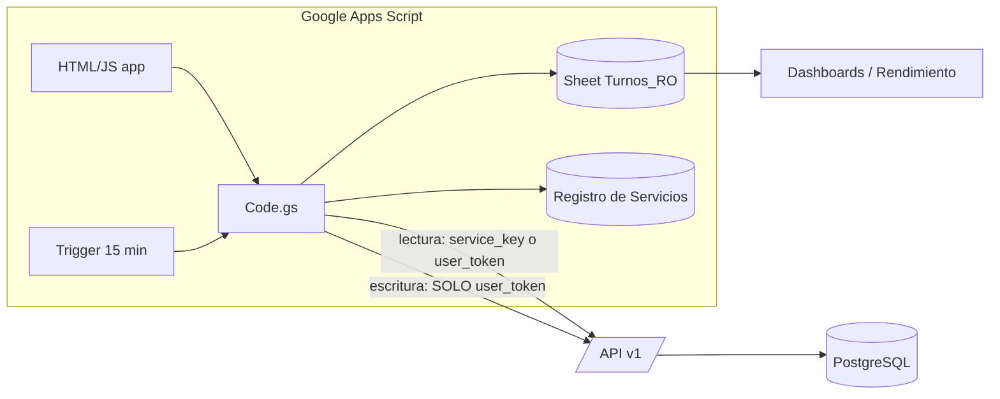
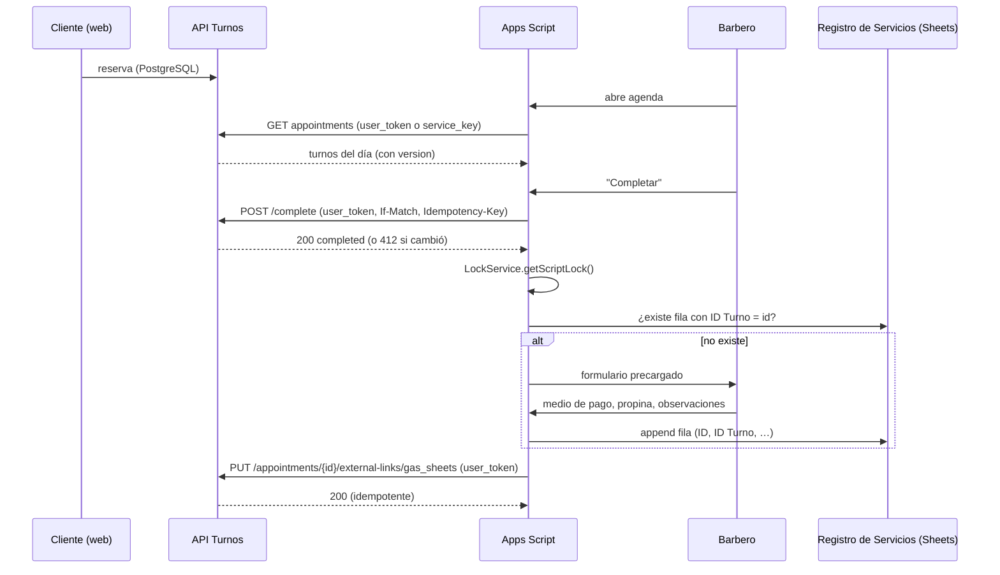

# 07 — Integración con Google Apps Script (GAS)

> v1.1 — **Decisión central**: sin identidad individual verificable, Apps Script es **sólo lectura**. Toda **escritura** (confirmar, completar, ausente, cancelar, reprogramar, crear, vincular, mapear) exige un **`user_token`** atado a un miembro del negocio, con permisos comprobados por la base de datos.

Principio: el sistema de turnos **no depende** de GAS para nada (ni para confirmar reservas ni para notificar). GAS es un **cliente más** de la API v1.

## 1. Opciones de arquitectura

| Criterio                      | A — Bajo demanda                                   | B — Sincronización periódica            | C — Híbrido (**recomendada**)                                  |
| ----------------------------- | -------------------------------------------------- | --------------------------------------- | -------------------------------------------------------------- |
| Latencia de agenda            | Real (≈300–900 ms por llamada desde `UrlFetchApp`) | Hasta el período del trigger (5–15 min) | Real para agenda                                               |
| Datos para reportes en Sheets | Requiere llamadas pesadas por reporte              | Local y rápido                          | Local y rápido                                                 |
| Cuotas de Apps Script         | Consume `UrlFetch` por cada vista                  | Bajo y predecible (lotes)               | Moderado                                                       |
| Riesgo si la API cae          | La agenda falla                                    | Reportes siguen con último dato         | Agenda falla; reportes siguen                                  |
| Riesgo de inconsistencia      | Nulo (una sola fuente)                             | Medio (desfase, duplicados)             | Bajo (agenda siempre viva, feed sin pérdidas + reconciliación) |
| Complejidad / mantenimiento   | Baja                                               | Media                                   | Media                                                          |

**Decisión**: **C**.

- **Agenda, próximos clientes y acciones**: bajo demanda, con `CacheService` de 15–30 s **sólo para lecturas**.
- **Reportes/KPIs**: trigger de tiempo (cada 15 min) que consume `/integrations/changes` y hace **upsert** en una hoja de **sólo lectura** `Turnos_RO`; reconciliación nocturna con `/integrations/reconcile`. Los dashboards existentes leen esa hoja.
- **Regla**: GAS nunca escribe en la base de turnos ni pisa campos de reserva. Cuando tiene permiso, sólo invoca **comandos** de la API (el servidor valida y decide).



## 2. Autenticación e identidad

### 2.1 Principio

Una credencial compartida **no identifica a quién actúa**. Por lo tanto:

1. **Lectura** puede hacerse con una credencial de negocio (`service_key`), con alcance mínimo.
2. **Escritura** exige **identidad verificable y permisos comprobables**: un `user_token` ligado a un `business_member`, evaluado **en la base de datos** en cada llamada (membresía activa + rol + scope).
3. Una identidad **declarada** (nombre de barbero en un parámetro/cabecera) **nunca** habilita escrituras ni se usa para atribuirlas.

### 2.2 Dos tipos de credencial (`integration_credentials`)

| Tipo          | Uso                                              | Dónde se guarda en GAS                                        | Scopes posibles                                                                                                                                            | Identidad                               | Escritura                                                                                                    |
| ------------- | ------------------------------------------------ | ------------------------------------------------------------- | ---------------------------------------------------------------------------------------------------------------------------------------------------------- | --------------------------------------- | ------------------------------------------------------------------------------------------------------------ |
| `service_key` | Triggers de sincronización y lecturas de negocio | `PropertiesService.getScriptProperties()`                     | Sólo lectura (`business:read`, `staff:read`, `services:read`, `availability:read`, `appointments:read`, `customers:read`, `changes:read`, `mappings:read`) | El **negocio** (sin persona)            | **Imposible**: `CHECK` en BD + rechazo en `ctx_integration` + las funciones de escritura exigen `user_token` |
| `user_token`  | Acciones de una persona                          | `PropertiesService.getUserProperties()` (privado por usuario) | Lectura y escritura según `scopes ∩ permisos del rol del miembro`                                                                                          | Un **miembro verificado** (`member_id`) | Sí, dentro de su rol (barbero: sólo sus reservas)                                                            |

Los tokens nunca viajan al navegador: la UI llama a `google.script.run` → `Code.gs` → `UrlFetchApp`. No se imprimen en logs ni se guardan en hojas.

### 2.3 Modos operativos (supuesto S4 a confirmar en el spike de Sprint 2)

**Modo A — identidad individual verificada (escritura habilitada)**
Aplicable si el script se despliega **«ejecutar como el usuario que accede»**, de modo que cada persona tiene su propio `UserProperties`.

1. El barbero/admin entra al panel de turnos → _Conectar Apps Script_ (requiere sesión, `aal2` para admin) → se genera un `user_token` (secreto visible una vez, vence a 90 días, rotable).
2. Lo pega **una vez** en la app GAS (se guarda en `UserProperties`).
3. Las escrituras usan **ese** token; la BD aplica el rol real del miembro. Un usuario no puede obtener el token de otro.

**Modo R — sólo lectura (sin identidad individual verificable)**
Si el script se ejecuta **«como yo»** (propietario) y por tanto todos los usuarios comparten identidad Google, **no se concede ninguna escritura** a GAS durante el MVP:

- Se usa **una** `service_key` de sólo lectura.
- Las acciones (completar, ausente, cancelar, reprogramar, crear, vincular, mapear) **se realizan en el panel de turnos** (PWA móvil del barbero/admin), que sí tiene sesión verificada.
- Apps Script consume el resultado por lectura (agenda, estado `completed`, feed) para precargar el Registro de Servicios.
- No existe «modo intermedio» con actor declarado ni lista blanca de acciones de escritura.

**Resumen de capacidades por modo**

| Capacidad en GAS                                        | Modo A                                                | Modo R              |
| ------------------------------------------------------- | ----------------------------------------------------- | ------------------- |
| Ver agenda por fecha/profesional, próximos clientes     | ✔                                                     | ✔                   |
| KPIs/Turnos_RO por sincronización                       | ✔ (`service_key`)                                     | ✔ (`service_key`)   |
| Confirmar, completar, ausente                           | ✔ (`user_token`)                                      | ✖ → panel de turnos |
| Crear, cancelar, reprogramar                            | ✔ (`user_token`, según rol)                           | ✖ → panel de turnos |
| Vincular reserva ↔ registro de servicio (Postgres)      | ✔                                                     | ✖ (ver §5.2)        |
| Crear/renombrar mapeos de clientes, barberos, servicios | ✖ (se hace en el panel de turnos con sesión de admin) | ✖                   |

> Decisión de alcance: los **mapeos y el import inicial de clientes** se hacen desde una pantalla del panel de turnos («Vinculaciones», sesión de admin), que recibe un archivo exportado por GAS. Así ninguna credencial de integración necesita escribir mapeos.

**Alternativa a evaluar en el spike (no condiciona el MVP)**: `ScriptApp.getIdentityToken()` (OIDC del usuario efectivo, requiere el scope `openid` en el manifiesto) para verificar en el servidor la identidad Google del usuario y emitir/validar `user_token` sin pegado manual. Sólo aporta identidad si el script corre como el usuario que accede.

### 2.4 Ciclo de vida y seguridad de credenciales

- Formato `trn_live_<prefix>_<secreto de 256 bits>`; en BD sólo `token_prefix` + hash SHA‑256.
- Expiración obligatoria (`user_token` 90 días; `service_key` 180 días); `rotate` crea el nuevo y mantiene el anterior 24 h (`rotated_from_id`); `revoke` es **inmediato**: la BD verifica estado, vencimiento, negocio y miembro en **cada** llamada (sin caché en el servidor).
- Scopes mínimos; negocio derivado de la credencial; el `businessId` de la ruta debe coincidir.
- `last_used_at/ip` visibles en el panel; alertas por uso inusual. Sin allowlist de IP (las de Google varían); compensado con scopes, rate limit, rotación y revocación.
- Toda **escritura** genera `audit_logs` con `integration_credential_id` + `actor_user_id` **derivados de la credencial verificada**. Las lecturas quedan en logs de aplicación.
- Si el miembro asociado pierde el rol o se suspende, **todas sus credenciales dejan de funcionar** en la siguiente llamada.

## 3. Fuente de verdad por entidad

| Entidad                                                                                        | Fuente de verdad                                                                                              | Réplica / vínculo                         | Reglas                                                        |
| ---------------------------------------------------------------------------------------------- | ------------------------------------------------------------------------------------------------------------- | ----------------------------------------- | ------------------------------------------------------------- |
| Reservas (turnos)                                                                              | **PostgreSQL**                                                                                                | `Turnos_RO` en Sheets (sólo lectura)      | GAS no sobrescribe; usa comandos (Modo A) o el panel (Modo R) |
| Disponibilidad, horarios, bloqueos                                                             | PostgreSQL                                                                                                    | —                                         |                                                               |
| Cliente: contacto y contadores de reserva                                                      | PostgreSQL                                                                                                    | mapeo `customer`                          | Teléfono es clave; Sheets nunca sobrescribe                   |
| Cliente: información comercial (canal de adquisición, compras de productos, recompra 30 días…) | **Google Sheets**                                                                                             | `external_meta` opcional                  | El sistema de turnos no la modifica                           |
| Profesional                                                                                    | PostgreSQL para agenda; **Sheets** para comisiones/cierres                                                    | mapeo `staff_member`                      | Vinculación manual 1:1 en el panel                            |
| Servicio (catálogo)                                                                            | PostgreSQL para duración/habilitación/precio de reserva; **Sheets** para precio contable vigente al registrar | mapeo `service`                           | Ver §5.3                                                      |
| Registro de servicio efectivo (pago, propina, observaciones)                                   | **Google Sheets**                                                                                             | mapeo `service_record` ↔ reserva (Modo A) | Postgres sólo guarda el **vínculo**                           |
| Cierre de caja                                                                                 | Google Sheets                                                                                                 | `service_record` asociado                 | PostgreSQL no lo duplica                                      |

## 4. Mapeo de identificadores (`external_id_mappings`)

Estructura y restricciones: doc 04 §3.18 (FKs compuestas por negocio, `map_u_external`, `map_u_internal`, trigger de inmutabilidad). Ejemplos con `external_system='gas_sheets'`:

| entity_type      | Destino interno (FK tipada) | external_id                                                          | Notas                                                                                           |
| ---------------- | --------------------------- | -------------------------------------------------------------------- | ----------------------------------------------------------------------------------------------- |
| `customer`       | `customer_id`               | ID de fila estable de BDD Clientes (o `ig:juanp` mientras no exista) | Un cliente puede acumular varios IDs externos (fusión); un ID externo identifica **un** cliente |
| `staff_member`   | `staff_member_id`           | ID/nombre del barbero en _Barberos_                                  | 1:1                                                                                             |
| `service`        | `service_id`                | ID/nombre en _Catálogo de Servicios_                                 | 1:1                                                                                             |
| `service_record` | `appointment_id`            | **ID** del registro en _Registro de Servicios_                       | 1:1 en ambos sentidos: evita duplicar                                                           |

**Prerrequisito (S3 del doc 01)**: agregar a _Registro de Servicios_ las columnas `ID` (UUID generado por GAS) y `ID Turno` (uuid de la reserva); rellenar `ID` en filas existentes una vez.

### 4.1 Vinculación inicial de clientes (desde el panel de turnos)

1. GAS exporta BDD Clientes a un archivo; el admin lo sube en el panel de turnos («Vinculaciones»), primero en **dry run**.
2. Por fila: normalizar teléfono → match por teléfono ⇒ mapeo `linked`; sólo Instagram coincidente ⇒ `needs_review` (no cuenta como vínculo efectivo hasta que un admin lo apruebe); sin match ⇒ crear cliente (`source='import_gas'`) + mapeo.
3. Informe (nuevos / vinculados / a revisar / inválidos) y confirmación. Reversible por `source`.
4. Barberos y servicios: pantalla de vinculación manual 1:1.

## 5. Flujo «turno → servicio realizado» (sección 12 del requerimiento)

### 5.1 Modo A (escritura con `user_token`)



### 5.2 Modo R (sólo lectura)

1. El barbero marca **Completado** en el panel de turnos (PWA móvil; sesión verificada, `If-Match`).
2. Apps Script (lectura, `service_key`) lista las reservas `completed` **sin fila con `ID Turno`** en el Registro (comparación local contra la hoja) y las ofrece como «Pendientes de registrar» con datos precargados.
3. El barbero completa pago/propina/observaciones; GAS agrega la fila bajo `LockService` verificando antes que no exista `ID Turno` (**invariante anti‑duplicado del lado de Sheets**).
4. **No se escribe el vínculo en Postgres** (requeriría identidad). Consecuencias asumidas: el panel de turnos no muestra «registrado en Sheets»; la reconciliación en Sheets reporta en `Sync_Errors` los `completed` sin registro tras 24 h.

### 5.3 Comportamientos

| Situación                                     | Comportamiento                                                                                                                                                                       |
| --------------------------------------------- | ------------------------------------------------------------------------------------------------------------------------------------------------------------------------------------ |
| Servicio distinto al reservado                | El barbero elige el real en el Registro; la reserva **conserva** su snapshot; en Modo A el vínculo registra evento `service_record_linked` con `{booked_service, performed_service}` |
| Precio distinto al snapshot                   | El Registro guarda el precio **efectivo**; la reserva conserva el cotizado; el reporte muestra la diferencia                                                                         |
| Cliente no asiste                             | `no_show` (panel o Modo A); **no** se crea registro de servicio; sí cuenta en métricas de ausencias                                                                                  |
| Cancelación                                   | Sin registro. Si existiera vínculo (error), se marca para revisión                                                                                                                   |
| Cliente espontáneo                            | Se registra en Sheets como hoy (sin vínculo)                                                                                                                                         |
| Completar dos veces                           | `409 INVALID_STATE_TRANSITION`; el segundo registro se bloquea por el lookup de `ID Turno`                                                                                           |
| Revertir `completed`                          | Sólo admin en el panel; si hay vínculo, `409 LINKED_SERVICE_RECORD`: primero desvincular (auditado; emite `change_log`) y ajustar la fila de Sheets                                  |
| Revertir `no_show` cuyo hueco fue reutilizado | `409 SLOT_TAKEN (REVERT_CONFLICT)`; el admin decide                                                                                                                                  |

## 6. Sincronización incremental (lecturas con `service_key`)

**Feed** (`GET /integrations/changes`): cursor por `(tx_id, seq)` con horizonte de visibilidad; **no se pierden** cambios confirmados fuera de orden (doc 05 §4.1, doc 04 §3.20). Ya **no** se usa `updated_at` ni solapamientos fijos.

**Trigger cada 15 min (`TurnosSync.run`)**

1. Tomar `LockService.getScriptLock()` (si no se obtiene, salir).
2. Leer cursor de `PropertiesService`; pedir lotes ≤ 200 hasta `has_more=false` o hasta ~4 min de ejecución (límite de GAS 6 min).
3. **Upsert** en `Turnos_RO` por `appointment_id`; descartar si `version` entrante ≤ guardada; aplicar tombstones (`customer_merge`, `delete`).
4. Persistir `next_cursor` **sólo después** de escribir el lote.
5. Errores 5xx/429: reintento con backoff acotado; si no alcanza, se retoma desde el mismo cursor en la próxima ejecución. Filas problemáticas → hoja `Sync_Errors` (id, error, resumen).
6. `410 CURSOR_EXPIRED` → ejecutar reconciliación completa y obtener cursor nuevo.

**Reconciliación (`TurnosSync.reconcile`, nocturna y a demanda)**: `GET /integrations/reconcile?from&to` (ventana `[hoy−7, hoy+30]`), compara `count` + `checksum` por día contra `Turnos_RO` (mismo `md5` de `id:version` ordenado), y para los días distintos pide `appointments?fields=id,version,status` y repara sólo las filas que difieren. Cubre cursor perdido, ediciones manuales de la hoja, retención vencida y huecos de la propia hoja.

**Propiedades**: unidireccional (Postgres → Sheets) para reservas; ningún campo de reserva se envía desde Sheets; duplicados imposibles por upsert por ID; concurrencia entre triggers evitada con `LockService`; concurrencia en servidor resuelta con `version`/`If-Match`.
**Cuotas**: `UrlFetchApp` (≈20 000/día cuentas personales, ≈100 000 Workspace; verificar vigentes) y 6 min por ejecución; el diseño usa decenas de llamadas por día para sincronización.

## 7. Contrato mínimo de la librería GAS (para Codex en Sprint 11)

```javascript
// Pseudocódigo — sin implementar aún
TurnosClient.mode(); // 'A' si hay user_token válido (GET /integrations/me → read_only=false); si no 'R'
TurnosClient.request(method, path, body, { idempotencyKey, ifMatch });
//  - Authorization: Bearer <user_token> si existe y la operación es de escritura; <service_key> sólo para lecturas
//  - si la operación es de escritura y mode()==='R' => lanza error local WRITE_NOT_ALLOWED (sin llamar a la API)
//  - añade X-Request-Id, Idempotency-Key y If-Match; NO envía identidad declarada
//  - reintenta 429/5xx con backoff (máx. 4); NO reintenta 412 (devuelve a la UI para recargar)
//  - normaliza errores a {code, message, request_id, current_version?}
TurnosClient.listAppointments({ from, to, staffId, status }); // lectura
TurnosClient.transition(id, "complete" | "no-show" | "confirm", version); // sólo Modo A
TurnosClient.link(id, serviceRecordId); // sólo Modo A
TurnosSync.run(); // changes feed -> Turnos_RO (service_key)
TurnosSync.reconcile(); // nocturno (service_key)
Registro.pendientes(); // completed sin 'ID Turno' (lectura) — única vía en Modo R
```

## 8. Riesgos de esta integración

| Riesgo                                                                | Mitigación                                                                                      |
| --------------------------------------------------------------------- | ----------------------------------------------------------------------------------------------- |
| Filtración de `service_key`                                           | Sólo lectura (no permite modificar nada); rotación 180 días; revocación inmediata               |
| Usuario pega su token en lugar equivocado / se filtra un `user_token` | Expiración 90 días, scopes ∩ rol, revocación inmediata, auditoría, alertas                      |
| Modo R reduce comodidad (acciones en el panel de turnos)              | PWA móvil rápida; deep‑link desde GAS al turno; evaluar Modo A tras el spike                    |
| Cuotas/tiempo de GAS                                                  | Caché de lectura, lotes, cursor, reconciliación acotada                                         |
| Fila de Registro editada a mano (borra `ID Turno`)                    | Protección de columna + reporte de `Sync_Errors`; en Modo A reconciliación de vínculos asistida |
| Cambio de nombre de barbero/servicio en Sheets                        | Mapeo por ID estable, no por nombre                                                             |
| Feed retrasado por transacciones largas                               | Timeouts de sesión, alerta de retraso del horizonte                                             |
| GAS caído                                                             | Turnos sigue operando con el panel propio                                                       |
