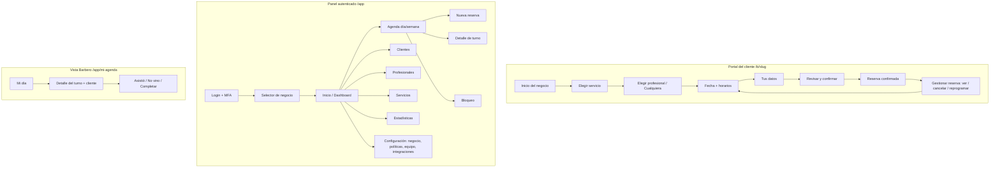

# 09 — Especificación UX/UI (mobile‑first)

## 1. Principios

1. **Mobile‑first**: diseñar para 360 px; escalar a tablet/desktop. El flujo público debe completarse con una mano, en ≤ 5 pasos y < 60 s.
2. **Minimalismo funcional**: una acción principal por pantalla; sin cuentas ni formularios largos para el cliente.
3. **Rapidez percibida**: skeletons, estados optimistas en el panel, prefetch de disponibilidad del día siguiente.
4. **Accesibilidad**: WCAG 2.1 AA (contraste, foco visible, objetivos táctiles ≥ 44 px, labels, `aria-live` para errores de slot).
5. **Marca**: tokens de diseño (colores, radio, tipografía) en CSS variables; logo y color primario por negocio (`branding`). Tema claro por defecto, modo oscuro opcional en paneles.
6. Idioma es‑AR, voseo en mensajes ("Elegí un horario"), formato de fecha `dd/MM` y hora 24 h; moneda `$ 12.000`.

## 2. Mapa de navegación



Los roles ven menús distintos: Barbero sólo _Mi agenda, Mis clientes, Mi disponibilidad (si permitido)_.

## 3. Portal del cliente

| Pantalla    | Contenido                                                                                                                        | Notas                                            |
| ----------- | -------------------------------------------------------------------------------------------------------------------------------- | ------------------------------------------------ |
| Inicio      | Logo, nombre, dirección (mapa link), botón "Reservar turno", lista breve de servicios                                            | SEO básico, Open Graph                           |
| Servicio    | Tarjetas: nombre, duración, precio; agrupadas por categoría                                                                      | Selección única (MVP)                            |
| Profesional | "Cualquiera disponible" (por defecto) + tarjetas con foto/nombre                                                                 | Oculta profesionales sin ese servicio            |
| Fecha/hora  | Tira de días (14 días scrolleable) + grilla de horarios agrupados (mañana/tarde); estado "sin horarios → próximo día disponible" | Zona horaria del negocio visible                 |
| Datos       | Nombre, teléfono (máscara AR), email opcional, notas, consentimiento                                                             | Turnstile invisible                              |
| Confirmar   | Resumen (servicio, profesional, fecha, precio) + botón                                                                           | Reintento si `SLOT_TAKEN` mostrando alternativas |
| Confirmada  | Resumen, "Agregar al calendario" (.ics), enlace de gestión, cómo llegar                                                          | Email enviado                                    |
| Gestionar   | Detalle, Cancelar (con motivo opcional), Reprogramar (reusa selector de fecha/hora)                                              | Mensajes claros si pasó el límite de la política |

### Wireframe conceptual (360 px)

```text
┌──────────────────────────┐
│ ← Barbería Central       │
│ ● ● ○ ○ ○   (paso 3/5)   │
│ Elegí día y horario      │
│ [Lun 2][Mar 3][Mié 4] →  │
│ Mañana                   │
│ [10:00][10:15][10:30]    │
│ [10:45][11:00][11:15]    │
│ Tarde                    │
│ [15:00][15:15][15:30]    │
│                          │
│ ─────────────────────────│
│ Corte · Lucas · $12.000  │
│ [      Continuar       ] │
└──────────────────────────┘
```

## 4. Panel administrativo

| Pantalla                    | Contenido clave                                                                                                                                                                                                                                                   |
| --------------------------- | ----------------------------------------------------------------------------------------------------------------------------------------------------------------------------------------------------------------------------------------------------------------- |
| Dashboard                   | Turnos de hoy, próximos 5, ocupación de la semana, ausencias, nuevos clientes; filtros por rango/profesional                                                                                                                                                      |
| Agenda                      | Vista **día** (columnas por profesional, scroll horizontal en móvil con selector de profesional) y **semana** (una columna por día, filtrable). Bloques coloreados por estado y por profesional; "ahora" resaltado; tap → detalle en hoja inferior (bottom sheet) |
| Detalle de turno            | Cliente (con acceso a ficha), servicio/precio/duración, estado, historial (`appointment_events`), acciones según estado: Confirmar, Completar, No vino, Cancelar, Reprogramar, Revertir (admin)                                                                   |
| Nueva reserva               | Búsqueda/alta rápida de cliente por teléfono → servicio → profesional → hora (misma API de slots, con opción "saltear políticas")                                                                                                                                 |
| Bloqueos                    | Crear rango (vacaciones, trámite) con vista previa de turnos afectados                                                                                                                                                                                            |
| Clientes                    | Lista con búsqueda (nombre/teléfono/Instagram), ficha: datos, contadores, historial, notas internas, fusionar duplicados                                                                                                                                          |
| Profesionales               | Alta/edición, servicios habilitados, **editor de horarios semanal** (intervalos múltiples por día), excepciones, vacaciones                                                                                                                                       |
| Servicios                   | CRUD, activación, orden, categorías                                                                                                                                                                                                                               |
| Estadísticas                | Reservas por estado, tasa de ausencias, ocupación por profesional, servicios más reservados, reservas por origen                                                                                                                                                  |
| Configuración               | Negocio, políticas de reserva, equipo y roles (invitaciones), integraciones (tokens GAS: crear/rotar/revocar), notificaciones                                                                                                                                     |
| Vinculaciones (admin)       | Importar clientes exportados de Sheets (**dry run** con informe nuevos/vinculados/a revisar/inválidos y confirmación); vincular barberos y servicios 1:1; revisar candidatos `needs_review`; desvincular registros de servicio                                    |
| Credenciales de integración | Crear/rotar/revocar `user_token` personal (secreto visible una vez) y `service_key` de sólo lectura; último uso; aviso «Modo R: Apps Script sólo lectura»                                                                                                         |

### Wireframe agenda móvil

```text
┌────────────────────────────┐
│ ‹ Lun 2 nov ›   [Lucas ▾]  │
│ 09 ┤                       │
│ 10 ┤ ▓▓ Juan P · Corte     │
│    ┤ ▓▓ confirmado         │
│ 11 ┤ ░░ Bloqueo            │
│ 12 ┤ ── descanso ──        │
│ 13 ┤                       │
│                      [＋]   │
└────────────────────────────┘
```

## 5. Panel del barbero (`Mi agenda`)

- Vista por defecto: **hoy**, lista cronológica de turnos con hora, cliente, servicio, estado; el próximo turno destacado.
- Tarjeta de cliente: nombre, teléfono (acción llamar/WhatsApp), visitas previas, notas relevantes, observaciones del turno.
- Acciones de un toque: **Asistió/Completar**, **No vino**, **Cancelar** (si permitido). Confirmaciones con _undo_ de 5 s para evitar errores.
- Indicador de turno "Registrar servicio" si hay integración activa (abre GAS o deep‑link).

## 6. Componentes reutilizables (shadcn/ui + propios)

`AppShell` (navegación inferior en móvil / lateral en desktop), `PageHeader`, `DateStrip`, `SlotGrid`, `ServiceCard`, `StaffPicker`, `AppointmentCard`, `AppointmentSheet` (bottom sheet), `StatusBadge`, `AgendaDay`/`AgendaWeek`, `WeeklyHoursEditor`, `TimeRangeInput`, `CustomerSearch`, `PhoneInput (AR)`, `ConfirmDialog`, `EmptyState`, `Toast`, `DataTable` (con paginación por cursor), `PermissionGate` (oculta UI según `can()`, **no** reemplaza validación servidor), `FormField` (react‑hook‑form + Zod), `Skeleton*`.

## 7. Estados y manejo de errores en UI

Vacío ("Aún no hay turnos hoy"), cargando (skeleton), error recuperable (reintentar), conflicto `SLOT_TAKEN` (mostrar alternativas), sin conexión (banner; sólo lectura), permisos (pantalla 403 clara), sesión vencida (re‑login conservando destino). **Conflicto de versión (`412`)**: banner «Este turno cambió», recarga automática del estado vigente y re-confirmación explícita de la acción (nunca reintento ciego). **Revertir** completado/ausente: sólo admin, diálogo con motivo obligatorio y aviso si hay registro vinculado (primero desvincular).

## 8. PWA

**Recomendación**: PWA **instalable** para panel de barberos/admin (manifest, íconos, `display: standalone`, tema), service worker mínimo (caché de shell y assets, **sin** caché de datos sensibles ni escrituras offline). Portal público: manifest simple + metaetiquetas, sin service worker complejo.

- Fuera del MVP: _push notifications_ (Web Push; iOS requiere instalación como PWA), modo offline con cola de escrituras (riesgo de conflictos con el motor de reservas).
- Verificar compatibilidad iOS/Android en Sprint 8.

## 9. Rendimiento y calidad

Objetivos: LCP < 2,5 s en 4G para portal público; JS inicial < 150 KB gzip en rutas públicas; Server Components por defecto, Client Components sólo donde hay interacción; imágenes optimizadas (`next/image`); fuentes del sistema o una familia variable. Pruebas Lighthouse y axe en CI.

## 10. Contenido de emails (plantillas MVP)

Confirmación (resumen + enlace de gestión + .ics), cancelación, reprogramación, recordatorio (con botón "Gestionar"), aviso interno al admin/barbero. Texto plano + HTML; remitente verificado (SPF/DKIM/DMARC); incluir datos del negocio y leyenda de privacidad.
