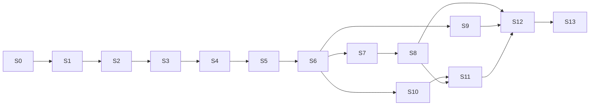

# 10 — Roadmap de implementación

## 1. Supuestos de estimación

- 1 desarrollador full‑time (o equivalente) usando Codex para generar código; **el esfuerzo incluye revisar, testear e integrar** lo generado (aprox. 35–45 % del tiempo).
- Sprints de **1 semana** (S0–S1 y S13 pueden ser más cortos). Unidad de esfuerzo: días‑persona (dp).
- Complejidad: B (baja), M (media), A (alta). Riesgo: B/M/A.
- Total MVP estimado: **15–18 semanas calendario** (≈ 66–82 dp). Con dedicación parcial multiplicar proporcionalmente.
- Los sprints son **secuenciales salvo indicación**; cada uno termina con _demo verificable_ y _PR mergeado con CI verde_.

## 2. Definición de terminado (global)

1. Código en `main` vía PR revisado; CI verde (lint, tipos, unit, integración, pgTAP).
2. Migraciones aplicadas en _staging_ sin errores; reversibles o con plan de rollback.
3. Tests nuevos para reglas de negocio y autorización del sprint.
4. Sin secretos ni PII en logs; RLS probada para tablas nuevas.
5. Documentación afectada actualizada (`docs/`), ADR si hubo decisión nueva.
6. Criterios de aceptación del sprint demostrados.
7. Toda función `SECURITY DEFINER` nueva pasa el test de catálogo (doc 08 §3.2) y tiene tests de identidad por contexto.
8. Toda modificación de recurso versionado exige `If-Match` y tiene test de `412`/`428`.

## 3. Resumen

| Sprint | Tema                                                            | Esfuerzo | Complejidad | Riesgo |
| ------ | --------------------------------------------------------------- | -------- | ----------- | ------ |
| S0     | Configuración del proyecto                                      | 3–4 dp   | B           | B      |
| S1     | Multi‑tenancy base                                              | 4–5 dp   | M           | M      |
| S2     | Autenticación, roles e identidad por contexto (+ spike GAS)     | 6 dp     | A           | M      |
| S3     | Modelo de datos completo, privilegios y RLS                     | 6–7 dp   | A           | M      |
| S4     | Profesionales y servicios                                       | 5 dp     | M           | B      |
| S5     | Horarios y disponibilidad (cálculo)                             | 6 dp     | A           | A      |
| S6     | Motor de reservas (BD), versionado y transiciones               | 8–9 dp   | A           | A      |
| S7     | Portal público                                                  | 6 dp     | M           | M      |
| S8     | Panel administrativo + barbero + vinculaciones                  | 9–10 dp  | A           | M      |
| S9     | Notificaciones                                                  | 5 dp     | M           | M      |
| S10    | API de integración (credenciales, feed, reconciliación)         | 6 dp     | A           | M      |
| S11    | Integración con Google Apps Script (Modo R; Modo A según spike) | 5–6 dp   | M           | A      |
| S12    | Pruebas de seguridad y concurrencia                             | 5 dp     | M           | M      |
| S13    | Despliegue productivo y piloto                                  | 3–4 dp   | M           | M      |

**Cambio v1.1**: +≈ 6 dp (de ≈ 60–75 a ≈ 66–82 dp) por identidad verificada en funciones privilegiadas, versionado/`If-Match`, `change_log` y reconciliación, mapeos tipados y panel de vinculaciones. S11 baja porque el Modo R no requiere escritura desde GAS.

> Reordenamiento menor respecto del orden de prioridad solicitado: el **modelo de datos** (S3) se ejecuta antes de profesionales/servicios para fijar el esquema, los privilegios y las políticas RLS de una sola vez; el resto respeta el orden pedido.

## 4. Detalle por sprint

### S0 — Configuración del proyecto

- **Objetivo**: base reproducible y automatizada.
- **Alcance**: repo, Next.js + TS estricto + Tailwind + shadcn, ESLint/Prettier, Vitest, Playwright (smoke), Supabase CLI local (Docker), GitHub Actions, Vercel (preview), Sentry, variables de entorno tipadas (Zod), logger con `request_id`, convenciones (`AGENTS.md`).
- **Dependencias**: cuentas Vercel/Supabase/GitHub.
- **Tareas**: scaffolding; estructura `modules/`; regla ESLint de import restringido; pipeline CI; `GET /api/health`.
- **Tablas/Endpoints**: ninguna / `GET /api/health`.
- **Pruebas**: smoke e2e, unit de utilidades.
- **Aceptación**: `pnpm dev`, `pnpm test`, `pnpm lint` funcionan; despliegue _preview_ por PR; Supabase local levanta con `supabase start`.

### S1 — Arquitectura multi‑tenant

- **Objetivo**: contexto de tenant y esquema base.
- **Alcance**: tablas `businesses`, `business_settings`; resolvedor de tenant (slug / ruta / token); helpers `app.*`; plantilla de migración con RLS; seed `create_business()`; convención de FKs compuestas.
- **Dependencias**: S0.
- **Tareas**: migraciones, `TenantContext`, middleware de resolución, tests pgTAP de patrón RLS.
- **Endpoints**: `GET /public/{slug}`.
- **Pruebas**: aislamiento básico entre 2 negocios seed; slug inválido/reservado.
- **Aceptación**: dos negocios seed no se ven entre sí en SQL con distintos usuarios; `GET /public/{slug}` correcto y 404 para inexistente.

### S2 — Autenticación, roles e identidad por contexto

- **Objetivo**: login seguro, RBAC por negocio y **verificación de identidad dentro de la BD** para cada contexto.
- **Alcance**: Supabase Auth (SSR), `users`, `business_members`, `platform_admins`, `support_grants`; esquemas `app`/`api`/`app_internal`, rol `app_server`, línea base de privilegios (doc 04 §4.1); `app.ctx` y `app.ctx_session`, `app.authorize` + `app.role_permissions` + `supabase/permissions.json` (generador del `can()` TS); `api.manage_member`; invitaciones; MFA TOTP (`aal2`) para owner/admin; selector de negocio; layout autenticado; **test de catálogo de funciones definer** (doc 08 §3.2).
- **Spike (1 día)**: confirmar cómo se despliega/autentica la app GAS (supuesto S4): «ejecutar como el usuario que accede» vs «como yo», `UserProperties`, viabilidad de `getIdentityToken()`, cuotas. **Salida**: decisión Modo A o Modo R documentada en ADR-008.
- **Tablas**: `users`, `business_members`, `platform_admins`, `support_grants`, `audit_logs` (base), `role_permissions`.
- **Endpoints**: `GET/POST /members…`, `/me`.
- **Pruebas**: matriz de permisos (SQL y TS idénticas), X‑05, X‑06, X‑15…X‑18, X‑24; JWT expirado/falsificado; usuario multi‑negocio; test de catálogo (sin parámetros de actor, `search_path`, `EXECUTE` por rol).
- **Aceptación**: owner invita admin y barbero; barbero no cambia roles; usuario en 2 negocios cambia de contexto; último owner no se puede quitar; llamar a `api.*` con un `business_id` ajeno devuelve `TS005`; `anon`/`app_server` no pueden ejecutar funciones fuera de su esquema; decisión Modo A/R registrada.

### S3 — Modelo de datos completo, privilegios y RLS

- **Objetivo**: esquema final del MVP con integridad temporal, mapeos seguros, feed sin pérdidas y versionado.
- **Alcance**: todas las tablas del doc 04 (`staff_members`, `services`, `staff_services`, `working_hours`, `schedule_exceptions`, `time_blocks`, `customers`, `appointments` con `EXCLUDE` **y CHECKs temporales + triggers `derive_times`/`guard`**, `appointment_events`, `notifications`, `integration_credentials` (CHECK `service_key` sólo lectura), **`external_id_mappings` con FKs tipadas e índices únicos**, `idempotency_keys`, **`change_log` + `feed_state`**, `job_runs`), trigger `bump_version`, triggers de `change_log`, privilegios y RLS, tipos TS generados.
- **Pruebas** (pgTAP): constraints, FKs compuestas, EXCLUDE (solapes, contigüidad), CHECK de coherencia temporal y de resultado (`appt_outcome_fields`), inmutabilidad de snapshots, `mapping_guard`, unicidad de mapeos (M1–M11), `bump_version`, `change_log` con transacciones confirmadas fuera de orden (§ doc 11 §14), privilegios (X‑10, X‑17, X‑18), append‑only.
- **Aceptación**: suite pgTAP verde; `supabase db reset` reproduce el esquema; cruzar tenants falla por FK; insertar `ends_at` inconsistente es corregido/rechazado; dos filas con el mismo `external_id` o dos registros para una misma reserva son imposibles.

### S4 — Profesionales y servicios

- **Objetivo**: catálogo operativo.
- **Alcance**: CRUD profesionales y servicios, `staff_services`, baja lógica, desactivación con reporte de reservas futuras, UI admin básica (listas y formularios), validación Zod.
- **Endpoints**: doc 05 §2.2 (sin horarios) y §2.3.
- **Pruebas**: unit + integración API; autorización por rol; unicidad de nombre por negocio.
- **Aceptación**: admin gestiona profesionales/servicios; barbero sólo lectura; servicio sin profesionales no aparece en público.

### S5 — Horarios y disponibilidad

- **Objetivo**: calcular slots correctamente (cálculo informativo).
- **Alcance**: `working_hours` (vigencias, múltiples intervalos), `schedule_exceptions`, `time_blocks`, UI del editor de horarios, módulo puro `scheduling` (`computeSlots`), `GET availability` (público y privado), caché corto.
- **Dependencias**: S3, S4.
- **Pruebas**: unit exhaustivos + property‑based (fast‑check) + casos DST con zona de prueba (p. ej. `America/New_York`), escenarios B‑02…B‑23 (parte de cálculo).
- **Aceptación**: slots correctos con descansos, feriados, vacaciones, vigencias y buffers; p95 < 600 ms con datos de 1 negocio (10 profesionales, 60 días).

### S6 — Motor de reservas, versionado y transiciones

- **Objetivo**: garantía transaccional con identidad verificada y concurrencia definida.
- **Alcance**: `app.create_appointment_core`, `reschedule_core`, `cancel_core`, `transition_core`, `adjust_appointment` y _wrappers_ por contexto (`api.*`, `app_internal.public_*`); **bloques `BEGIN…EXCEPTION` (sin SAVEPOINT)**, lock ordenado de profesionales, asignación «cualquier profesional», snapshots, eventos, outbox, **idempotencia en la misma transacción**, `app.recompute_customer_stats`, guardas temporales de `complete`/`no_show`, `revert`, **`If-Match`/`412`/`428`** en la capa API, normalización de teléfono y match de clientes, endpoints de reservas y clientes, catálogo de errores `TSxxx`.
- **Pruebas**: B‑01…B‑56 (doc 06), en particular concurrencia (B‑31, B‑32, B‑37, B‑38), rollback del sub‑bloque (B‑33…B‑36, B‑40), versión (B‑53, B‑54), integridad temporal (B‑42…B‑45), resultado y reversión (B‑46…B‑52), identidad (B‑55, B‑56).
- **Aceptación**: 0 dobles reservas en estrés; reprogramación atómica; estados inválidos `409`; versión vieja `412`; sin `SAVEPOINT`/`COMMIT` en funciones; sin efectos parciales ante fallos.

### S7 — Portal público

- **Objetivo**: reserva end‑to‑end sin cuenta.
- **Alcance**: flujo de 5 pasos, Turnstile, rate limits, página de gestión por token, `.ics`, SEO/OG, PWA manifest.
- **Pruebas**: e2e Playwright (móvil), abuso (rate limit), accesibilidad (axe), `SLOT_TAKEN` UX.
- **Aceptación**: reservar, cancelar y reprogramar desde el celular; Lighthouse móvil ≥ 90 (rendimiento/accesibilidad); sin fuga de datos del cliente existente.

### S8 — Panel administrativo, de barbero y vinculaciones

- **Alcance**: dashboard, agenda día/semana, detalle, nueva reserva, bloqueos, clientes (búsqueda, ficha, fusión), estadísticas básicas, vista Barbero (completar / ausente con guardas temporales), **revertir** (admin, motivo), manejo de `412` (recarga y reintento explícito), **pantalla «Vinculaciones»** (importar clientes de Sheets con dry run, vincular barberos/servicios, revisar `needs_review`, desvincular), pantalla de **credenciales de integración** (crear/rotar/revocar `user_token` y `service_key`), PWA instalable.
- **Pruebas**: e2e por rol; permisos de UI y de API; fusión de clientes; conflicto de versión en UI; import con dry run; rendimiento de agenda.
- **Aceptación**: admin opera un día completo sin tocar BD; barbero ve sólo lo propio y no puede revertir; acciones auditadas; un `412` nunca pisa cambios ajenos.

### S9 — Notificaciones

- **Alcance**: worker `dispatch` (HTTP + `app_internal.worker_dispatch_notifications`), `expire_pending` por `pg_cron` en SQL, provider de email, plantillas, recordatorios, reintentos/backoff, dedupe, panel de estado (cola/dead), `pg_cron`/`pg_net` o Vercel Cron.
- **Pruebas**: idempotencia (doble ejecución del worker), reintentos, cancelación de recordatorios al reprogramar, proveedor simulado con fallos.
- **Aceptación**: emails de confirmación/cancelación/reprogramación/recordatorio correctos; ningún duplicado con 2 workers concurrentes; `dead` genera alerta.

### S10 — API de integración

- **Alcance**: credenciales `service_key` (sólo lectura) y `user_token` (`app.ctx_integration`, verificación en BD en cada llamada, sin caché), scopes y catálogo, rotación/revocación, `/integrations/me`, funciones `app_internal.integration_*` (lecturas y escrituras `user_token`), **feed `/integrations/changes` sobre `change_log` con horizonte de visibilidad**, **`/integrations/reconcile`**, mapeos y vínculos (con M1–M11), auditoría por credencial/miembro, rate limit por token, OpenAPI.
- **Pruebas**: X‑07, X‑08, X‑19…X‑23; feed con transacciones confirmadas fuera de orden y larga abierta; tombstones; `410 CURSOR_EXPIRED`; reconciliación (divergencias detectadas y reparadas); `service_key` imposible de escribir en 3 capas.
- **Aceptación**: token revocado deja de funcionar en la **siguiente** llamada; el feed entrega todo cambio sin pérdidas en la prueba con commits concurrentes y una transacción de 30 s abierta; reconciliación detecta una fila alterada manualmente.

### S11 — Integración con Google Apps Script

- **Alcance**: librería `TurnosClient`/`TurnosSync` (GAS) con detección de modo; **Modo R (obligatorio)**: agenda de sólo lectura, `Turnos_RO`, «Pendientes de registrar» (completed sin `ID Turno`), registro precargado bajo `LockService`, columnas `ID`/`ID Turno`, reconciliación nocturna, `Sync_Errors`, deep‑link al panel de turnos para acciones. **Modo A (condicional al spike S2)**: escritura con `user_token` desde `UserProperties` (completar, ausente, vincular), con `If-Match` e `Idempotency-Key`.
- **Dependencias**: S8 (panel con vinculaciones), S10.
- **Pruebas**: contra _staging_ con hoja de pruebas; doble clic/duplicados de registro; fallo parcial; cursor perdido/`410`; API caída; **intentar escritura en Modo R ⇒ error local y `403` si se fuerza**; `412` mostrado sin reintento ciego.
- **Aceptación**: flujo «reserva → completar (panel o Modo A) → registro precargado en Sheets» sin duplicados; dashboards leen `Turnos_RO`; con la API caída el resto de la app GAS sigue funcionando; **ninguna escritura posible con `service_key`**.

### S12 — Seguridad y concurrencia

- **Alcance**: suite de aislamiento (X‑01…X‑25), tests de identidad por contexto (doc 11 §12), carga (k6) de reservas simultáneas y disponibilidad, concurrencia de `If-Match` (doc 11 §15), feed y reconciliación bajo carga, revisión OWASP ASVS, escaneo de dependencias/secretos, prueba de restauración de backup, ajuste de límites.
- **Aceptación**: checklist de doc 08 §10 completo salvo revisión legal; 0 hallazgos críticos/altos abiertos; 0 `40P01` sin absorber en la prueba de locks.

### S13 — Despliegue productivo y piloto

- **Alcance**: entornos prod/staging, dominios, DNS de email (SPF/DKIM/DMARC), monitoreo y alertas, runbooks, datos reales de la barbería (staff, servicios, horarios), capacitación, piloto controlado (2 semanas), plan de rollback.
- **Aceptación**: reservas reales durante el piloto sin incidentes severos; métricas del doc 01 §8 medidas.

## 5. Dependencias entre sprints

S7, S9 y S10 pueden solaparse parcialmente tras S6 si hay más de una persona.

## 6. Riesgos y mitigaciones del plan

| Riesgo                                             | Mitigación                                                                                                               |
| -------------------------------------------------- | ------------------------------------------------------------------------------------------------------------------------ |
| Subestimar el motor (S5/S6)                        | Presupuesto con holgura; tests de propiedades desde el inicio; no empezar UI de reservas antes de S6 estable             |
| Codex genera lógica de negocio incorrecta          | Funciones SQL y `scheduling` revisadas línea a línea; tests escritos **antes** de la implementación (TDD) en estas áreas |
| Incertidumbre de integración GAS (S4 del doc 01)   | Spike de 1 día en S2 para confirmar modo de despliegue y cuotas                                                          |
| Funciones privilegiadas con identidad mal derivada | Test de catálogo en CI + revisión humana obligatoria + tests de identidad por contexto (doc 11 §12)                      |
| Feed retrasado por transacciones largas            | Timeouts de sesión, alerta de retraso del horizonte, reconciliación                                                      |
| Alcance creciente                                  | `CODEX_IMPLEMENTATION_GUIDE.md`: lista explícita de "fuera de alcance"                                                   |
| Dependencia de planes pagos (Cron, PITR)           | Decidir plan antes de S9/S13                                                                                             |
| Cumplimiento legal tardío                          | Iniciar revisión legal en S7 (en paralelo)                                                                               |

## 7. Qué NO entra en el MVP (control de alcance)

Pagos, WhatsApp, Google Calendar, multi‑sucursal, multi‑servicio por turno, onboarding self‑service, planes/suscripciones, dominios propios, lista de espera, reportes avanzados, notificaciones push, modo offline.
