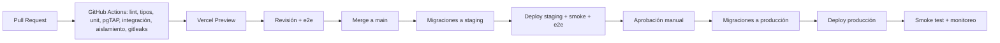

# 12 — Despliegue y operaciones

## 1. Entornos

| Entorno        | Propósito                                | App                     | Base de datos                                                      | Datos                   |
| -------------- | ---------------------------------------- | ----------------------- | ------------------------------------------------------------------ | ----------------------- |
| **local**      | Desarrollo                               | `next dev`              | Supabase CLI (Docker)                                              | Seeds sintéticos        |
| **preview**    | Una URL por PR                           | Vercel Preview          | Proyecto Supabase _staging_ (esquema por migraciones) o rama de BD | Sintéticos              |
| **staging**    | Validación previa a release, pruebas GAS | Vercel (rama `staging`) | Proyecto Supabase _staging_                                        | Sintéticos/anonimizados |
| **production** | Operación real                           | Vercel (rama `main`)    | Proyecto Supabase _production_                                     | Reales                  |

Reglas: proyectos de Supabase **separados** por entorno (staging/prod); claves y secretos distintos; ningún entorno no‑productivo accede a datos reales.
Regiones: Supabase **São Paulo (sa‑east‑1)** y funciones de Vercel en `gru1` para minimizar latencia desde Buenos Aires (verificar disponibilidad vigente; ver observaciones legales sobre transferencia internacional en doc 08 §9).

## 2. Flujo de CI/CD

**Orden crítico**: aplicar migraciones **antes** del deploy de código; las migraciones deben ser **compatibles hacia atrás** (patrón _expand → migrate → contract_): el código anterior debe seguir funcionando con el esquema nuevo. Nunca eliminar columnas en el mismo release que deja de usarlas.

- Migraciones: `supabase/migrations/*.sql`, aplicadas con `supabase db push` desde CI con credenciales de CI (no personales). La migración inicial crea esquemas (`app`, `api`, `app_internal`), el rol `app_server`, y la línea base de privilegios (doc 04 §4.1); el test de catálogo (doc 11 §12) corre en CI contra ese esquema. Prohibido editar migraciones ya aplicadas; se crea una nueva.
- Rollback: preferir _roll‑forward_ (migración correctiva). Para cambios riesgosos, tomar snapshot/PITR marker antes de aplicar.
- Feature flags simples (`business_settings` o variables de entorno) para activar funcionalidades gradualmente.

## 3. Variables de entorno

| Variable                                      | Alcance            | Descripción                                                                                                                                                                                           |
| --------------------------------------------- | ------------------ | ----------------------------------------------------------------------------------------------------------------------------------------------------------------------------------------------------- |
| `NEXT_PUBLIC_SUPABASE_URL`                    | cliente+servidor   | URL del proyecto                                                                                                                                                                                      |
| `NEXT_PUBLIC_SUPABASE_ANON_KEY`               | cliente+servidor   | Clave anónima (sin acceso a tablas)                                                                                                                                                                   |
| `SUPABASE_SERVICE_ROLE_KEY`                   | **sólo servidor**  | **Únicamente** Auth Admin (invitaciones) y Storage. **No** se usa para datos de negocio                                                                                                               |
| `DATABASE_URL_APP_SERVER`                     | **sólo servidor**  | Pooler (modo transacción) con el rol **`app_server`** (sin privilegios sobre tablas; sólo `EXECUTE` en `app_internal.*`). Usado por `public-booking`, `integrations`, `workers`. Distinto por entorno |
| `APP_BASE_URL`                                | ambos              | URL pública (enlaces en emails)                                                                                                                                                                       |
| `INTERNAL_JOBS_SECRET`                        | servidor           | Autentica llamadas del cron a `/api/internal/jobs/*`                                                                                                                                                  |
| `TURNSTILE_SITE_KEY` / `TURNSTILE_SECRET_KEY` | cliente / servidor | Anti‑bot                                                                                                                                                                                              |
| `UPSTASH_REDIS_REST_URL` / `_TOKEN`           | servidor           | Rate limiting                                                                                                                                                                                         |
| `EMAIL_PROVIDER_API_KEY`, `EMAIL_FROM`        | servidor           | Email transaccional                                                                                                                                                                                   |
| `SENTRY_DSN`, `SENTRY_AUTH_TOKEN`             | servidor / CI      | Errores y source maps                                                                                                                                                                                 |
| `INTEGRATION_TOKEN_PEPPER` (opcional)         | servidor           | Pepper para calcular `HMAC-SHA256(token)` en el servidor **antes** de enviar el hash a la BD (la BD sólo compara el hash recibido)                                                                    |
| `FEATURE_*`                                   | servidor           | Flags                                                                                                                                                                                                 |

Validación al arranque con Zod: la app **no inicia** si falta una variable obligatoria. `.env.example` sin valores reales en el repo.

## 4. Jobs y programación

- `pg_cron` ejecuta **directamente en SQL** (sin HTTP) `expire_pending` (1 min), `change_log.purge` (diario) y el monitor de retraso del feed (1 min).
- `pg_cron` + `pg_net` → `POST /api/internal/jobs/notifications-dispatch` (1 min) con `Authorization: Bearer $INTERNAL_JOBS_SECRET` (secreto guardado en Supabase Vault); el handler llama a `app_internal.worker_dispatch_notifications()` con el rol `app_server`.
- **Parámetros de sesión** (garantizan que el feed de cambios no se retrase por transacciones colgadas): `idle_in_transaction_session_timeout = 60s` y `statement_timeout` (p. ej. 15 s) para `authenticated` y `app_server`.
- Alternativa: Vercel Cron (verificar frecuencia mínima y límites por plan).
- Cada job registra inicio/fin/cantidad en `job_runs` (tabla simple) y emite alerta si pasan > 5 min sin ejecución.
- Timeouts: handlers de job procesan lotes pequeños (≤ 50) para respetar el límite de duración de funciones serverless.

## 5. Monitoreo y alertas

| Señal                                                              | Herramienta                                                                    | Umbral / alerta                                              |
| ------------------------------------------------------------------ | ------------------------------------------------------------------------------ | ------------------------------------------------------------ |
| Errores 5xx / excepciones                                          | Sentry                                                                         | > 1 % de requests en 5 min                                   |
| Latencia API                                                       | Vercel Analytics / logs                                                        | p95 > 1 s sostenido                                          |
| Disponibilidad                                                     | Monitor externo (UptimeRobot/BetterStack) sobre `/api/health` y portal público | Caída > 2 min                                                |
| Notificaciones `dead` / cola atrasada                              | Consulta SQL + job de alerta                                                   | `dead > 0` o pendientes con `next_attempt_at` < now()‑10 min |
| Jobs detenidos                                                     | `job_runs`                                                                     | Sin ejecución > 5 min                                        |
| Retraso del feed de cambios (horizonte `xmin`)                     | Consulta a `pg_stat_activity`/`pg_snapshot_xmin`                               | Transacción abierta > 5 min                                  |
| Ejecuciones con errores `TS012`/403 `INSUFFICIENT_SCOPE` repetidos | Logs                                                                           | Pico = posible uso indebido de credenciales                  |
| BD: conexiones, CPU, disco, consultas lentas                       | Panel Supabase + `pg_stat_statements`                                          | CPU > 80 %, disco > 80 %, query > 500 ms recurrente          |
| Violaciones `23P01` anómalas / 429 masivos                         | Logs                                                                           | Picos 5× sobre línea base (posible abuso)                    |
| Seguridad                                                          | Alertas de uso inusual de tokens de integración, logins fallidos               | Notificación al owner                                        |

Dashboards mínimos: salud de API, reservas/hora por estado, cola de notificaciones, errores por ruta.

## 6. Backups y recuperación

- **Backups**: diarios automáticos (Supabase) + PITR (verificar plan). Export lógico semanal cifrado fuera del proveedor.
- **Objetivos**: RPO ≤ 15 min (con PITR), RTO ≤ 4 h.
- **Runbook de restauración**: (1) declarar incidente; (2) congelar escrituras (modo mantenimiento: `public_booking_enabled=false` global); (3) restaurar a un proyecto nuevo al instante elegido; (4) validar conteos, constraints, RLS; (5) apuntar la app (variables) o volcar datos; (6) reconciliar notificaciones enviadas vs. pendientes para evitar duplicados; (7) informar a GAS (cursor puede quedar "adelantado": forzar resync); (8) postmortem.
- **Simulacro trimestral** con registro de tiempos.

## 7. Runbooks operativos (a redactar en Sprint 13)

1. _Doble reserva detectada_ (no debería ocurrir): consultar `appointment_events`, revisar constraint y último deploy.
2. _Cola de notificaciones atascada_: ver `job_runs`, reiniciar job, reprocesar `failed`.
3. _Token de integración comprometido_: revocar → rotar → revisar `audit_logs` desde `last_used_at` previo.
4. _Fuga entre tenants sospechada_: congelar acceso, revisar logs, ejecutar suite de aislamiento, notificación legal.
5. _Caída de Supabase/Vercel_: página de estado, comunicación al cliente, plan manual (agenda en papel/exportación diaria).
6. _Rotación de secretos de plataforma_.
7. _Alta de nuevo negocio (hasta tener onboarding)_: script `create_business()` + checklist.

## 8. Seguridad operativa

Acceso a producción por SSO/MFA; mínimo privilegio en Vercel/Supabase/GitHub; protección de rama `main` (PR + CI + 1 revisión); secretos sólo en gestores de variables; logs con retención 30–90 días y sin PII; DNS del email (SPF, DKIM, DMARC) validado; dominio con renovación automática.

## 9. Costos mensuales de referencia (verificar precios vigentes)

Vercel Pro ≈ US$20 por asiento; Supabase Pro ≈ US$25 + PITR (complemento variable); email transaccional (gratis–US$20); Upstash (gratis–US$10); Sentry (gratis–US$26); monitor externo (gratis); dominio (~US$15/año). **Total ≈ US$60–110/mes** para una barbería; el costo marginal por tenant adicional es bajo hasta que la BD requiera escalar.

## 10. Escalado progresivo

1. Ajustar plan/tamaño de Supabase y pooler. 2. Índices/consultas según `pg_stat_statements`. 3. Caché de disponibilidad (15 s → Redis si hace falta). 4. Réplica de lectura para reportes. 5. Particionado de `appointments`/`audit_logs`. 6. Extraer _workers_ a un servicio aparte sólo si el volumen lo justifica.

## 11. Checklist de salida a producción

- [ ] Migraciones y seeds aplicados; `create_business()` ejecutado para la barbería.
- [ ] Test de catálogo de funciones `SECURITY DEFINER` y de privilegios verde en staging (sin `EXECUTE` para `PUBLIC`/`anon`; `app_server` sin acceso a tablas).
- [ ] Variables completas y verificadas; claves de staging **no** presentes.
- [ ] Dominio, HTTPS, DNS de email validados; remitente probado en Gmail/Outlook.
- [ ] Monitores y alertas activos con destinatarios reales.
- [ ] Backups/PITR habilitados y simulacro realizado.
- [ ] Suite de seguridad/concurrencia verde en staging con la misma versión.
- [ ] Textos legales publicados (privacidad, términos).
- [ ] Plan de rollback y contacto de guardia definidos.
